# Scale audit — 11 October 2026

Twenty polygon districts plus the hills overlay: **21 places**. Rows: 277 pass, 146 watch, 29 fail.

## How this was measured

- Engine units are metres. Origin 34.0522 N, 118.2437 W. +X east, +Z south, +Y up.
- Fabric is the same generateFabric the chunk worker runs. Each measured block is a window that contains only that block centre, so the boxes belong to one district.
- On slopes the generator sinks a grounded box by 8 m and adds 8 m to its height. Reported mass height subtracts that sink.
- Façade storey is CELL_H for the style that dominates detail-0 masses at least 4 m tall.
- A driving line is metres from the street centreline to the car. It is not a painted lane. Painted lanes exist on freeways as spacing 3.45–3.6 m.
- Implied sidewalk = street/2 − driving line − 1.8 m, assuming one 3.6 m lane centred on the driving line. On streets 30 m and wider that remainder is mostly unused carriageway.
- Kit props are centered meshes. A box placed at ground height is half buried.
- Landmark tops for megatowers and pyramids are buildTower / buildPyramid parts.top. Other landmarks are the constants those builders add, checked against the source.
- Vehicle and pedestrian sizes are parsed from the geometry calls. Those files import three.js and are not loaded here.
- Quality tiers do not multiply world metres. The low tier draws no ground cars and shortens view distance.

## Graphics tiers

Quality changes density and draw distance. It does not rescale metres. Low draws no ground cars (groundTraffic 0) and shortens farRadius to 4500 m; the map stays about 50 × 53 km. detailScale is 0.30 / 0.55 / 0.82 / 1 from low to ultra and only drops street-kit props. Phones never auto-pick high (medium or low). There is no world-scale factor.

| Tier | detailScale | farRadius | groundTraffic | crowd | crowd radius | landmarkLod |
| --- | --- | --- | --- | --- | --- | --- |
| low | 0.3 | 4500 m | 0 | 56 | 48 m | 0.6 |
| medium | 0.55 | 7000 m | 22 | 160 | 64 m | 0.8 |
| high | 0.82 | 10000 m | 40 | 340 | 78 m | 1 |
| ultra | 1 | 14000 m | 64 | 680 | 88 m | 1.35 |

Low hides ground cars and pulls the far city in. It does not shrink a door, a car, or the 1.75 m reference figure. The phone screenshots in this folder are the same street at a narrow viewport.

On the same Little Tokyo camera, the 1.75 m figure was 0.214 of the frame height at low and 0.214 at ultra (154px / 720px and 154px / 720px). The phone viewport put the same figure at 0.214 of its frame height (181px / 844px). Those fractions stay together because quality settings do not rescale metres.

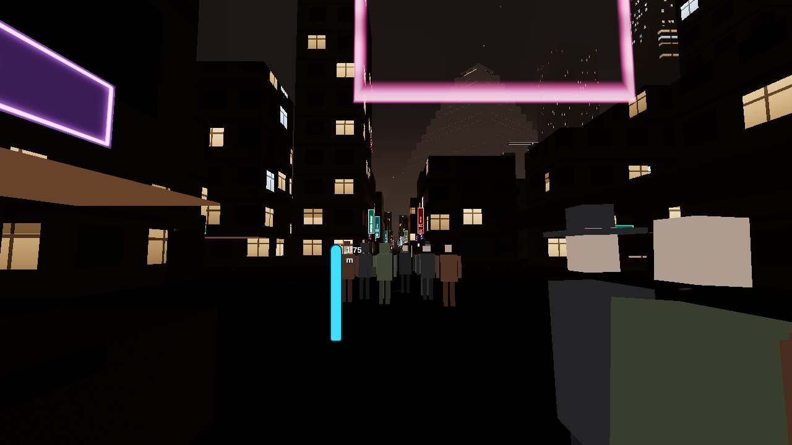

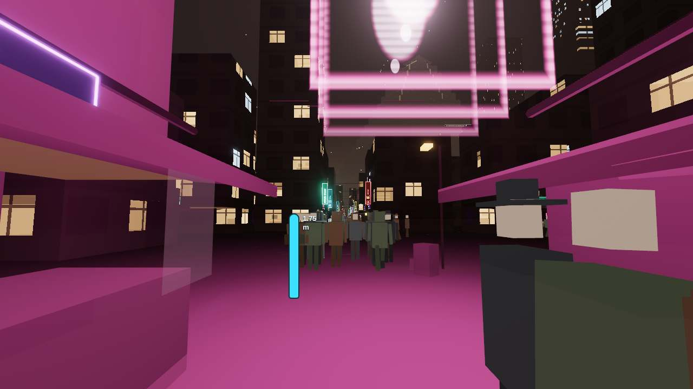

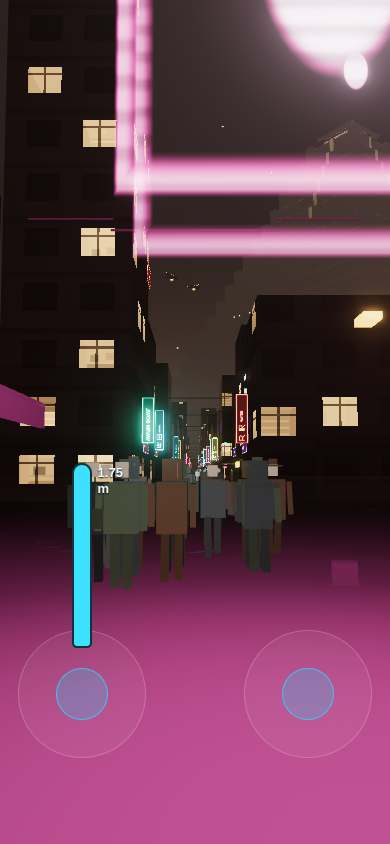

## Ranked fixes

Grouped so a later pass can take one subject. High severity first. The same mesh is listed once, with every district that shows it.

### Vehicles

Raise the shared car (and the truck classes) so a 1.75 m person reads next to them. The bible’s 0.9 m compact height is the number to change with the mesh.

- **high fail — Compact car, visual roof.** Measured 1.03 m roof, 4.2 m long, 1.82 m wide. Expected real sedan roof 1.40–1.55 m, length 4.5–5.6 m. `src/vehicles/vehicleModels.ts car boxes`. Districts: financial-megatowers, dtla, civic-center, historic-core, lakewood-megablocks, south-la-megablocks, westside, basin-sprawl, hollywood, lax-spaceport, long-beach, east-la. Traffic length MESH_LEN.car is 4.35 m. The bible compact car is 4.2 × 1.82 × 0.9 m. The mesh matches that length and width; the roof is 1.03 m against the bible 0.9 m and a real roof near 1.45 m.
- **high fail — Hauler, visual.** Measured 2.85 m roof, 10.75 m long. Expected real articulated truck height 3.5–4.2 m, length 14–18 m. `src/vehicles/vehicleModels.ts hauler boxes`. Districts: harbor. MESH_LEN.hauler is 11.7 m, which matches the bible and is short of a real tractor-trailer.
- **high fail — Parked rickshaw prop.** Measured 0.725 m above the ground. Expected rickshaw body about 1.2–1.6 m. `src/districts/historic-core/dress.ts sy 1.45 at y ground`. Districts: historic-core. Kit boxes are centered. y is the ground, so half of the 1.45 m box is under the street.
- **medium watch — Tanker, visual.** Measured 2.78 m roof, 8.53 m long. Expected real tanker overall height about 3.2–4.0 m. `src/vehicles/vehicleModels.ts tanker`. Districts: southeast-industrial, south-bay-refineries. MESH_LEN.tanker is 10.8 m. The shell is a 1.05 m radius cylinder.
- **medium watch — Canyon rickshaw scale.** Measured 1.26 m roof, 3.04 m long, 0.91 m wide (28% of cars). Expected rickshaw about 1.4–1.8 m tall and 2.5–3.2 m long. `src/vehicles/groundTraffic.ts style() sx 0.5 sy 1.22 sz 0.7`. Districts: historic-core. Applied when the edge kind is canyon or the driving line is under 5 m.
- **low watch — Compact car vs bible height.** Measured 1.03 m. Expected bible 0.9 m. `docs/BIBLE.md ground vehicles; vehicleModels.ts`. Districts: financial-megatowers, dtla, civic-center, historic-core, lakewood-megablocks, south-la-megablocks, westside, basin-sprawl, hollywood, lax-spaceport, long-beach, east-la. The authored height is the short one. Real-world scale is the row above.
- **low watch — Van, visual.** Measured 1.73 m roof, 5.05 m long, 2.02 m wide. Expected real van roof 1.8–2.6 m, length 5.0–6.2 m. `src/vehicles/vehicleModels.ts van boxes`. Districts: civic-center, lakewood-megablocks, south-la-megablocks, westside, basin-sprawl, lax-spaceport, east-la. MESH_LEN.van is 5.55 m (bible). Visual length is the merged boxes.
- **low watch — Box truck, visual.** Measured 2.58 m roof, 7.38 m long. Expected real box truck roof 2.8–3.8 m, length 6–10 m. `src/vehicles/vehicleModels.ts box boxes`. Districts: arts-district, southeast-industrial. MESH_LEN.box is 7.9 m (bible traffic length).
### Doors

Human openings should land between 2.0 and 2.4 m. Monumental portals can stay huge if a human door sits in front of them.

- **high fail — Bradbury service door.** Measured 2.8 m high, 2.1 m wide. Expected 2.0–2.4 m. `src/districts/historic-core/interior.ts service door y −0.2 to 2.6, hw 1.05`. Districts: historic-core.
- **high fail — Bradbury street door.** Measured 7.2 m high, 4.8 m wide. Expected human door 2.0–2.4 m. `src/districts/historic-core/bradbury.ts DOOR_H / DOOR`. Districts: historic-core. Heritage portal on the street face.
- **high fail — LAPD lobby opening.** Measured 16.4 m wide, headroom to 12.4 m. Expected human door 2.0–2.4 m. `src/districts/civic-center/spec.ts HQ.doorHalf`. Districts: civic-center. Lobby floor is 5.2 m. The opening is a mouth, not a leaf.
- **medium watch — Concourse door.** Measured 2.6 m high, 2.1 m wide. Expected 2.0–2.4 m. `src/districts/long-beach/interior.ts door y 0 to 2.6, hw 1.05`. Districts: long-beach.
- **medium watch — Court door.** Measured 2.3 m × 2.7 m. Expected 2.0–2.4 m. `src/districts/wallace-vernon/spec.ts COURT.doorH`. Districts: wallace-vernon. Human door in front of the portal, on the 3 m deck.
- **medium watch — Noodle-bar soffit.** Measured 2.62 m. Expected door / shop opening 2.0–2.4 m. `src/districts/little-tokyo-market/dress.ts SOFFIT`. Districts: little-tokyo-market. Shop opening under the stall, not a leaf door.
- **medium watch — Pyramid portal.** Measured 288 m wide, 195.8 m tall. Expected monumental entrance, not a 2.0–2.4 m door. `src/districts/_shared/megatower/pyramid.ts portalW / portalH`. Districts: wallace-vernon. The court door in front of it is the human opening. This glow is the north portal.
- **medium watch — Street lobby mouth.** Measured 5.4 m wide. Expected a door leaf is about 0.9–2.1 m; a lobby mouth can be wider. `src/districts/hollywood/plan.ts DOOR_HALF_T 2.7`. Districts: hollywood. The interior door is 2.1 m wide. The street gap is DOOR_HALF_T × 2.
- **low watch — Lift door.** Measured 2.05 × 2.32 m. Expected lift opening about 2.0–2.3 m. `src/districts/k-megablock/spec.ts LIFT`. Districts: k-megablock.
### Stairs

Real risers are 0.15–0.18 m and treads about 0.28 m. Flights the bible already calls out (0.35 m, 0.375 m, apron ~0.39 m) need a lore decision before the mesh changes.

- **high fail — Apron stair rise.** Measured 0.395 m median, 0.398 m max (210 treads). Expected real 0.15–0.18 m. `src/districts/coastal-strip/apronPlan.ts rise/round(rise/0.39)`. Districts: coastal-strip. The comment says treads rise ≤ 0.40 m. The formula can step past that. Bible row follows.
- **high fail — Catwalk stair rise.** Measured 0.337 m. Expected 0.15–0.18 m. `src/districts/little-tokyo-market/dress.ts deckY / steps`. Districts: little-tokyo-market. 12 risers to a 4.05 m deck. Tread run is 0.42 m (real tread about 0.25–0.32 m).
- **high fail — Catwalk tread.** Measured 0.42 m. Expected 0.25–0.32 m. `src/districts/little-tokyo-market/dress.ts run`. Districts: little-tokyo-market.
- **high fail — City Hall stair tread.** Measured 0.645 m. Expected 0.25–0.32 m. `src/districts/civic-center/spec.ts HALL_STAIR`. Districts: civic-center.
- **high fail — Court stair rise.** Measured 0.375 m. Expected real 0.15–0.18 m. `src/districts/wallace-vernon/spec.ts COURT.stairRise`. Districts: wallace-vernon. 8 risers, tread 2.4 m. Bible allows this under the 0.45 m step-up.
- **high fail — Court tread.** Measured 2.4 m. Expected 0.25–0.32 m. `src/districts/wallace-vernon/spec.ts COURT.stairTread`. Districts: wallace-vernon. A ceremonial run, much deeper than a step.
- **high fail — Footbridge stair rise.** Measured 0.35 m. Expected real 0.15–0.18 m. `src/districts/historic-core/bridge.ts DECK/STEPS`. Districts: historic-core. Bible records 32 × 0.35 m. That lore row is the next one.
- **high fail — LAPD stair tread.** Measured 0.583 m. Expected 0.25–0.32 m. `src/districts/civic-center/spec.ts STAIR`. Districts: civic-center. 32 treads from z -77.8 to -59.15.
- **medium watch — Footbridge tread.** Measured 0.34 m. Expected 0.25–0.32 m. `src/districts/historic-core/bridge.ts TREAD`. Districts: historic-core.
### Rails

Handrails want about 0.9–1.1 m. Anything under the 0.45 m step-up can be walked over.

- **high fail — Catwalk rail.** Measured 0.55 m above the deck. Expected 0.90–1.10 m. `src/districts/little-tokyo-market/dress.ts rail at deckY+0.55`. Districts: little-tokyo-market. Centered box, sy 0.08, so the rail occupies about 0.51–0.59 m. Walk mode steps up 0.45 m, so this rail can be stepped over.
### Storeys

Façade CELL_H is the floor the player counts. Keep 3–4 m for housing and shops. Office bands the bible already allows at 4.0–5.5 m should be labeled as that, not left looking like a mistake. Slit and monolith panels are not floors.

- **high fail — Façade storey.** Measured Coffer 6.6 m (7 masses). Expected 3–4 m storey. `src/world/windows/facade.ts CELL_H`. Districts: south-la-megablocks. Coffer cell is what the façade shader repeats as a floor.
- **high fail — Façade storey (Coffer).** Measured Coffer 6.6 m (5 masses). Expected 3–4 m storey. `src/world/windows/facade.ts CELL_H`. Districts: civic-center. Coffer cell is what the façade shader repeats as a floor.
- **high fail — Façade storey (Coffer).** Measured Coffer 6.6 m (6 masses). Expected 3–4 m storey. `src/world/windows/facade.ts CELL_H`. Districts: lakewood-megablocks. Coffer cell is what the façade shader repeats as a floor.
- **medium watch — Façade storey.** Measured Industrial 7 m (12 masses). Expected 3–4 m if it reads as a floor; 6–8 m is a bay. `src/world/windows/facade.ts CELL_H`. Districts: arts-district. Industrial cell is a bay height, not a residential storey.
- **medium watch — Façade storey.** Measured Industrial 7 m (14 masses). Expected 3–4 m if it reads as a floor; 6–8 m is a bay. `src/world/windows/facade.ts CELL_H`. Districts: southeast-industrial. Industrial cell is a bay height, not a residential storey.
- **medium watch — Façade storey.** Measured Industrial 7 m (15 masses). Expected 3–4 m if it reads as a floor; 6–8 m is a bay. `src/world/windows/facade.ts CELL_H`. Districts: south-bay-refineries. Industrial cell is a bay height, not a residential storey.
- **medium watch — Façade storey.** Measured Industrial 7 m (8 masses). Expected 3–4 m if it reads as a floor; 6–8 m is a bay. `src/world/windows/facade.ts CELL_H`. Districts: harbor. Industrial cell is a bay height, not a residential storey.
- **medium watch — Façade storey (Deco).** Measured Deco 5.6 m (7 masses). Expected 3–4 m floor; bible office/civic band stops at 5.5 m. `src/world/windows/facade.ts CELL_H`. Districts: historic-core. Deco sits just past the office band.
- **medium watch — Façade storey (Deco).** Measured Deco 5.6 m (11 masses). Expected 3–4 m floor; bible office/civic band stops at 5.5 m. `src/world/windows/facade.ts CELL_H`. Districts: hollywood. Deco sits just past the office band.
- **medium watch — Façade storey (Industrial).** Measured Industrial 7 m (6 masses). Expected 3–4 m if it reads as a floor; 6–8 m is a bay. `src/world/windows/facade.ts CELL_H`. Districts: financial-megatowers. Industrial cell is a bay height, not a residential storey.
- **medium watch — Façade storey (Industrial).** Measured Industrial 7 m (5 masses). Expected 3–4 m if it reads as a floor; 6–8 m is a bay. `src/world/windows/facade.ts CELL_H`. Districts: lax-spaceport. Industrial cell is a bay height, not a residential storey.
- **medium watch — Façade storey (Masonry).** Measured Masonry 4.8 m (15 masses). Expected 3–4 m floor (bible office/civic band is 4.0–5.5 m). `src/world/windows/facade.ts CELL_H`. Districts: historic-core. Masonry is inside the bible office/civic module and above a 3–4 m floor.
- **medium watch — Façade storey (Ribbon).** Measured Ribbon 4.4 m (7 masses). Expected 3–4 m floor (bible office/civic band is 4.0–5.5 m). `src/world/windows/facade.ts CELL_H`. Districts: financial-megatowers. Ribbon is inside the bible office/civic module and above a 3–4 m floor.
- **medium watch — Floor module.** Measured 5.0 m. Expected 3–4 m floor; bible office band 4.0–5.5 m. `src/districts/long-beach/spec.ts MODULE`. Districts: long-beach.
- **medium watch — Office module.** Measured 5.0 m. Expected 3–4 m floor; bible office band 4.0–5.5 m. `src/districts/lax-spaceport/spec.ts FLOOR`. Districts: lax-spaceport.
- **medium watch — Strip floor module.** Measured 4.4 m. Expected 3–4 m floor; bible office band 4.0–5.5 m. `src/districts/hollywood/spec.ts FLOOR`. Districts: hollywood.
- **low watch — Roof vs 54 modules.** Measured 183.6 m vs slab 185 m. Expected a whole number of 3.4 m floors. `src/districts/k-megablock/spec.ts FLOOR / SLAB_H`. Districts: k-megablock. 54 × 3.4 = 183.6 m. The roof is 185 m, so the last band is not one module.
- **low watch — Sampled mass height.** Measured 38.4 m median of 40 detail-0 boxes. Expected 90–305 m fabric band. `generateFabric visual height (slope sink of 8 m removed)`. Districts: financial-megatowers. Sample range 5.7 m to 113 m. Heroes are landmarks and are not in this fabric sample.
- **low watch — Sampled mass height.** Measured 63.8 m median of 27 detail-0 boxes. Expected 90–250 m fabric band. `generateFabric visual height (slope sink of 8 m removed)`. Districts: dtla. Sample range 6.4 m to 169.3 m. Heroes are landmarks and are not in this fabric sample.
- **low watch — Sampled mass height.** Measured 34.5 m median of 44 detail-0 boxes. Expected 40–110 m fabric band. `generateFabric visual height (slope sink of 8 m removed)`. Districts: historic-core. Sample range 5 m to 61.5 m. Heroes are landmarks and are not in this fabric sample.
- **low watch — Sampled mass height.** Measured 43.7 m median of 10 detail-0 boxes. Expected 60–185 m fabric band. `generateFabric visual height (slope sink of 8 m removed)`. Districts: k-megablock. Sample range 6.4 m to 113.9 m. Heroes are landmarks and are not in this fabric sample.
- **low watch — Sampled mass height.** Measured 7.6 m median of 46 detail-0 boxes. Expected 15–60 m fabric band. `generateFabric visual height (slope sink of 8 m removed)`. Districts: coastal-strip. Sample range 4.6 m to 53.9 m. Heroes are landmarks and are not in this fabric sample.
- **low watch — Sampled mass height.** Measured 17.6 m median of 34 detail-0 boxes. Expected 22–119 m fabric band. `generateFabric visual height (slope sink of 8 m removed)`. Districts: hollywood. Sample range 4.4 m to 49.3 m. Heroes are landmarks and are not in this fabric sample.
- **low watch — Sampled mass height.** Measured 50 m median of 24 detail-0 boxes. Expected 60–180 m fabric band. `generateFabric visual height (slope sink of 8 m removed)`. Districts: long-beach. Sample range 6.4 m to 161.5 m. Heroes are landmarks and are not in this fabric sample.
### Lanes and sidewalks

Keep freeway spacing at 3.5–3.7 m. Say out loud that a driving line is a centreline offset. Wide avenues with one tracked lane should not be read as 8 m sidewalks.

- **medium watch — Implied sidewalk.** Measured 10 m. Expected 1.5–4.5 m. `derived: street/2 − lane − 1.8`. Districts: financial-megatowers. street/2 − driving line − 1.8 m (half of a 3.6 m lane centred on the driving line). The driving line is not a painted lane width. One tracked lane in a film-wide street; the remainder is carriageway, not a sidewalk slab.
- **medium watch — Implied sidewalk.** Measured 8 m. Expected 1.5–4.5 m. `derived: street/2 − lane − 1.8`. Districts: dtla. street/2 − driving line − 1.8 m (half of a 3.6 m lane centred on the driving line). The driving line is not a painted lane width. One tracked lane in a film-wide street; the remainder is carriageway, not a sidewalk slab.
- **medium watch — Implied sidewalk.** Measured 11 m. Expected 1.5–4.5 m. `derived: street/2 − lane − 1.8`. Districts: civic-center. street/2 − driving line − 1.8 m (half of a 3.6 m lane centred on the driving line). The driving line is not a painted lane width. One tracked lane in a film-wide street; the remainder is carriageway, not a sidewalk slab.
- **medium watch — Implied sidewalk.** Measured 16.7 m. Expected 1.5–4.5 m. `derived: street/2 − lane − 1.8`. Districts: lax-spaceport. street/2 − driving line − 1.8 m (half of a 3.6 m lane centred on the driving line). The driving line is not a painted lane width. One tracked lane in a film-wide street; the remainder is carriageway, not a sidewalk slab.
- **medium watch — Implied sidewalk.** Measured 5.7 m. Expected 1.5–4.5 m. `derived: street/2 − lane − 1.8`. Districts: harbor. street/2 − driving line − 1.8 m (half of a 3.6 m lane centred on the driving line). The driving line is not a painted lane width. One tracked lane in a film-wide street; the remainder is carriageway, not a sidewalk slab.
- **medium watch — Implied sidewalk.** Measured 6.4 m. Expected 1.5–4.5 m. `derived: street/2 − lane − 1.8`. Districts: long-beach. street/2 − driving line − 1.8 m (half of a 3.6 m lane centred on the driving line). The driving line is not a painted lane width. One tracked lane in a film-wide street; the remainder is carriageway, not a sidewalk slab.
- **low watch — Freeway lane spacing.** Measured I-110 3.5 m × 3; US-101 3.45 m × 3; I-10 3.55 m × 3; I-405 3.6 m × 2; I-5 3.6 m × 2; I-105 3.6 m × 2; I-710 3.6 m × 2. Expected 3.5–3.7 m. `src/vehicles/trafficBuiltins.ts spacing`. Districts: little-tokyo-market, financial-megatowers, dtla, civic-center, historic-core, wallace-vernon, k-megablock, arts-district, coastal-strip, lakewood-megablocks, south-la-megablocks, westside, basin-sprawl, southeast-industrial, hollywood, lax-spaceport, south-bay-refineries, harbor, long-beach, east-la, hills-sparse. I-110 is 3.5, I-10 is 3.55, I-405 / I-5 / I-105 / I-710 are 3.6. US-101 is 3.45, a tenth under the band.
- **low watch — Implied sidewalk.** Measured 4.6 m. Expected 1.5–4.5 m. `derived: street/2 − lane − 1.8`. Districts: south-la-megablocks, southeast-industrial. street/2 − driving line − 1.8 m (half of a 3.6 m lane centred on the driving line). The driving line is not a painted lane width.
- **low watch — Implied sidewalk.** Measured 1.1 m. Expected 1.5–4.5 m. `derived: street/2 − lane − 1.8`. Districts: basin-sprawl, east-la. street/2 − driving line − 1.8 m (half of a 3.6 m lane centred on the driving line). The driving line is not a painted lane width.
- **low watch — Implied sidewalk.** Measured 5 m. Expected 1.5–4.5 m. `derived: street/2 − lane − 1.8`. Districts: lakewood-megablocks. street/2 − driving line − 1.8 m (half of a 3.6 m lane centred on the driving line). The driving line is not a painted lane width.
### Signs

Street panels stay in a human range. Billboards are boards.

- **medium watch — Blade sign.** Measured 11.07 m median (8 in sample). Expected 2–8 m blade. `fabric Sign.h kind 1`. Districts: dtla.
- **medium watch — Blade sign.** Measured 9.9 m median (92 in sample). Expected 2–8 m blade. `fabric Sign.h kind 1`. Districts: hollywood.
- **medium watch — Blade sign.** Measured 10.5 m median (7 in sample). Expected 2–8 m blade. `fabric Sign.h kind 1`. Districts: long-beach.
- **low watch — Street signs.** Measured none in the fabric sample. Expected panels about 0.6–4 m. `fabric Sign.h`. Districts: wallace-vernon, southeast-industrial, harbor, hills-sparse. The sample window had no sign records. Landmark signs are listed with the landmark.
- **low watch — Blade sign.** Measured 8.12 m median (5 in sample). Expected 2–8 m blade. `fabric Sign.h kind 1`. Districts: financial-megatowers.
- **low watch — Blade sign.** Measured 9 m median (92 in sample). Expected 2–8 m blade. `fabric Sign.h kind 1`. Districts: historic-core.
### People

The shared body is already 1.80 m. Districts with no crowd registration read as empty.

- **medium watch — Crowd share.** Measured not registered (0). Expected a street crowd where people should read. `src/districts/little-tokyo-market/crowd.ts registerCrowdSource`. Districts: wallace-vernon, coastal-strip, lax-spaceport, hills-sparse. No source calls registerCrowdSource for this district, so the player sees none of the 1.80 m mesh here.
- **low watch — Pedestrian hat.** Measured 1.92 m. Expected 1.60–1.90 m to the top of the head; a hat may add a little. `src/districts/little-tokyo-market/crowd.ts hat box`. Districts: little-tokyo-market, financial-megatowers, dtla, civic-center, historic-core, wallace-vernon, k-megablock, arts-district, coastal-strip, lakewood-megablocks, south-la-megablocks, westside, basin-sprawl, southeast-industrial, hollywood, lax-spaceport, south-bay-refineries, harbor, long-beach, east-la, hills-sparse. The crown box is centred at 1.86 m with height 0.12 m.
- **low watch — Dancer hologram.** Measured 68 m tall, 15 m wide. Expected a pedestrian is 1.6–1.9 m; this is a billboard. `src/districts/historic-core/bridge.ts DANCER_H`. Districts: historic-core. Bible: the figure is not on the deck. It stands in the Broadway intersection. Not a person mesh.
### Landmarks

Published height and the mesh tip should be the same number, or the bible should say the mast is extra in the same sentence as the height.

- **medium watch — El Segundo stacks.** Measured 147 m tallest of 14 (published 140 m). Expected bible stacks to 140 m. `src/world/landmarks/Landmarks.ts flare-field h = height × range(0.6, 1.1)`. Districts: coastal-strip, south-bay-refineries. The loop can draw 1.1 × the published height, then a flare sprite 4 m above that.
- **medium watch — Bradbury masonry front.** Measured 22.4 m. Expected JSON height 27 m is the jacket, not this stone front. `src/districts/historic-core/bradbury.ts H`. Districts: historic-core. JACKET_H is 27 m and matches the JSON height. The stone front the player reads from the street is 22.4 m.
- **low watch — Megatower 6 (blade) height field.** Measured JSON 520 m, mesh top 552 m. Expected the height field is the roof; the mast is extra and listed in the bible. `src/data/city-layout.json height; tower.ts mast()`. Districts: financial-megatowers, historic-core. Anyone reading only the height field will undershoot the silhouette by the mast.
- **low watch — Old Corporate Pyramid (north) height field.** Measured JSON 1000 m, mesh top 1070 m. Expected published height versus the silhouette. `city-layout.json height; pyramid.ts`. Districts: wallace-vernon, southeast-industrial.
- **low watch — Old Corporate Pyramid (south) height field.** Measured JSON 860 m, mesh top 930 m. Expected published height versus the silhouette. `city-layout.json height; pyramid.ts`. Districts: wallace-vernon, southeast-industrial.
- **low watch — Megatower 1 (Bunker Hill slab) height field.** Measured JSON 1020 m, mesh top 1105 m. Expected the height field is the roof; the mast is extra and listed in the bible. `src/data/city-layout.json height; tower.ts mast()`. Districts: financial-megatowers. Anyone reading only the height field will undershoot the silhouette by the mast.
- **low watch — Megatower 2 (flared stack) height field.** Measured JSON 760 m, mesh top 805 m. Expected the height field is the roof; the mast is extra and listed in the bible. `src/data/city-layout.json height; tower.ts mast()`. Districts: financial-megatowers. Anyone reading only the height field will undershoot the silhouette by the mast.
- **low watch — Megatower 3 (terraced) height field.** Measured JSON 660 m, mesh top 710 m. Expected the height field is the roof; the mast is extra and listed in the bible. `src/data/city-layout.json height; tower.ts mast()`. Districts: financial-megatowers. Anyone reading only the height field will undershoot the silhouette by the mast.
- **low watch — Megatower 4 (cruciform lantern) height field.** Measured JSON 600 m, mesh top 640 m. Expected the height field is the roof; the mast is extra and listed in the bible. `src/data/city-layout.json height; tower.ts mast()`. Districts: financial-megatowers. Anyone reading only the height field will undershoot the silhouette by the mast.
- **low watch — Megatower 5 (twin gate) height field.** Measured JSON 880 m, mesh top 940 m. Expected the height field is the roof; the mast is extra and listed in the bible. `src/data/city-layout.json height; tower.ts mast()`. Districts: financial-megatowers. Anyone reading only the height field will undershoot the silhouette by the mast.
- **low watch — Megatower 7 (cage crown) height field.** Measured JSON 560 m, mesh top 600 m. Expected the height field is the roof; the mast is extra and listed in the bible. `src/data/city-layout.json height; tower.ts mast()`. Districts: financial-megatowers. Anyone reading only the height field will undershoot the silhouette by the mast.
- **low watch — Wallace Corporation Earth Headquarters height field.** Measured JSON 3500 m, mesh top 3610 m. Expected published height versus the silhouette. `city-layout.json height; pyramid.ts`. Districts: wallace-vernon.
### Lamps

Poles that are centered on the ground sink. A 7.5 m shared lamp is a fair arterial pole where it is allowed to draw.

- **medium watch — Canyon bollard.** Measured 0.425 m above the ground. Expected bollard 0.6–1.0 m. `src/districts/historic-core/dress.ts cyl sy 0.85 at y ground`. Districts: historic-core. Same centered-mesh placement. Visible height is sy/2.
- **low watch — Shared street lamp.** Measured suppressed (NO_LAMPS). Expected a 6–12 m pole where the district has no replacement. `src/districts/_shared/streetLamps.ts NO_LAMPS / POLE_H 7.5`. Districts: little-tokyo-market, civic-center, historic-core, wallace-vernon, coastal-strip, south-la-megablocks, hollywood, lax-spaceport, south-bay-refineries, harbor. The shared pole is 7.5 m (head near the top). This district is in NO_LAMPS, so that pole is not drawn.

## Districts

### 2. Little Tokyo Night Market

`little-tokyo-market` · archetype `little-tokyo-market` · 14 pass, 4 watch, 3 fail.
Sample around (323, 332), ground 0.0 m, 6 blocks, 195 boxes, 157 signs.

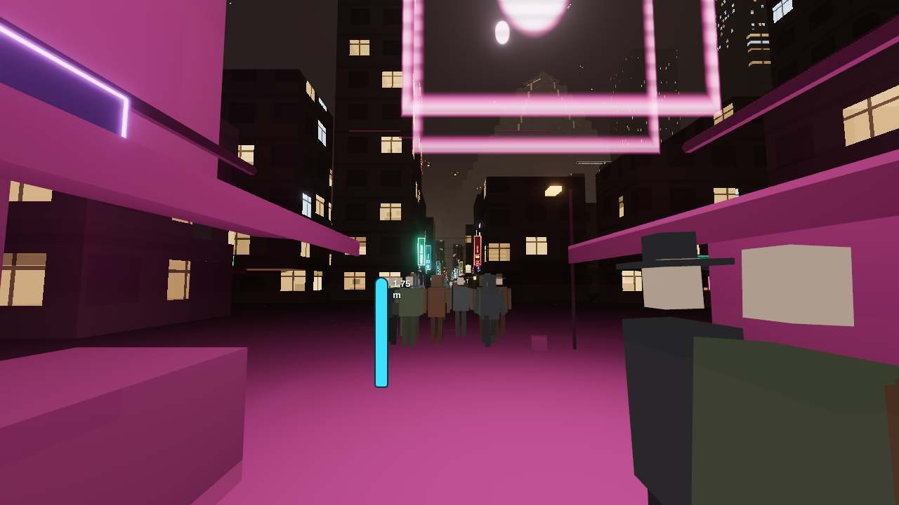

| Item | Measured | Expected | Verdict | Severity | Source |
| --- | --- | --- | --- | --- | --- |
| Façade storey | Market 3.2 m (115 masses) | 3–4 m storey Market cell sits in the real storey band. | pass | — | `src/world/windows/facade.ts CELL_H` |
| Sampled mass height | 13.1 m median of 117 detail-0 boxes | 7–95 m fabric band Sample range 5.9 m to 83.5 m. Heroes are landmarks and are not in this fabric sample. | pass | — | `generateFabric visual height (slope sink of 8 m removed)` |
| Flat sign panel | 0.72 m median (90 in sample) | 0.6–4 m street panel | pass | — | `fabric Sign.h kind 0` |
| Blade sign | 3.37 m median (65 in sample) | 2–8 m blade | pass | — | `fabric Sign.h kind 1` |
| Billboard panel | 7.74 m median (2 in sample) | a billboard, not a door or a person Kind 2 is a figure panel. Height is the board, not a storey. | pass | — | `fabric Sign.h kind 2` |
| Street width | 7 m | bible 7 m | pass | — | `src/data/city-layout.json grid.street` |
| Driving line | no lattice | a centreline offset where cars are spawned No cars are placed on a driving line here. | pass | — | `src/vehicles/trafficRegistry.ts` |
| Freeway lane spacing | I-110 3.5 m × 3; US-101 3.45 m × 3; I-10 3.55 m × 3; I-405 3.6 m × 2; I-5 3.6 m × 2; I-105 3.6 m × 2; I-710 3.6 m × 2 | 3.5–3.7 m I-110 is 3.5, I-10 is 3.55, I-405 / I-5 / I-105 / I-710 are 3.6. US-101 is 3.45, a tenth under the band. | watch | low | `src/vehicles/trafficBuiltins.ts spacing` |
| Signal pole | 5.45 m pole, head centred at 5.52 m | bible about 5.5 m; real signal about 4.5–6.5 m | pass | — | `src/vehicles/groundTraffic.ts BoxGeometry 0.16 × 5.45` |
| Quality rescale | none | metres stay put at every tier detailScale, farRadius, crowd count and groundTraffic change. The city is not shrunk for a phone. | pass | — | `src/core/quality.ts settingsFor` |
| Ground vehicles | no street graph | cars only where a lattice exists The market has no lattice. The bible sends it pedestrians, umbrellas and bikes. | pass | — | `src/vehicles/trafficRegistry.ts NO_STREET_GRAPH` |
| Traffic spinner | 5 m long, 2.66 m wide, 1.51 m high | length 4.5–5.6 m; cabin about 1.2–1.8 m Authored SPINNER_DIMS are 5.0 × 2.3 × 1.45 m. Pods reach about 2.66 m. The player craft is the glTF spinner; traffic uses this procedural mesh. Width vs the 2.3 m field is 2.66 m. | pass | — | `src/vehicles/spinnerModel.ts spinnerGeometries / SPINNER_DIMS` |
| Pedestrian head | 1.8 m | 1.60–1.90 m One shared mesh. WalkController HUMAN is eye 1.7 m, height 1.8 m, walk 1.5 m/s, run 4.2 m/s. | pass | — | `src/districts/little-tokyo-market/crowd.ts personGeometry` |
| Pedestrian hat | 1.92 m | 1.60–1.90 m to the top of the head; a hat may add a little The crown box is centred at 1.86 m with height 0.12 m. | watch | low | `src/districts/little-tokyo-market/crowd.ts hat box` |
| Crowd share | 1 | registered crowd using the 1.80 m mesh Share scales how many of the tier budget this district keeps. It does not scale the mesh. | pass | — | `registerCrowdSource share 1` |
| Shared street lamp | suppressed (NO_LAMPS) | a 6–12 m pole where the district has no replacement The shared pole is 7.5 m (head near the top). This district is in NO_LAMPS, so that pole is not drawn. | watch | low | `src/districts/_shared/streetLamps.ts NO_LAMPS / POLE_H 7.5` |
| Noodle-bar soffit | 2.62 m | door / shop opening 2.0–2.4 m Shop opening under the stall, not a leaf door. | watch | medium | `src/districts/little-tokyo-market/dress.ts SOFFIT` |
| Catwalk stair rise | 0.337 m | 0.15–0.18 m 12 risers to a 4.05 m deck. Tread run is 0.42 m (real tread about 0.25–0.32 m). | fail | high | `src/districts/little-tokyo-market/dress.ts deckY / steps` |
| Catwalk tread | 0.42 m | 0.25–0.32 m | fail | high | `src/districts/little-tokyo-market/dress.ts run` |
| Catwalk rail | 0.55 m above the deck | 0.90–1.10 m Centered box, sy 0.08, so the rail occupies about 0.51–0.59 m. Walk mode steps up 0.45 m, so this rail can be stepped over. | fail | high | `src/districts/little-tokyo-market/dress.ts rail at deckY+0.55` |
| Market lamp | 4.1 m | pedestrian lamp 3.5–6 m Cylinder is centered, and the placement adds half the height, so it stands from the ground to 4.1 m. | pass | — | `src/districts/little-tokyo-market/dress.ts cyl sy 4.1 at ground+2.05` |

### 3. Financial District Megatowers

`financial-megatowers` · archetype `financial-megatowers` · 25 pass, 15 watch, 1 fail.
Sample around (-1049, 80), ground 0.0 m, 6 blocks, 192 boxes, 158 signs.

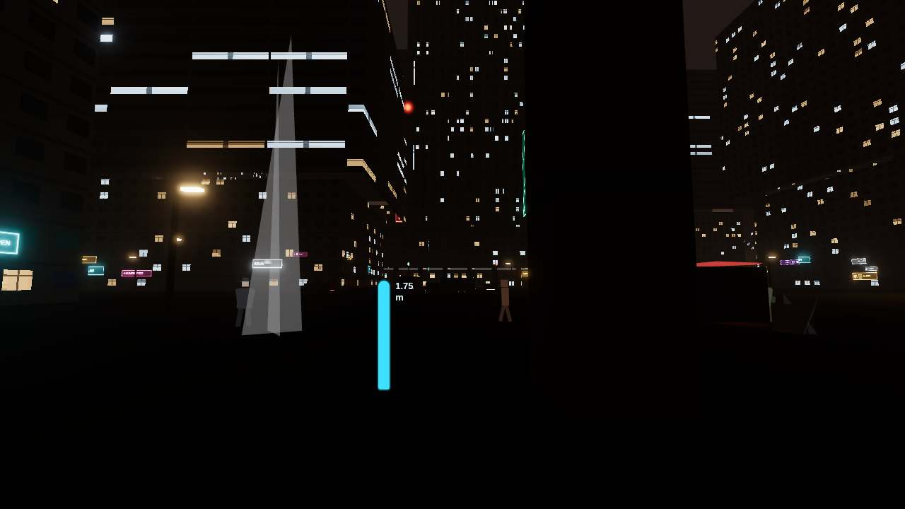

| Item | Measured | Expected | Verdict | Severity | Source |
| --- | --- | --- | --- | --- | --- |
| Façade storey | Megablock 3.6 m (17 masses) | 3–4 m storey Megablock cell sits in the real storey band. | pass | — | `src/world/windows/facade.ts CELL_H` |
| Façade storey (Ribbon) | Ribbon 4.4 m (7 masses) | 3–4 m floor (bible office/civic band is 4.0–5.5 m) Ribbon is inside the bible office/civic module and above a 3–4 m floor. | watch | medium | `src/world/windows/facade.ts CELL_H` |
| Façade storey (Industrial) | Industrial 7 m (6 masses) | 3–4 m if it reads as a floor; 6–8 m is a bay Industrial cell is a bay height, not a residential storey. | watch | medium | `src/world/windows/facade.ts CELL_H` |
| Sampled mass height | 38.4 m median of 40 detail-0 boxes | 90–305 m fabric band Sample range 5.7 m to 113 m. Heroes are landmarks and are not in this fabric sample. | watch | low | `generateFabric visual height (slope sink of 8 m removed)` |
| Flat sign panel | 1.67 m median (150 in sample) | 0.6–4 m street panel | pass | — | `fabric Sign.h kind 0` |
| Blade sign | 8.12 m median (5 in sample) | 2–8 m blade | watch | low | `fabric Sign.h kind 1` |
| Billboard panel | 12.51 m median (3 in sample) | a billboard, not a door or a person Kind 2 is a figure panel. Height is the board, not a storey. | pass | — | `fabric Sign.h kind 2` |
| Street width | 38 m | bible 38 m | pass | — | `src/data/city-layout.json grid.street` |
| Driving-line offset | 7.2 m from the centreline | bible ±7.2 m; not a 3.5–3.7 m painted lane The constant is metres from the street centreline to the car. Freeway spacing is the painted-lane module. | pass | — | `streetLattices().lane` |
| Implied sidewalk | 10 m | 1.5–4.5 m street/2 − driving line − 1.8 m (half of a 3.6 m lane centred on the driving line). The driving line is not a painted lane width. One tracked lane in a film-wide street; the remainder is carriageway, not a sidewalk slab. | watch | medium | `derived: street/2 − lane − 1.8` |
| Freeway lane spacing | I-110 3.5 m × 3; US-101 3.45 m × 3; I-10 3.55 m × 3; I-405 3.6 m × 2; I-5 3.6 m × 2; I-105 3.6 m × 2; I-710 3.6 m × 2 | 3.5–3.7 m I-110 is 3.5, I-10 is 3.55, I-405 / I-5 / I-105 / I-710 are 3.6. US-101 is 3.45, a tenth under the band. | watch | low | `src/vehicles/trafficBuiltins.ts spacing` |
| Signal pole | 5.45 m pole, head centred at 5.52 m | bible about 5.5 m; real signal about 4.5–6.5 m | pass | — | `src/vehicles/groundTraffic.ts BoxGeometry 0.16 × 5.45` |
| Quality rescale | none | metres stay put at every tier detailScale, farRadius, crowd count and groundTraffic change. The city is not shrunk for a phone. | pass | — | `src/core/quality.ts settingsFor` |
| Compact car, visual roof | 1.03 m roof, 4.2 m long, 1.82 m wide | real sedan roof 1.40–1.55 m, length 4.5–5.6 m Traffic length MESH_LEN.car is 4.35 m. The bible compact car is 4.2 × 1.82 × 0.9 m. The mesh matches that length and width; the roof is 1.03 m against the bible 0.9 m and a real roof near 1.45 m. | fail | high | `src/vehicles/vehicleModels.ts car boxes` |
| Compact car vs bible height | 1.03 m | bible 0.9 m The authored height is the short one. Real-world scale is the row above. | watch | low | `docs/BIBLE.md ground vehicles; vehicleModels.ts` |
| Traffic spinner | 5 m long, 2.66 m wide, 1.51 m high | length 4.5–5.6 m; cabin about 1.2–1.8 m Authored SPINNER_DIMS are 5.0 × 2.3 × 1.45 m. Pods reach about 2.66 m. The player craft is the glTF spinner; traffic uses this procedural mesh. Width vs the 2.3 m field is 2.66 m. | pass | — | `src/vehicles/spinnerModel.ts spinnerGeometries / SPINNER_DIMS` |
| Pedestrian head | 1.8 m | 1.60–1.90 m One shared mesh. WalkController HUMAN is eye 1.7 m, height 1.8 m, walk 1.5 m/s, run 4.2 m/s. | pass | — | `src/districts/little-tokyo-market/crowd.ts personGeometry` |
| Pedestrian hat | 1.92 m | 1.60–1.90 m to the top of the head; a hat may add a little The crown box is centred at 1.86 m with height 0.12 m. | watch | low | `src/districts/little-tokyo-market/crowd.ts hat box` |
| Crowd share | 0.4 | registered crowd using the 1.80 m mesh Share scales how many of the tier budget this district keeps. It does not scale the mesh. | pass | — | `registerCrowdSource share 0.4` |
| Shared street lamp | 7.5 m pole | arterial pole 6–12 m Spacing 32 m. Curb inset is min(2.2, street × 0.18). The mesh is translated so the pole stands on the ground. | pass | — | `src/districts/_shared/streetLamps.ts POLE_H` |
| Megatower 1 (Bunker Hill slab) visual top | 1105 m | bible roof 1020 m + mast 85 m = 1105 m JSON height is 1020 m. The mast is added on top of that roof. Sited in financial-megatowers. | pass | — | `src/districts/_shared/megatower/tower.ts buildTower parts.top` |
| Megatower 1 (Bunker Hill slab) height field | JSON 1020 m, mesh top 1105 m | the height field is the roof; the mast is extra and listed in the bible Anyone reading only the height field will undershoot the silhouette by the mast. | watch | low | `src/data/city-layout.json height; tower.ts mast()` |
| Megatower 2 (flared stack) visual top | 805 m | bible roof 760 m + mast 45 m = 805 m JSON height is 760 m. The mast is added on top of that roof. Sited in financial-megatowers. | pass | — | `src/districts/_shared/megatower/tower.ts buildTower parts.top` |
| Megatower 2 (flared stack) height field | JSON 760 m, mesh top 805 m | the height field is the roof; the mast is extra and listed in the bible Anyone reading only the height field will undershoot the silhouette by the mast. | watch | low | `src/data/city-layout.json height; tower.ts mast()` |
| Megatower 3 (terraced) visual top | 710 m | bible roof 660 m + mast 50 m = 710 m JSON height is 660 m. The mast is added on top of that roof. Sited in financial-megatowers. | pass | — | `src/districts/_shared/megatower/tower.ts buildTower parts.top` |
| Megatower 3 (terraced) height field | JSON 660 m, mesh top 710 m | the height field is the roof; the mast is extra and listed in the bible Anyone reading only the height field will undershoot the silhouette by the mast. | watch | low | `src/data/city-layout.json height; tower.ts mast()` |
| Megatower 4 (cruciform lantern) visual top | 640 m | bible roof 600 m + mast 40 m = 640 m JSON height is 600 m. The mast is added on top of that roof. Sited in financial-megatowers. | pass | — | `src/districts/_shared/megatower/tower.ts buildTower parts.top` |
| Megatower 4 (cruciform lantern) height field | JSON 600 m, mesh top 640 m | the height field is the roof; the mast is extra and listed in the bible Anyone reading only the height field will undershoot the silhouette by the mast. | watch | low | `src/data/city-layout.json height; tower.ts mast()` |
| Megatower 5 (twin gate) visual top | 940 m | bible roof 880 m + mast 60 m = 940 m JSON height is 880 m. The mast is added on top of that roof. Sited in financial-megatowers. | pass | — | `src/districts/_shared/megatower/tower.ts buildTower parts.top` |
| Megatower 5 (twin gate) height field | JSON 880 m, mesh top 940 m | the height field is the roof; the mast is extra and listed in the bible Anyone reading only the height field will undershoot the silhouette by the mast. | watch | low | `src/data/city-layout.json height; tower.ts mast()` |
| Megatower 6 (blade) visual top | 552 m | bible roof 520 m + mast 32 m = 552 m JSON height is 520 m. The mast is added on top of that roof. Sited in historic-core. | pass | — | `src/districts/_shared/megatower/tower.ts buildTower parts.top` |
| Megatower 6 (blade) height field | JSON 520 m, mesh top 552 m | the height field is the roof; the mast is extra and listed in the bible Anyone reading only the height field will undershoot the silhouette by the mast. | watch | low | `src/data/city-layout.json height; tower.ts mast()` |
| Megatower 7 (cage crown) visual top | 600 m | bible roof 560 m + mast 40 m = 600 m JSON height is 560 m. The mast is added on top of that roof. Sited in financial-megatowers. | pass | — | `src/districts/_shared/megatower/tower.ts buildTower parts.top` |
| Megatower 7 (cage crown) height field | JSON 560 m, mesh top 600 m | the height field is the roof; the mast is extra and listed in the bible Anyone reading only the height field will undershoot the silhouette by the mast. | watch | low | `src/data/city-layout.json height; tower.ts mast()` |
| 2019-era Ziggurat Tower A visual top | 420 m | bible 420 m (mast 0; flames sit above) JSON height is 420 m. The mast is added on top of that roof. Sited in financial-megatowers. | pass | — | `src/districts/_shared/megatower/tower.ts buildTower parts.top` |
| 2019-era Ziggurat Tower B visual top | 360 m | bible 360 m (mast 0; flames sit above) JSON height is 360 m. The mast is added on top of that roof. Sited in financial-megatowers. | pass | — | `src/districts/_shared/megatower/tower.ts buildTower parts.top` |
| 2019-era Ziggurat Tower C visual top | 310 m | bible 310 m (mast 0; flames sit above) JSON height is 310 m. The mast is added on top of that roof. Sited in financial-megatowers. | pass | — | `src/districts/_shared/megatower/tower.ts buildTower parts.top` |
| Skybridge MT-1 / Ziggurat A deck | 342 m underside | JSON height is the deck, not a roof Enclosure height is the landmark baseDepth (fallback 12 m) plus a 1.6 m roof on the tube. | pass | — | `src/districts/financial-megatowers/landmarks.ts y: l.height` |
| Skybridge MT-2 / MT-4 deck | 436 m underside | JSON height is the deck, not a roof Enclosure height is the landmark baseDepth (fallback 12 m) plus a 1.6 m roof on the tube. | pass | — | `src/districts/financial-megatowers/landmarks.ts y: l.height` |
| Skybridge MT-5 / Ziggurat B deck | 336 m underside | JSON height is the deck, not a roof Enclosure height is the landmark baseDepth (fallback 12 m) plus a 1.6 m roof on the tube. | pass | — | `src/districts/financial-megatowers/landmarks.ts y: l.height` |
| Skybridge MT-1 / MT-3 deck | 560 m underside | JSON height is the deck, not a roof Enclosure height is the landmark baseDepth (fallback 12 m) plus a 1.6 m roof on the tube. | pass | — | `src/districts/financial-megatowers/landmarks.ts y: l.height` |

### 4. Downtown Megablocks

`dtla` · archetype `megablock-downtown` · 11 pass, 6 watch, 1 fail.
Sample around (-922, -850), ground 0.0 m, 6 blocks, 599 boxes, 104 signs.

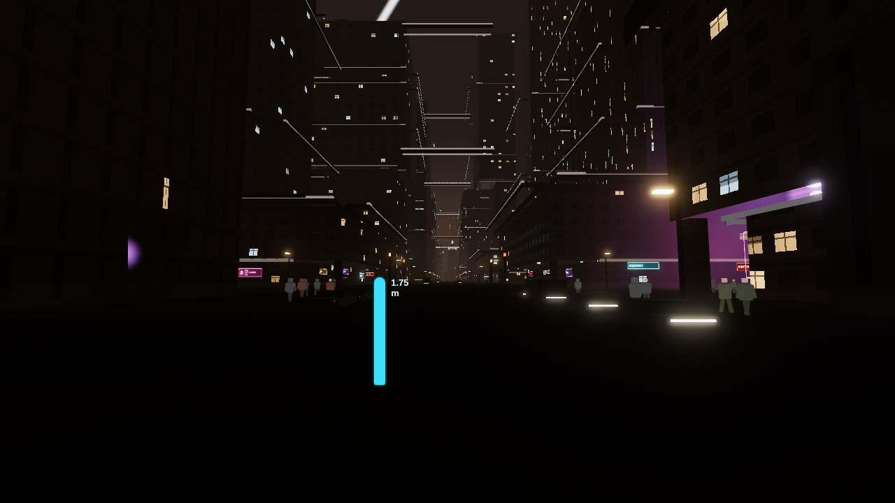

| Item | Measured | Expected | Verdict | Severity | Source |
| --- | --- | --- | --- | --- | --- |
| Façade storey | Panel 3.9 m (10 masses) | 3–4 m storey Panel cell sits in the real storey band. | pass | — | `src/world/windows/facade.ts CELL_H` |
| Sampled mass height | 63.8 m median of 27 detail-0 boxes | 90–250 m fabric band Sample range 6.4 m to 169.3 m. Heroes are landmarks and are not in this fabric sample. | watch | low | `generateFabric visual height (slope sink of 8 m removed)` |
| Flat sign panel | 1.76 m median (94 in sample) | 0.6–4 m street panel | pass | — | `fabric Sign.h kind 0` |
| Blade sign | 11.07 m median (8 in sample) | 2–8 m blade | watch | medium | `fabric Sign.h kind 1` |
| Billboard panel | 13.5 m median (2 in sample) | a billboard, not a door or a person Kind 2 is a figure panel. Height is the board, not a storey. | pass | — | `fabric Sign.h kind 2` |
| Street width | 34 m | bible 34 m | pass | — | `src/data/city-layout.json grid.street` |
| Driving-line offset | 7.2 m from the centreline | bible ±7.2 m; not a 3.5–3.7 m painted lane The constant is metres from the street centreline to the car. Freeway spacing is the painted-lane module. | pass | — | `streetLattices().lane` |
| Implied sidewalk | 8 m | 1.5–4.5 m street/2 − driving line − 1.8 m (half of a 3.6 m lane centred on the driving line). The driving line is not a painted lane width. One tracked lane in a film-wide street; the remainder is carriageway, not a sidewalk slab. | watch | medium | `derived: street/2 − lane − 1.8` |
| Freeway lane spacing | I-110 3.5 m × 3; US-101 3.45 m × 3; I-10 3.55 m × 3; I-405 3.6 m × 2; I-5 3.6 m × 2; I-105 3.6 m × 2; I-710 3.6 m × 2 | 3.5–3.7 m I-110 is 3.5, I-10 is 3.55, I-405 / I-5 / I-105 / I-710 are 3.6. US-101 is 3.45, a tenth under the band. | watch | low | `src/vehicles/trafficBuiltins.ts spacing` |
| Signal pole | 5.45 m pole, head centred at 5.52 m | bible about 5.5 m; real signal about 4.5–6.5 m | pass | — | `src/vehicles/groundTraffic.ts BoxGeometry 0.16 × 5.45` |
| Quality rescale | none | metres stay put at every tier detailScale, farRadius, crowd count and groundTraffic change. The city is not shrunk for a phone. | pass | — | `src/core/quality.ts settingsFor` |
| Compact car, visual roof | 1.03 m roof, 4.2 m long, 1.82 m wide | real sedan roof 1.40–1.55 m, length 4.5–5.6 m Traffic length MESH_LEN.car is 4.35 m. The bible compact car is 4.2 × 1.82 × 0.9 m. The mesh matches that length and width; the roof is 1.03 m against the bible 0.9 m and a real roof near 1.45 m. | fail | high | `src/vehicles/vehicleModels.ts car boxes` |
| Compact car vs bible height | 1.03 m | bible 0.9 m The authored height is the short one. Real-world scale is the row above. | watch | low | `docs/BIBLE.md ground vehicles; vehicleModels.ts` |
| Traffic spinner | 5 m long, 2.66 m wide, 1.51 m high | length 4.5–5.6 m; cabin about 1.2–1.8 m Authored SPINNER_DIMS are 5.0 × 2.3 × 1.45 m. Pods reach about 2.66 m. The player craft is the glTF spinner; traffic uses this procedural mesh. Width vs the 2.3 m field is 2.66 m. | pass | — | `src/vehicles/spinnerModel.ts spinnerGeometries / SPINNER_DIMS` |
| Pedestrian head | 1.8 m | 1.60–1.90 m One shared mesh. WalkController HUMAN is eye 1.7 m, height 1.8 m, walk 1.5 m/s, run 4.2 m/s. | pass | — | `src/districts/little-tokyo-market/crowd.ts personGeometry` |
| Pedestrian hat | 1.92 m | 1.60–1.90 m to the top of the head; a hat may add a little The crown box is centred at 1.86 m with height 0.12 m. | watch | low | `src/districts/little-tokyo-market/crowd.ts hat box` |
| Crowd share | 0.4 | registered crowd using the 1.80 m mesh Share scales how many of the tier budget this district keeps. It does not scale the mesh. | pass | — | `registerCrowdSource share 0.4` |
| Shared street lamp | 7.5 m pole | arterial pole 6–12 m Spacing 32 m. Curb inset is min(2.2, street × 0.18). The mesh is translated so the pole stands on the ground. | pass | — | `src/districts/_shared/streetLamps.ts POLE_H` |

### 5. Civic Center (LAPD HQ)

`civic-center` · archetype `civic-center` · 16 pass, 6 watch, 5 fail.
Sample around (-8, -38), ground 0.0 m, 6 blocks, 242 boxes, 1 signs.

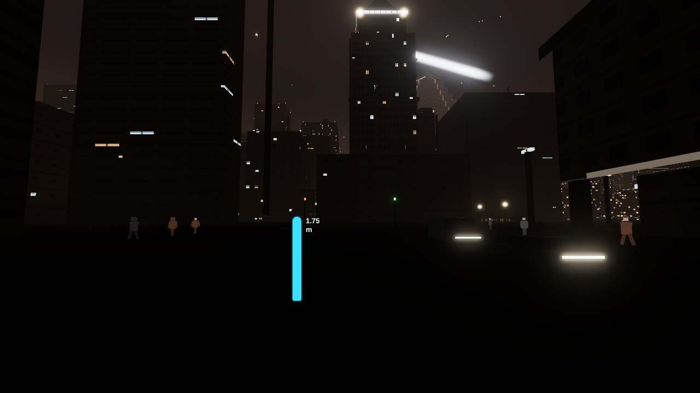

| Item | Measured | Expected | Verdict | Severity | Source |
| --- | --- | --- | --- | --- | --- |
| Façade storey | Megablock 3.6 m (11 masses) | 3–4 m storey Megablock cell sits in the real storey band. | pass | — | `src/world/windows/facade.ts CELL_H` |
| Façade storey (Coffer) | Coffer 6.6 m (5 masses) | 3–4 m storey Coffer cell is what the façade shader repeats as a floor. | fail | high | `src/world/windows/facade.ts CELL_H` |
| Sampled mass height | 47.6 m median of 27 detail-0 boxes | 36–122 m fabric band Sample range 6.4 m to 106.5 m. Heroes are landmarks and are not in this fabric sample. | pass | — | `generateFabric visual height (slope sink of 8 m removed)` |
| Flat sign panel | 1.3 m median (1 in sample) | 0.6–4 m street panel | pass | — | `fabric Sign.h kind 0` |
| Street width | 40 m | bible 40 m | pass | — | `src/data/city-layout.json grid.street` |
| Driving-line offset | 7.2 m from the centreline | bible ±7.2 m; not a 3.5–3.7 m painted lane The constant is metres from the street centreline to the car. Freeway spacing is the painted-lane module. | pass | — | `streetLattices().lane` |
| Implied sidewalk | 11 m | 1.5–4.5 m street/2 − driving line − 1.8 m (half of a 3.6 m lane centred on the driving line). The driving line is not a painted lane width. One tracked lane in a film-wide street; the remainder is carriageway, not a sidewalk slab. | watch | medium | `derived: street/2 − lane − 1.8` |
| Freeway lane spacing | I-110 3.5 m × 3; US-101 3.45 m × 3; I-10 3.55 m × 3; I-405 3.6 m × 2; I-5 3.6 m × 2; I-105 3.6 m × 2; I-710 3.6 m × 2 | 3.5–3.7 m I-110 is 3.5, I-10 is 3.55, I-405 / I-5 / I-105 / I-710 are 3.6. US-101 is 3.45, a tenth under the band. | watch | low | `src/vehicles/trafficBuiltins.ts spacing` |
| Signal pole | 5.45 m pole, head centred at 5.52 m | bible about 5.5 m; real signal about 4.5–6.5 m | pass | — | `src/vehicles/groundTraffic.ts BoxGeometry 0.16 × 5.45` |
| Quality rescale | none | metres stay put at every tier detailScale, farRadius, crowd count and groundTraffic change. The city is not shrunk for a phone. | pass | — | `src/core/quality.ts settingsFor` |
| Compact car, visual roof | 1.03 m roof, 4.2 m long, 1.82 m wide | real sedan roof 1.40–1.55 m, length 4.5–5.6 m Traffic length MESH_LEN.car is 4.35 m. The bible compact car is 4.2 × 1.82 × 0.9 m. The mesh matches that length and width; the roof is 1.03 m against the bible 0.9 m and a real roof near 1.45 m. | fail | high | `src/vehicles/vehicleModels.ts car boxes` |
| Compact car vs bible height | 1.03 m | bible 0.9 m The authored height is the short one. Real-world scale is the row above. | watch | low | `docs/BIBLE.md ground vehicles; vehicleModels.ts` |
| Van, visual | 1.73 m roof, 5.05 m long, 2.02 m wide | real van roof 1.8–2.6 m, length 5.0–6.2 m MESH_LEN.van is 5.55 m (bible). Visual length is the merged boxes. | watch | low | `src/vehicles/vehicleModels.ts van boxes` |
| Traffic spinner | 5 m long, 2.66 m wide, 1.51 m high | length 4.5–5.6 m; cabin about 1.2–1.8 m Authored SPINNER_DIMS are 5.0 × 2.3 × 1.45 m. Pods reach about 2.66 m. The player craft is the glTF spinner; traffic uses this procedural mesh. Width vs the 2.3 m field is 2.66 m. | pass | — | `src/vehicles/spinnerModel.ts spinnerGeometries / SPINNER_DIMS` |
| Pedestrian head | 1.8 m | 1.60–1.90 m One shared mesh. WalkController HUMAN is eye 1.7 m, height 1.8 m, walk 1.5 m/s, run 4.2 m/s. | pass | — | `src/districts/little-tokyo-market/crowd.ts personGeometry` |
| Pedestrian hat | 1.92 m | 1.60–1.90 m to the top of the head; a hat may add a little The crown box is centred at 1.86 m with height 0.12 m. | watch | low | `src/districts/little-tokyo-market/crowd.ts hat box` |
| Crowd share | 0.22 | registered crowd using the 1.80 m mesh Share scales how many of the tier budget this district keeps. It does not scale the mesh. | pass | — | `registerCrowdSource share 0.22` |
| Shared street lamp | suppressed (NO_LAMPS) | a 6–12 m pole where the district has no replacement The shared pole is 7.5 m (head near the top). This district is in NO_LAMPS, so that pole is not drawn. | watch | low | `src/districts/_shared/streetLamps.ts NO_LAMPS / POLE_H 7.5` |
| LAPD stair rise | 0.157 m | 0.15–0.18 m | pass | — | `src/districts/civic-center/spec.ts STAIR` |
| LAPD stair tread | 0.583 m | 0.25–0.32 m 32 treads from z -77.8 to -59.15. | fail | high | `src/districts/civic-center/spec.ts STAIR` |
| City Hall stair rise | 0.156 m | 0.15–0.18 m | pass | — | `src/districts/civic-center/spec.ts HALL_STAIR` |
| City Hall stair tread | 0.645 m | 0.25–0.32 m | fail | high | `src/districts/civic-center/spec.ts HALL_STAIR` |
| LAPD lobby opening | 16.4 m wide, headroom to 12.4 m | human door 2.0–2.4 m Lobby floor is 5.2 m. The opening is a mouth, not a leaf. | fail | high | `src/districts/civic-center/spec.ts HQ.doorHalf` |
| LAPD height | 216 m | JSON / bible 216 m | pass | — | `src/districts/civic-center/spec.ts HQ.height` |
| City Hall height | 138 m | JSON / bible 138 m to the lamp | pass | — | `src/districts/civic-center/spec.ts HALL.height` |
| LAPD JSON height | 216 m | bible 216 m | pass | — | `city-layout.json lapd-hq` |
| City Hall JSON height | 138 m | bible 138 m | pass | — | `city-layout.json city-hall` |

### 6. Broadway Neon Canyon

`historic-core` · archetype `historic-core` · 17 pass, 14 watch, 5 fail.
Sample around (-552, 480), ground 0.0 m, 6 blocks, 182 boxes, 101 signs.

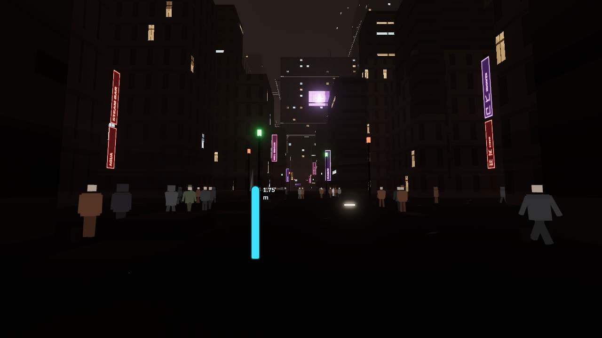

| Item | Measured | Expected | Verdict | Severity | Source |
| --- | --- | --- | --- | --- | --- |
| Façade storey | Panel 3.9 m (22 masses) | 3–4 m storey Panel cell sits in the real storey band. | pass | — | `src/world/windows/facade.ts CELL_H` |
| Façade storey (Masonry) | Masonry 4.8 m (15 masses) | 3–4 m floor (bible office/civic band is 4.0–5.5 m) Masonry is inside the bible office/civic module and above a 3–4 m floor. | watch | medium | `src/world/windows/facade.ts CELL_H` |
| Façade storey (Deco) | Deco 5.6 m (7 masses) | 3–4 m floor; bible office/civic band stops at 5.5 m Deco sits just past the office band. | watch | medium | `src/world/windows/facade.ts CELL_H` |
| Sampled mass height | 34.5 m median of 44 detail-0 boxes | 40–110 m fabric band Sample range 5 m to 61.5 m. Heroes are landmarks and are not in this fabric sample. | watch | low | `generateFabric visual height (slope sink of 8 m removed)` |
| Flat sign panel | 1.15 m median (9 in sample) | 0.6–4 m street panel | pass | — | `fabric Sign.h kind 0` |
| Blade sign | 9 m median (92 in sample) | 2–8 m blade | watch | low | `fabric Sign.h kind 1` |
| Street width | 18 m | bible 18 m | pass | — | `src/data/city-layout.json grid.street` |
| Driving-line offset | 3.15 m from the centreline (canyon) | bible ±3.15 m; not a 3.5–3.7 m painted lane The constant is metres from the street centreline to the car. Freeway spacing is the painted-lane module. | pass | — | `streetLattices().lane` |
| Implied sidewalk | 4.05 m | 1.5–4.5 m street/2 − driving line − 1.8 m (half of a 3.6 m lane centred on the driving line). The driving line is not a painted lane width. | pass | — | `derived: street/2 − lane − 1.8` |
| Freeway lane spacing | I-110 3.5 m × 3; US-101 3.45 m × 3; I-10 3.55 m × 3; I-405 3.6 m × 2; I-5 3.6 m × 2; I-105 3.6 m × 2; I-710 3.6 m × 2 | 3.5–3.7 m I-110 is 3.5, I-10 is 3.55, I-405 / I-5 / I-105 / I-710 are 3.6. US-101 is 3.45, a tenth under the band. | watch | low | `src/vehicles/trafficBuiltins.ts spacing` |
| Signal pole | 5.45 m pole, head centred at 5.52 m | bible about 5.5 m; real signal about 4.5–6.5 m | pass | — | `src/vehicles/groundTraffic.ts BoxGeometry 0.16 × 5.45` |
| Quality rescale | none | metres stay put at every tier detailScale, farRadius, crowd count and groundTraffic change. The city is not shrunk for a phone. | pass | — | `src/core/quality.ts settingsFor` |
| Compact car, visual roof | 1.03 m roof, 4.2 m long, 1.82 m wide | real sedan roof 1.40–1.55 m, length 4.5–5.6 m Traffic length MESH_LEN.car is 4.35 m. The bible compact car is 4.2 × 1.82 × 0.9 m. The mesh matches that length and width; the roof is 1.03 m against the bible 0.9 m and a real roof near 1.45 m. | fail | high | `src/vehicles/vehicleModels.ts car boxes` |
| Compact car vs bible height | 1.03 m | bible 0.9 m The authored height is the short one. Real-world scale is the row above. | watch | low | `docs/BIBLE.md ground vehicles; vehicleModels.ts` |
| Canyon rickshaw scale | 1.26 m roof, 3.04 m long, 0.91 m wide (28% of cars) | rickshaw about 1.4–1.8 m tall and 2.5–3.2 m long Applied when the edge kind is canyon or the driving line is under 5 m. | watch | medium | `src/vehicles/groundTraffic.ts style() sx 0.5 sy 1.22 sz 0.7` |
| Traffic spinner | 5 m long, 2.66 m wide, 1.51 m high | length 4.5–5.6 m; cabin about 1.2–1.8 m Authored SPINNER_DIMS are 5.0 × 2.3 × 1.45 m. Pods reach about 2.66 m. The player craft is the glTF spinner; traffic uses this procedural mesh. Width vs the 2.3 m field is 2.66 m. | pass | — | `src/vehicles/spinnerModel.ts spinnerGeometries / SPINNER_DIMS` |
| Pedestrian head | 1.8 m | 1.60–1.90 m One shared mesh. WalkController HUMAN is eye 1.7 m, height 1.8 m, walk 1.5 m/s, run 4.2 m/s. | pass | — | `src/districts/little-tokyo-market/crowd.ts personGeometry` |
| Pedestrian hat | 1.92 m | 1.60–1.90 m to the top of the head; a hat may add a little The crown box is centred at 1.86 m with height 0.12 m. | watch | low | `src/districts/little-tokyo-market/crowd.ts hat box` |
| Crowd share | 0.72 | registered crowd using the 1.80 m mesh Share scales how many of the tier budget this district keeps. It does not scale the mesh. | pass | — | `registerCrowdSource share 0.72` |
| Shared street lamp | suppressed (NO_LAMPS) | a 6–12 m pole where the district has no replacement The shared pole is 7.5 m (head near the top). This district is in NO_LAMPS, so that pole is not drawn. | watch | low | `src/districts/_shared/streetLamps.ts NO_LAMPS / POLE_H 7.5` |
| Bradbury street door | 7.2 m high, 4.8 m wide | human door 2.0–2.4 m Heritage portal on the street face. | fail | high | `src/districts/historic-core/bradbury.ts DOOR_H / DOOR` |
| Bradbury service door | 2.8 m high, 2.1 m wide | 2.0–2.4 m | fail | high | `src/districts/historic-core/interior.ts service door y −0.2 to 2.6, hw 1.05` |
| Bradbury masonry front | 22.4 m | JSON height 27 m is the jacket, not this stone front JACKET_H is 27 m and matches the JSON height. The stone front the player reads from the street is 22.4 m. | watch | medium | `src/districts/historic-core/bradbury.ts H` |
| Bradbury jacket | 27 m | JSON height 27 m | pass | — | `src/districts/historic-core/bradbury.ts JACKET_H` |
| Footbridge stair rise | 0.35 m | real 0.15–0.18 m Bible records 32 × 0.35 m. That lore row is the next one. | fail | high | `src/districts/historic-core/bridge.ts DECK/STEPS` |
| Footbridge stair vs bible | 0.35 m × 32, tread 0.34 m | bible 32 × 0.35 m Authored flight matches the bible and not a real riser. | pass | — | `src/districts/historic-core/bridge.ts` |
| Footbridge tread | 0.34 m | 0.25–0.32 m | watch | medium | `src/districts/historic-core/bridge.ts TREAD` |
| Footbridge rail | 1.05 m | 0.90–1.10 m | pass | — | `src/districts/historic-core/bridge.ts rail box h 1.05` |
| Footbridge deck | 11.2 m | JSON / bible deck 11.2 m | pass | — | `src/districts/historic-core/bridge.ts DECK` |
| Dancer hologram | 68 m tall, 15 m wide | a pedestrian is 1.6–1.9 m; this is a billboard Bible: the figure is not on the deck. It stands in the Broadway intersection. Not a person mesh. | watch | low | `src/districts/historic-core/bridge.ts DANCER_H` |
| Parked rickshaw prop | 0.725 m above the ground | rickshaw body about 1.2–1.6 m Kit boxes are centered. y is the ground, so half of the 1.45 m box is under the street. | fail | high | `src/districts/historic-core/dress.ts sy 1.45 at y ground` |
| Canyon bollard | 0.425 m above the ground | bollard 0.6–1.0 m Same centered-mesh placement. Visible height is sy/2. | watch | medium | `src/districts/historic-core/dress.ts cyl sy 0.85 at y ground` |
| Bradbury JSON height | 27 m | jacket 27 m | pass | — | `city-layout.json bradbury-building` |
| Bridge JSON deck | 11.2 m | 11.2 m | pass | — | `city-layout.json canyon-bridge` |
| Megatower 6 (blade) visual top | 552 m | bible roof 520 m + mast 32 m = 552 m JSON height is 520 m. The mast is added on top of that roof. Sited in historic-core. | pass | — | `src/districts/_shared/megatower/tower.ts buildTower parts.top` |
| Megatower 6 (blade) height field | JSON 520 m, mesh top 552 m | the height field is the roof; the mast is extra and listed in the bible Anyone reading only the height field will undershoot the silhouette by the mast. | watch | low | `src/data/city-layout.json height; tower.ts mast()` |

### 7. Wallace Corporation Precinct (Vernon)

`wallace-vernon` · archetype `wallace-vernon` · 17 pass, 10 watch, 2 fail.
Sample around (658, 3546), ground 0.0 m, 6 blocks, 317 boxes, 0 signs.

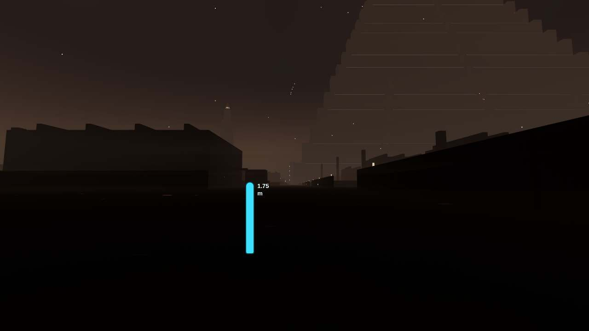

| Item | Measured | Expected | Verdict | Severity | Source |
| --- | --- | --- | --- | --- | --- |
| Façade storey | Solid 3.2 m (14 masses) | 3–4 m storey Solid cell sits in the real storey band. | pass | — | `src/world/windows/facade.ts CELL_H` |
| Sampled mass height | 21.8 m median of 18 detail-0 boxes | 15–60 m fabric band Sample range 10.1 m to 50.1 m. Heroes are landmarks and are not in this fabric sample. | pass | — | `generateFabric visual height (slope sink of 8 m removed)` |
| Street signs | none in the fabric sample | panels about 0.6–4 m The sample window had no sign records. Landmark signs are listed with the landmark. | watch | low | `fabric Sign.h` |
| Street width | 30 m | bible 30 m | pass | — | `src/data/city-layout.json grid.street` |
| Driving line | no lattice | a centreline offset where cars are spawned No cars are placed on a driving line here. | pass | — | `src/vehicles/trafficRegistry.ts` |
| Freeway lane spacing | I-110 3.5 m × 3; US-101 3.45 m × 3; I-10 3.55 m × 3; I-405 3.6 m × 2; I-5 3.6 m × 2; I-105 3.6 m × 2; I-710 3.6 m × 2 | 3.5–3.7 m I-110 is 3.5, I-10 is 3.55, I-405 / I-5 / I-105 / I-710 are 3.6. US-101 is 3.45, a tenth under the band. | watch | low | `src/vehicles/trafficBuiltins.ts spacing` |
| Signal pole | 5.45 m pole, head centred at 5.52 m | bible about 5.5 m; real signal about 4.5–6.5 m | pass | — | `src/vehicles/groundTraffic.ts BoxGeometry 0.16 × 5.45` |
| Quality rescale | none | metres stay put at every tier detailScale, farRadius, crowd count and groundTraffic change. The city is not shrunk for a phone. | pass | — | `src/core/quality.ts settingsFor` |
| Ground vehicles | no street graph | cars only where a lattice exists This district never receives ground-traffic edges. | pass | — | `src/vehicles/trafficRegistry.ts NO_STREET_GRAPH` |
| Traffic spinner | 5 m long, 2.66 m wide, 1.51 m high | length 4.5–5.6 m; cabin about 1.2–1.8 m Authored SPINNER_DIMS are 5.0 × 2.3 × 1.45 m. Pods reach about 2.66 m. The player craft is the glTF spinner; traffic uses this procedural mesh. Width vs the 2.3 m field is 2.66 m. | pass | — | `src/vehicles/spinnerModel.ts spinnerGeometries / SPINNER_DIMS` |
| Pedestrian head | 1.8 m | 1.60–1.90 m One shared mesh. WalkController HUMAN is eye 1.7 m, height 1.8 m, walk 1.5 m/s, run 4.2 m/s. | pass | — | `src/districts/little-tokyo-market/crowd.ts personGeometry` |
| Pedestrian hat | 1.92 m | 1.60–1.90 m to the top of the head; a hat may add a little The crown box is centred at 1.86 m with height 0.12 m. | watch | low | `src/districts/little-tokyo-market/crowd.ts hat box` |
| Crowd share | not registered (0) | a street crowd where people should read No source calls registerCrowdSource for this district, so the player sees none of the 1.80 m mesh here. | watch | medium | `src/districts/little-tokyo-market/crowd.ts registerCrowdSource` |
| Shared street lamp | suppressed (NO_LAMPS) | a 6–12 m pole where the district has no replacement The shared pole is 7.5 m (head near the top). This district is in NO_LAMPS, so that pole is not drawn. | watch | low | `src/districts/_shared/streetLamps.ts NO_LAMPS / POLE_H 7.5` |
| Court door | 2.3 m × 2.7 m | 2.0–2.4 m Human door in front of the portal, on the 3 m deck. | watch | medium | `src/districts/wallace-vernon/spec.ts COURT.doorH` |
| Court stair rise | 0.375 m | real 0.15–0.18 m 8 risers, tread 2.4 m. Bible allows this under the 0.45 m step-up. | fail | high | `src/districts/wallace-vernon/spec.ts COURT.stairRise` |
| Court stair vs bible | 0.375 m | bible under 0.45 m | pass | — | `src/districts/wallace-vernon/spec.ts COURT.stairRise` |
| Court tread | 2.4 m | 0.25–0.32 m A ceremonial run, much deeper than a step. | fail | high | `src/districts/wallace-vernon/spec.ts COURT.stairTread` |
| Causeway bridge rail | 1.05 m | 0.90–1.10 m | pass | — | `src/districts/wallace-vernon/plaza.ts rail h 1.05` |
| Pyramid portal | 288 m wide, 195.8 m tall | monumental entrance, not a 2.0–2.4 m door The court door in front of it is the human opening. This glow is the north portal. | watch | medium | `src/districts/_shared/megatower/pyramid.ts portalW / portalH` |
| Wallace Corporation Earth Headquarters visual top | 3610 m | 3500 m roof + 110 m mast = 3610 m Bible calls the pyramid 3.5 km and also describes the 110 m mast. The mesh tip is the sum. Sited in wallace-vernon. | pass | — | `src/districts/_shared/megatower/pyramid.ts parts.top` |
| Wallace Corporation Earth Headquarters height field | JSON 3500 m, mesh top 3610 m | published height versus the silhouette | watch | low | `city-layout.json height; pyramid.ts` |
| Wallace Tower A mast | inside published 1400 m (36 m mast subtracted before the body) | bible 1400 m with a 36 m mast inside that height Sited in east-la, just outside the Wallace polygon if that is not the home district. | pass | — | `src/districts/wallace-vernon/satellite.ts bodyH = height − crown − mast` |
| Wallace Tower B mast | inside published 1250 m (36 m mast subtracted before the body) | bible 1250 m with a 36 m mast inside that height Sited in southeast-industrial, just outside the Wallace polygon if that is not the home district. | pass | — | `src/districts/wallace-vernon/satellite.ts bodyH = height − crown − mast` |
| Wallace Tower C mast | inside published 1100 m (36 m mast subtracted before the body) | bible 1100 m with a 36 m mast inside that height Sited in basin-sprawl, just outside the Wallace polygon if that is not the home district. | pass | — | `src/districts/wallace-vernon/satellite.ts bodyH = height − crown − mast` |
| Old Corporate Pyramid (north) visual top | 1070 m | published 1000 m + 70 m spire = 1070 m Bible height is the penthouse. The spire is parts.top = height + 70. Flame stacks sit near height + 46. Sited in southeast-industrial. | pass | — | `src/districts/_shared/megatower/pyramid.ts parts.top` |
| Old Corporate Pyramid (north) height field | JSON 1000 m, mesh top 1070 m | published height versus the silhouette | watch | low | `city-layout.json height; pyramid.ts` |
| Old Corporate Pyramid (south) visual top | 930 m | published 860 m + 70 m spire = 930 m Bible height is the penthouse. The spire is parts.top = height + 70. Flame stacks sit near height + 46. Sited in southeast-industrial. | pass | — | `src/districts/_shared/megatower/pyramid.ts parts.top` |
| Old Corporate Pyramid (south) height field | JSON 860 m, mesh top 930 m | published height versus the silhouette | watch | low | `city-layout.json height; pyramid.ts` |

### 8. K's Megablock

`k-megablock` · archetype `k-megablock` · 19 pass, 5 watch, 0 fail.
Sample around (11040, 21418), ground 0.0 m, 6 blocks, 168 boxes, 12 signs.

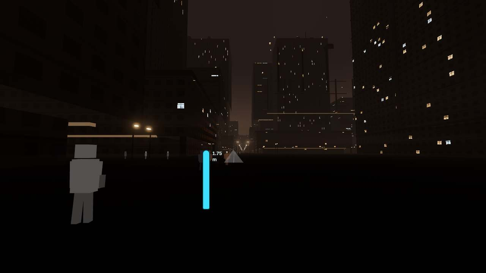

| Item | Measured | Expected | Verdict | Severity | Source |
| --- | --- | --- | --- | --- | --- |
| Façade storey | Ribbed 3.5 m (6 masses) | 3–4 m storey Ribbed cell sits in the real storey band. | pass | — | `src/world/windows/facade.ts CELL_H` |
| Sampled mass height | 43.7 m median of 10 detail-0 boxes | 60–185 m fabric band Sample range 6.4 m to 113.9 m. Heroes are landmarks and are not in this fabric sample. | watch | low | `generateFabric visual height (slope sink of 8 m removed)` |
| Flat sign panel | 1.05 m median (12 in sample) | 0.6–4 m street panel | pass | — | `fabric Sign.h kind 0` |
| Street width | 12 m | bible 12 m | pass | — | `src/data/city-layout.json grid.street` |
| Driving line | no lattice | a centreline offset where cars are spawned No cars are placed on a driving line here. | pass | — | `src/vehicles/trafficRegistry.ts` |
| Freeway lane spacing | I-110 3.5 m × 3; US-101 3.45 m × 3; I-10 3.55 m × 3; I-405 3.6 m × 2; I-5 3.6 m × 2; I-105 3.6 m × 2; I-710 3.6 m × 2 | 3.5–3.7 m I-110 is 3.5, I-10 is 3.55, I-405 / I-5 / I-105 / I-710 are 3.6. US-101 is 3.45, a tenth under the band. | watch | low | `src/vehicles/trafficBuiltins.ts spacing` |
| Signal pole | 5.45 m pole, head centred at 5.52 m | bible about 5.5 m; real signal about 4.5–6.5 m | pass | — | `src/vehicles/groundTraffic.ts BoxGeometry 0.16 × 5.45` |
| Quality rescale | none | metres stay put at every tier detailScale, farRadius, crowd count and groundTraffic change. The city is not shrunk for a phone. | pass | — | `src/core/quality.ts settingsFor` |
| Ground vehicles | no street graph | cars only where a lattice exists This district never receives ground-traffic edges. | pass | — | `src/vehicles/trafficRegistry.ts NO_STREET_GRAPH` |
| Traffic spinner | 5 m long, 2.66 m wide, 1.51 m high | length 4.5–5.6 m; cabin about 1.2–1.8 m Authored SPINNER_DIMS are 5.0 × 2.3 × 1.45 m. Pods reach about 2.66 m. The player craft is the glTF spinner; traffic uses this procedural mesh. Width vs the 2.3 m field is 2.66 m. | pass | — | `src/vehicles/spinnerModel.ts spinnerGeometries / SPINNER_DIMS` |
| Pedestrian head | 1.8 m | 1.60–1.90 m One shared mesh. WalkController HUMAN is eye 1.7 m, height 1.8 m, walk 1.5 m/s, run 4.2 m/s. | pass | — | `src/districts/little-tokyo-market/crowd.ts personGeometry` |
| Pedestrian hat | 1.92 m | 1.60–1.90 m to the top of the head; a hat may add a little The crown box is centred at 1.86 m with height 0.12 m. | watch | low | `src/districts/little-tokyo-market/crowd.ts hat box` |
| Crowd share | 0.32 | registered crowd using the 1.80 m mesh Share scales how many of the tier budget this district keeps. It does not scale the mesh. | pass | — | `registerCrowdSource share 0.32` |
| Shared street lamp | 7.5 m pole | arterial pole 6–12 m Spacing 32 m. Curb inset is min(2.2, street × 0.18). The mesh is translated so the pole stands on the ground. | pass | — | `src/districts/_shared/streetLamps.ts POLE_H` |
| Lobby back door | 1.35 × 2.2 m | 2.0–2.4 m high | pass | — | `src/districts/k-megablock/spec.ts LOBBY.backDoor` |
| Apartment template door | 0.82 m × 2.18 m | 2.0–2.4 m high, about 0.8–1.0 m wide Corridor is 2.38 m, so the template caps the leaf at min(2.2, height − 0.2). Width is min(1.4, width − 0.3) = 0.82 m. | pass | — | `src/world/interiors/template.ts doorH; k spec APARTMENT.corridor` |
| Lift door | 2.05 × 2.32 m | lift opening about 2.0–2.3 m | watch | low | `src/districts/k-megablock/spec.ts LIFT` |
| Slab height | 185 m | JSON / bible 185 m | pass | — | `src/districts/k-megablock/spec.ts SLAB_H` |
| K's floor | 136 m (floor 40 × 3.4 m) | bible 136 m | pass | — | `src/districts/k-megablock/spec.ts K_Y` |
| Roof vs 54 modules | 183.6 m vs slab 185 m | a whole number of 3.4 m floors 54 × 3.4 = 183.6 m. The roof is 185 m, so the last band is not one module. | watch | low | `src/districts/k-megablock/spec.ts FLOOR / SLAB_H` |
| Floor module | 3.4 m | residential 3.1–3.6 m (bible) and about 3–4 m | pass | — | `src/districts/k-megablock/spec.ts FLOOR` |
| Corridor headroom | 2.4 m | a corridor can be 2.4 m | pass | — | `src/districts/k-megablock/spec.ts CORRIDOR.height` |
| Head house door | 1.2 × 2.15 m | 2.0–2.4 m | pass | — | `src/districts/k-megablock/spec.ts HEAD.backDoor` |
| K slab JSON height | 185 m | bible 185 m | pass | — | `city-layout.json k-megablock-tower` |

### 9. Arts District Works

`arts-district` · archetype `industrial-dense` · 11 pass, 4 watch, 0 fail.
Sample around (825, 1264), ground 0.0 m, 6 blocks, 59 boxes, 1 signs.

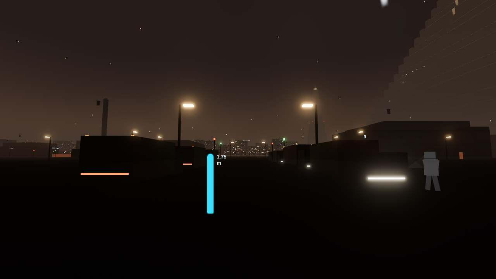

| Item | Measured | Expected | Verdict | Severity | Source |
| --- | --- | --- | --- | --- | --- |
| Façade storey | Industrial 7 m (12 masses) | 3–4 m if it reads as a floor; 6–8 m is a bay Industrial cell is a bay height, not a residential storey. | watch | medium | `src/world/windows/facade.ts CELL_H` |
| Sampled mass height | 14.6 m median of 13 detail-0 boxes | 10–140 m fabric band Sample range 4.4 m to 123.7 m. Heroes are landmarks and are not in this fabric sample. | pass | — | `generateFabric visual height (slope sink of 8 m removed)` |
| Flat sign panel | 1.4 m median (1 in sample) | 0.6–4 m street panel | pass | — | `fabric Sign.h kind 0` |
| Street width | 20 m | bible 20 m | pass | — | `src/data/city-layout.json grid.street` |
| Driving-line offset | 6.4 m from the centreline | bible ±6.4 m; not a 3.5–3.7 m painted lane The constant is metres from the street centreline to the car. Freeway spacing is the painted-lane module. | pass | — | `streetLattices().lane` |
| Implied sidewalk | 1.8 m | 1.5–4.5 m street/2 − driving line − 1.8 m (half of a 3.6 m lane centred on the driving line). The driving line is not a painted lane width. | pass | — | `derived: street/2 − lane − 1.8` |
| Freeway lane spacing | I-110 3.5 m × 3; US-101 3.45 m × 3; I-10 3.55 m × 3; I-405 3.6 m × 2; I-5 3.6 m × 2; I-105 3.6 m × 2; I-710 3.6 m × 2 | 3.5–3.7 m I-110 is 3.5, I-10 is 3.55, I-405 / I-5 / I-105 / I-710 are 3.6. US-101 is 3.45, a tenth under the band. | watch | low | `src/vehicles/trafficBuiltins.ts spacing` |
| Signal pole | 5.45 m pole, head centred at 5.52 m | bible about 5.5 m; real signal about 4.5–6.5 m | pass | — | `src/vehicles/groundTraffic.ts BoxGeometry 0.16 × 5.45` |
| Quality rescale | none | metres stay put at every tier detailScale, farRadius, crowd count and groundTraffic change. The city is not shrunk for a phone. | pass | — | `src/core/quality.ts settingsFor` |
| Box truck, visual | 2.58 m roof, 7.38 m long | real box truck roof 2.8–3.8 m, length 6–10 m MESH_LEN.box is 7.9 m (bible traffic length). | watch | low | `src/vehicles/vehicleModels.ts box boxes` |
| Traffic spinner | 5 m long, 2.66 m wide, 1.51 m high | length 4.5–5.6 m; cabin about 1.2–1.8 m Authored SPINNER_DIMS are 5.0 × 2.3 × 1.45 m. Pods reach about 2.66 m. The player craft is the glTF spinner; traffic uses this procedural mesh. Width vs the 2.3 m field is 2.66 m. | pass | — | `src/vehicles/spinnerModel.ts spinnerGeometries / SPINNER_DIMS` |
| Pedestrian head | 1.8 m | 1.60–1.90 m One shared mesh. WalkController HUMAN is eye 1.7 m, height 1.8 m, walk 1.5 m/s, run 4.2 m/s. | pass | — | `src/districts/little-tokyo-market/crowd.ts personGeometry` |
| Pedestrian hat | 1.92 m | 1.60–1.90 m to the top of the head; a hat may add a little The crown box is centred at 1.86 m with height 0.12 m. | watch | low | `src/districts/little-tokyo-market/crowd.ts hat box` |
| Crowd share | 0.06 | registered crowd using the 1.80 m mesh Share scales how many of the tier budget this district keeps. It does not scale the mesh. | pass | — | `registerCrowdSource share 0.06` |
| Shared street lamp | 7.5 m pole | arterial pole 6–12 m Spacing 32 m. Curb inset is min(2.2, street × 0.18). The mesh is translated so the pole stands on the ground. | pass | — | `src/districts/_shared/streetLamps.ts POLE_H` |

### 10. Grey Coast (behind the Sea Wall)

`coastal-strip` · archetype `coastal-grey` · 13 pass, 6 watch, 1 fail.
Sample around (-18751, 10637), ground 0.0 m, 6 blocks, 85 boxes, 1 signs.

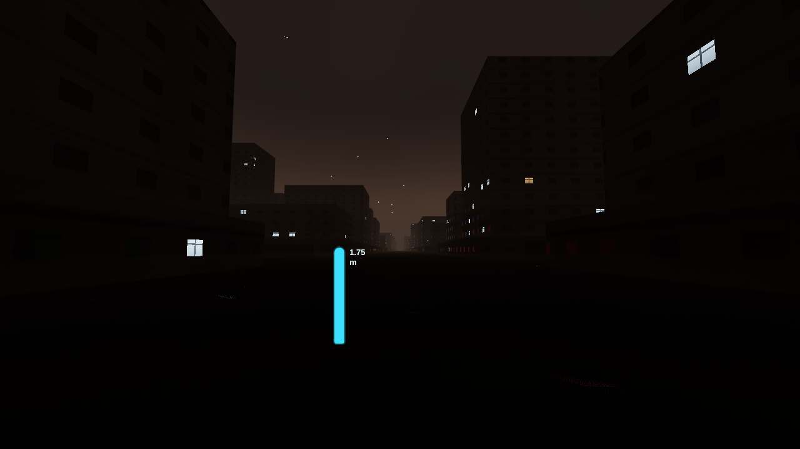

| Item | Measured | Expected | Verdict | Severity | Source |
| --- | --- | --- | --- | --- | --- |
| Façade storey | Coastal 3.4 m (46 masses) | 3–4 m storey Coastal cell sits in the real storey band. | pass | — | `src/world/windows/facade.ts CELL_H` |
| Sampled mass height | 7.6 m median of 46 detail-0 boxes | 15–60 m fabric band Sample range 4.6 m to 53.9 m. Heroes are landmarks and are not in this fabric sample. | watch | low | `generateFabric visual height (slope sink of 8 m removed)` |
| Flat sign panel | 1.05 m median (1 in sample) | 0.6–4 m street panel | pass | — | `fabric Sign.h kind 0` |
| Street width | 20 m | bible 20 m | pass | — | `src/data/city-layout.json grid.street` |
| Driving line | no lattice | a centreline offset where cars are spawned No cars are placed on a driving line here. | pass | — | `src/vehicles/trafficRegistry.ts` |
| Freeway lane spacing | I-110 3.5 m × 3; US-101 3.45 m × 3; I-10 3.55 m × 3; I-405 3.6 m × 2; I-5 3.6 m × 2; I-105 3.6 m × 2; I-710 3.6 m × 2 | 3.5–3.7 m I-110 is 3.5, I-10 is 3.55, I-405 / I-5 / I-105 / I-710 are 3.6. US-101 is 3.45, a tenth under the band. | watch | low | `src/vehicles/trafficBuiltins.ts spacing` |
| Signal pole | 5.45 m pole, head centred at 5.52 m | bible about 5.5 m; real signal about 4.5–6.5 m | pass | — | `src/vehicles/groundTraffic.ts BoxGeometry 0.16 × 5.45` |
| Quality rescale | none | metres stay put at every tier detailScale, farRadius, crowd count and groundTraffic change. The city is not shrunk for a phone. | pass | — | `src/core/quality.ts settingsFor` |
| Ground vehicles | no street graph | cars only where a lattice exists This district never receives ground-traffic edges. | pass | — | `src/vehicles/trafficRegistry.ts NO_STREET_GRAPH` |
| Traffic spinner | 5 m long, 2.66 m wide, 1.51 m high | length 4.5–5.6 m; cabin about 1.2–1.8 m Authored SPINNER_DIMS are 5.0 × 2.3 × 1.45 m. Pods reach about 2.66 m. The player craft is the glTF spinner; traffic uses this procedural mesh. Width vs the 2.3 m field is 2.66 m. | pass | — | `src/vehicles/spinnerModel.ts spinnerGeometries / SPINNER_DIMS` |
| Pedestrian head | 1.8 m | 1.60–1.90 m One shared mesh. WalkController HUMAN is eye 1.7 m, height 1.8 m, walk 1.5 m/s, run 4.2 m/s. | pass | — | `src/districts/little-tokyo-market/crowd.ts personGeometry` |
| Pedestrian hat | 1.92 m | 1.60–1.90 m to the top of the head; a hat may add a little The crown box is centred at 1.86 m with height 0.12 m. | watch | low | `src/districts/little-tokyo-market/crowd.ts hat box` |
| Crowd share | not registered (0) | a street crowd where people should read No source calls registerCrowdSource for this district, so the player sees none of the 1.80 m mesh here. | watch | medium | `src/districts/little-tokyo-market/crowd.ts registerCrowdSource` |
| Shared street lamp | suppressed (NO_LAMPS) | a 6–12 m pole where the district has no replacement The shared pole is 7.5 m (head near the top). This district is in NO_LAMPS, so that pole is not drawn. | watch | low | `src/districts/_shared/streetLamps.ts NO_LAMPS / POLE_H 7.5` |
| Sepulveda wall crest | 90 m | bible 90 m | pass | — | `city-layout.json seaWalls.crestHeight` |
| Sea-wall parapet | 1.15 m × 0.46 m | crest parapet about 0.9–1.3 m Sits on the crest. It is a wall, not a handrail. Bible: 1.15 m, above the 0.45 m step-up. | pass | — | `src/districts/coastal-strip/profile.ts PARAPET_H` |
| Apron stair rise | 0.395 m median, 0.398 m max (210 treads) | real 0.15–0.18 m The comment says treads rise ≤ 0.40 m. The formula can step past that. Bible row follows. | fail | high | `src/districts/coastal-strip/apronPlan.ts rise/round(rise/0.39)` |
| Apron stair vs bible | 0.398 m max | bible ≤ 0.40 m | pass | — | `src/districts/coastal-strip/apronPlan.ts` |
| Terrace rail | 0.98 m to the top of an 0.08 m bar | 0.90–1.10 m | pass | — | `src/districts/coastal-strip/surface.ts rail at t.y+0.9` |
| El Segundo stacks | 147 m tallest of 14 (published 140 m) | bible stacks to 140 m The loop can draw 1.1 × the published height, then a flare sprite 4 m above that. | watch | medium | `src/world/landmarks/Landmarks.ts flare-field h = height × range(0.6, 1.1)` |

### 11. Lakewood / Downey Megablocks

`lakewood-megablocks` · archetype `lakewood-megablocks` · 11 pass, 5 watch, 2 fail.
Sample around (9472, 22026), ground 0.0 m, 6 blocks, 469 boxes, 4 signs.

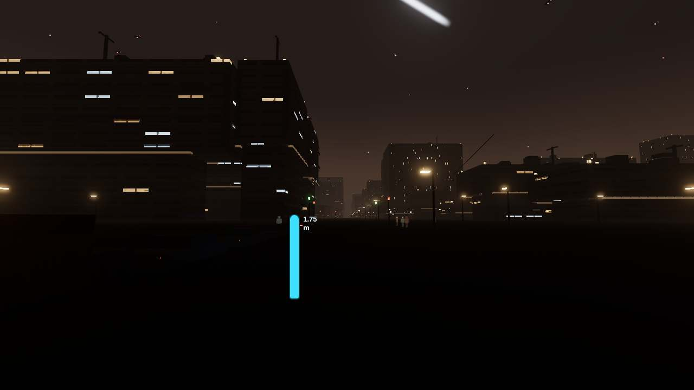

| Item | Measured | Expected | Verdict | Severity | Source |
| --- | --- | --- | --- | --- | --- |
| Façade storey | Panel 3.9 m (16 masses) | 3–4 m storey Panel cell sits in the real storey band. | pass | — | `src/world/windows/facade.ts CELL_H` |
| Façade storey (Coffer) | Coffer 6.6 m (6 masses) | 3–4 m storey Coffer cell is what the façade shader repeats as a floor. | fail | high | `src/world/windows/facade.ts CELL_H` |
| Sampled mass height | 25.3 m median of 22 detail-0 boxes | 20–130 m fabric band Sample range 8.3 m to 55.5 m. Heroes are landmarks and are not in this fabric sample. | pass | — | `generateFabric visual height (slope sink of 8 m removed)` |
| Flat sign panel | 1.08 m median (4 in sample) | 0.6–4 m street panel | pass | — | `fabric Sign.h kind 0` |
| Street width | 26 m | bible 26 m | pass | — | `src/data/city-layout.json grid.street` |
| Driving-line offset | 6.2 m from the centreline | bible ±6.2 m; not a 3.5–3.7 m painted lane The constant is metres from the street centreline to the car. Freeway spacing is the painted-lane module. | pass | — | `streetLattices().lane` |
| Implied sidewalk | 5 m | 1.5–4.5 m street/2 − driving line − 1.8 m (half of a 3.6 m lane centred on the driving line). The driving line is not a painted lane width. | watch | low | `derived: street/2 − lane − 1.8` |
| Freeway lane spacing | I-110 3.5 m × 3; US-101 3.45 m × 3; I-10 3.55 m × 3; I-405 3.6 m × 2; I-5 3.6 m × 2; I-105 3.6 m × 2; I-710 3.6 m × 2 | 3.5–3.7 m I-110 is 3.5, I-10 is 3.55, I-405 / I-5 / I-105 / I-710 are 3.6. US-101 is 3.45, a tenth under the band. | watch | low | `src/vehicles/trafficBuiltins.ts spacing` |
| Signal pole | 5.45 m pole, head centred at 5.52 m | bible about 5.5 m; real signal about 4.5–6.5 m | pass | — | `src/vehicles/groundTraffic.ts BoxGeometry 0.16 × 5.45` |
| Quality rescale | none | metres stay put at every tier detailScale, farRadius, crowd count and groundTraffic change. The city is not shrunk for a phone. | pass | — | `src/core/quality.ts settingsFor` |
| Compact car, visual roof | 1.03 m roof, 4.2 m long, 1.82 m wide | real sedan roof 1.40–1.55 m, length 4.5–5.6 m Traffic length MESH_LEN.car is 4.35 m. The bible compact car is 4.2 × 1.82 × 0.9 m. The mesh matches that length and width; the roof is 1.03 m against the bible 0.9 m and a real roof near 1.45 m. | fail | high | `src/vehicles/vehicleModels.ts car boxes` |
| Compact car vs bible height | 1.03 m | bible 0.9 m The authored height is the short one. Real-world scale is the row above. | watch | low | `docs/BIBLE.md ground vehicles; vehicleModels.ts` |
| Van, visual | 1.73 m roof, 5.05 m long, 2.02 m wide | real van roof 1.8–2.6 m, length 5.0–6.2 m MESH_LEN.van is 5.55 m (bible). Visual length is the merged boxes. | watch | low | `src/vehicles/vehicleModels.ts van boxes` |
| Traffic spinner | 5 m long, 2.66 m wide, 1.51 m high | length 4.5–5.6 m; cabin about 1.2–1.8 m Authored SPINNER_DIMS are 5.0 × 2.3 × 1.45 m. Pods reach about 2.66 m. The player craft is the glTF spinner; traffic uses this procedural mesh. Width vs the 2.3 m field is 2.66 m. | pass | — | `src/vehicles/spinnerModel.ts spinnerGeometries / SPINNER_DIMS` |
| Pedestrian head | 1.8 m | 1.60–1.90 m One shared mesh. WalkController HUMAN is eye 1.7 m, height 1.8 m, walk 1.5 m/s, run 4.2 m/s. | pass | — | `src/districts/little-tokyo-market/crowd.ts personGeometry` |
| Pedestrian hat | 1.92 m | 1.60–1.90 m to the top of the head; a hat may add a little The crown box is centred at 1.86 m with height 0.12 m. | watch | low | `src/districts/little-tokyo-market/crowd.ts hat box` |
| Crowd share | 0.12 | registered crowd using the 1.80 m mesh Share scales how many of the tier budget this district keeps. It does not scale the mesh. | pass | — | `registerCrowdSource share 0.12` |
| Shared street lamp | 7.5 m pole | arterial pole 6–12 m Spacing 32 m. Curb inset is min(2.2, street × 0.18). The mesh is translated so the pole stands on the ground. | pass | — | `src/districts/_shared/streetLamps.ts POLE_H` |

### 12. South LA Megablocks

`south-la-megablocks` · archetype `south-la-megablocks` · 9 pass, 6 watch, 2 fail.
Sample around (-4086, 4224), ground 0.0 m, 6 blocks, 325 boxes, 7 signs.

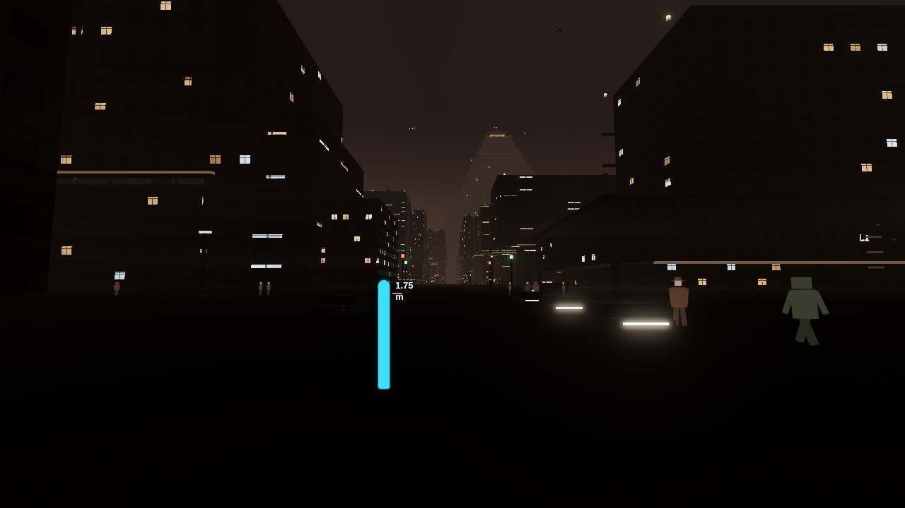

| Item | Measured | Expected | Verdict | Severity | Source |
| --- | --- | --- | --- | --- | --- |
| Façade storey | Coffer 6.6 m (7 masses) | 3–4 m storey Coffer cell is what the façade shader repeats as a floor. | fail | high | `src/world/windows/facade.ts CELL_H` |
| Sampled mass height | 42.5 m median of 15 detail-0 boxes | 20–130 m fabric band Sample range 6.4 m to 69.5 m. Heroes are landmarks and are not in this fabric sample. | pass | — | `generateFabric visual height (slope sink of 8 m removed)` |
| Flat sign panel | 1.05 m median (7 in sample) | 0.6–4 m street panel | pass | — | `fabric Sign.h kind 0` |
| Street width | 24 m | bible 24 m | pass | — | `src/data/city-layout.json grid.street` |
| Driving-line offset | 5.6 m from the centreline | bible ±5.6 m; not a 3.5–3.7 m painted lane The constant is metres from the street centreline to the car. Freeway spacing is the painted-lane module. | pass | — | `streetLattices().lane` |
| Implied sidewalk | 4.6 m | 1.5–4.5 m street/2 − driving line − 1.8 m (half of a 3.6 m lane centred on the driving line). The driving line is not a painted lane width. | watch | low | `derived: street/2 − lane − 1.8` |
| Freeway lane spacing | I-110 3.5 m × 3; US-101 3.45 m × 3; I-10 3.55 m × 3; I-405 3.6 m × 2; I-5 3.6 m × 2; I-105 3.6 m × 2; I-710 3.6 m × 2 | 3.5–3.7 m I-110 is 3.5, I-10 is 3.55, I-405 / I-5 / I-105 / I-710 are 3.6. US-101 is 3.45, a tenth under the band. | watch | low | `src/vehicles/trafficBuiltins.ts spacing` |
| Signal pole | 5.45 m pole, head centred at 5.52 m | bible about 5.5 m; real signal about 4.5–6.5 m | pass | — | `src/vehicles/groundTraffic.ts BoxGeometry 0.16 × 5.45` |
| Quality rescale | none | metres stay put at every tier detailScale, farRadius, crowd count and groundTraffic change. The city is not shrunk for a phone. | pass | — | `src/core/quality.ts settingsFor` |
| Compact car, visual roof | 1.03 m roof, 4.2 m long, 1.82 m wide | real sedan roof 1.40–1.55 m, length 4.5–5.6 m Traffic length MESH_LEN.car is 4.35 m. The bible compact car is 4.2 × 1.82 × 0.9 m. The mesh matches that length and width; the roof is 1.03 m against the bible 0.9 m and a real roof near 1.45 m. | fail | high | `src/vehicles/vehicleModels.ts car boxes` |
| Compact car vs bible height | 1.03 m | bible 0.9 m The authored height is the short one. Real-world scale is the row above. | watch | low | `docs/BIBLE.md ground vehicles; vehicleModels.ts` |
| Van, visual | 1.73 m roof, 5.05 m long, 2.02 m wide | real van roof 1.8–2.6 m, length 5.0–6.2 m MESH_LEN.van is 5.55 m (bible). Visual length is the merged boxes. | watch | low | `src/vehicles/vehicleModels.ts van boxes` |
| Traffic spinner | 5 m long, 2.66 m wide, 1.51 m high | length 4.5–5.6 m; cabin about 1.2–1.8 m Authored SPINNER_DIMS are 5.0 × 2.3 × 1.45 m. Pods reach about 2.66 m. The player craft is the glTF spinner; traffic uses this procedural mesh. Width vs the 2.3 m field is 2.66 m. | pass | — | `src/vehicles/spinnerModel.ts spinnerGeometries / SPINNER_DIMS` |
| Pedestrian head | 1.8 m | 1.60–1.90 m One shared mesh. WalkController HUMAN is eye 1.7 m, height 1.8 m, walk 1.5 m/s, run 4.2 m/s. | pass | — | `src/districts/little-tokyo-market/crowd.ts personGeometry` |
| Pedestrian hat | 1.92 m | 1.60–1.90 m to the top of the head; a hat may add a little The crown box is centred at 1.86 m with height 0.12 m. | watch | low | `src/districts/little-tokyo-market/crowd.ts hat box` |
| Crowd share | 0.2 | registered crowd using the 1.80 m mesh Share scales how many of the tier budget this district keeps. It does not scale the mesh. | pass | — | `registerCrowdSource share 0.2` |
| Shared street lamp | suppressed (NO_LAMPS) | a 6–12 m pole where the district has no replacement The shared pole is 7.5 m (head near the top). This district is in NO_LAMPS, so that pole is not drawn. | watch | low | `src/districts/_shared/streetLamps.ts NO_LAMPS / POLE_H 7.5` |

### 13. Westside Sprawl (Mid-Wilshire to Culver)

`westside` · archetype `westside-sprawl` · 12 pass, 4 watch, 1 fail.
Sample around (-16399, 973), ground 0.0 m, 6 blocks, 377 boxes, 2 signs.

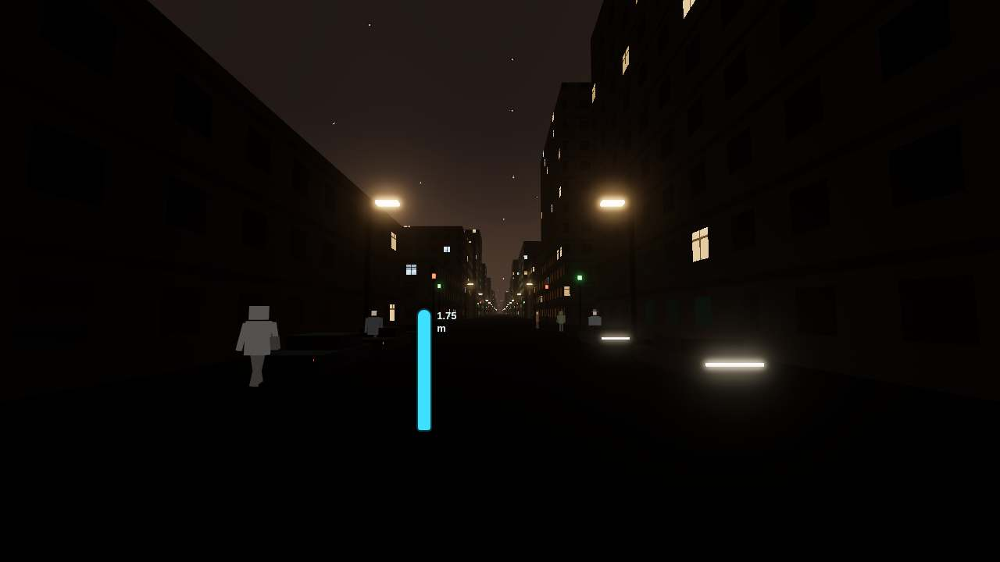

| Item | Measured | Expected | Verdict | Severity | Source |
| --- | --- | --- | --- | --- | --- |
| Façade storey | Sprawl 3.2 m (56 masses) | 3–4 m storey Sprawl cell sits in the real storey band. | pass | — | `src/world/windows/facade.ts CELL_H` |
| Sampled mass height | 23.8 m median of 59 detail-0 boxes | 10.2–57.8 m fabric band Sample range 6.8 m to 40.8 m. Heroes are landmarks and are not in this fabric sample. | pass | — | `generateFabric visual height (slope sink of 8 m removed)` |
| Flat sign panel | 1.12 m median (2 in sample) | 0.6–4 m street panel | pass | — | `fabric Sign.h kind 0` |
| Street width | 18 m | bible 18 m | pass | — | `src/data/city-layout.json grid.street` |
| Driving-line offset | 5.4 m from the centreline | bible ±5.4 m; not a 3.5–3.7 m painted lane The constant is metres from the street centreline to the car. Freeway spacing is the painted-lane module. | pass | — | `streetLattices().lane` |
| Implied sidewalk | 1.8 m | 1.5–4.5 m street/2 − driving line − 1.8 m (half of a 3.6 m lane centred on the driving line). The driving line is not a painted lane width. | pass | — | `derived: street/2 − lane − 1.8` |
| Freeway lane spacing | I-110 3.5 m × 3; US-101 3.45 m × 3; I-10 3.55 m × 3; I-405 3.6 m × 2; I-5 3.6 m × 2; I-105 3.6 m × 2; I-710 3.6 m × 2 | 3.5–3.7 m I-110 is 3.5, I-10 is 3.55, I-405 / I-5 / I-105 / I-710 are 3.6. US-101 is 3.45, a tenth under the band. | watch | low | `src/vehicles/trafficBuiltins.ts spacing` |
| Signal pole | 5.45 m pole, head centred at 5.52 m | bible about 5.5 m; real signal about 4.5–6.5 m | pass | — | `src/vehicles/groundTraffic.ts BoxGeometry 0.16 × 5.45` |
| Quality rescale | none | metres stay put at every tier detailScale, farRadius, crowd count and groundTraffic change. The city is not shrunk for a phone. | pass | — | `src/core/quality.ts settingsFor` |
| Compact car, visual roof | 1.03 m roof, 4.2 m long, 1.82 m wide | real sedan roof 1.40–1.55 m, length 4.5–5.6 m Traffic length MESH_LEN.car is 4.35 m. The bible compact car is 4.2 × 1.82 × 0.9 m. The mesh matches that length and width; the roof is 1.03 m against the bible 0.9 m and a real roof near 1.45 m. | fail | high | `src/vehicles/vehicleModels.ts car boxes` |
| Compact car vs bible height | 1.03 m | bible 0.9 m The authored height is the short one. Real-world scale is the row above. | watch | low | `docs/BIBLE.md ground vehicles; vehicleModels.ts` |
| Van, visual | 1.73 m roof, 5.05 m long, 2.02 m wide | real van roof 1.8–2.6 m, length 5.0–6.2 m MESH_LEN.van is 5.55 m (bible). Visual length is the merged boxes. | watch | low | `src/vehicles/vehicleModels.ts van boxes` |
| Traffic spinner | 5 m long, 2.66 m wide, 1.51 m high | length 4.5–5.6 m; cabin about 1.2–1.8 m Authored SPINNER_DIMS are 5.0 × 2.3 × 1.45 m. Pods reach about 2.66 m. The player craft is the glTF spinner; traffic uses this procedural mesh. Width vs the 2.3 m field is 2.66 m. | pass | — | `src/vehicles/spinnerModel.ts spinnerGeometries / SPINNER_DIMS` |
| Pedestrian head | 1.8 m | 1.60–1.90 m One shared mesh. WalkController HUMAN is eye 1.7 m, height 1.8 m, walk 1.5 m/s, run 4.2 m/s. | pass | — | `src/districts/little-tokyo-market/crowd.ts personGeometry` |
| Pedestrian hat | 1.92 m | 1.60–1.90 m to the top of the head; a hat may add a little The crown box is centred at 1.86 m with height 0.12 m. | watch | low | `src/districts/little-tokyo-market/crowd.ts hat box` |
| Crowd share | 0.14 | registered crowd using the 1.80 m mesh Share scales how many of the tier budget this district keeps. It does not scale the mesh. | pass | — | `registerCrowdSource share 0.14` |
| Shared street lamp | 7.5 m pole | arterial pole 6–12 m Spacing 32 m. Curb inset is min(2.2, street × 0.18). The mesh is translated so the pole stands on the ground. | pass | — | `src/districts/_shared/streetLamps.ts POLE_H` |

### 14. Basin Sprawl

`basin-sprawl` · archetype `basin-sprawl` · 12 pass, 5 watch, 1 fail.
Sample around (-10070, 11880), ground 0.0 m, 6 blocks, 484 boxes, 32 signs.

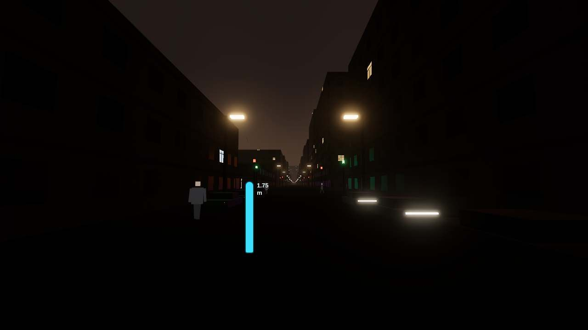

| Item | Measured | Expected | Verdict | Severity | Source |
| --- | --- | --- | --- | --- | --- |
| Façade storey | Sprawl 3.2 m (62 masses) | 3–4 m storey Sprawl cell sits in the real storey band. | pass | — | `src/world/windows/facade.ts CELL_H` |
| Sampled mass height | 17 m median of 62 detail-0 boxes | 6.8–34 m fabric band Sample range 6.8 m to 34 m. Heroes are landmarks and are not in this fabric sample. | pass | — | `generateFabric visual height (slope sink of 8 m removed)` |
| Flat sign panel | 1.2 m median (32 in sample) | 0.6–4 m street panel | pass | — | `fabric Sign.h kind 0` |
| Street width | 16 m | bible 16 m | pass | — | `src/data/city-layout.json grid.street` |
| Driving-line offset | 5.1 m from the centreline | bible ±5.1 m; not a 3.5–3.7 m painted lane The constant is metres from the street centreline to the car. Freeway spacing is the painted-lane module. | pass | — | `streetLattices().lane` |
| Implied sidewalk | 1.1 m | 1.5–4.5 m street/2 − driving line − 1.8 m (half of a 3.6 m lane centred on the driving line). The driving line is not a painted lane width. | watch | low | `derived: street/2 − lane − 1.8` |
| Freeway lane spacing | I-110 3.5 m × 3; US-101 3.45 m × 3; I-10 3.55 m × 3; I-405 3.6 m × 2; I-5 3.6 m × 2; I-105 3.6 m × 2; I-710 3.6 m × 2 | 3.5–3.7 m I-110 is 3.5, I-10 is 3.55, I-405 / I-5 / I-105 / I-710 are 3.6. US-101 is 3.45, a tenth under the band. | watch | low | `src/vehicles/trafficBuiltins.ts spacing` |
| Signal pole | 5.45 m pole, head centred at 5.52 m | bible about 5.5 m; real signal about 4.5–6.5 m | pass | — | `src/vehicles/groundTraffic.ts BoxGeometry 0.16 × 5.45` |
| Quality rescale | none | metres stay put at every tier detailScale, farRadius, crowd count and groundTraffic change. The city is not shrunk for a phone. | pass | — | `src/core/quality.ts settingsFor` |
| Compact car, visual roof | 1.03 m roof, 4.2 m long, 1.82 m wide | real sedan roof 1.40–1.55 m, length 4.5–5.6 m Traffic length MESH_LEN.car is 4.35 m. The bible compact car is 4.2 × 1.82 × 0.9 m. The mesh matches that length and width; the roof is 1.03 m against the bible 0.9 m and a real roof near 1.45 m. | fail | high | `src/vehicles/vehicleModels.ts car boxes` |
| Compact car vs bible height | 1.03 m | bible 0.9 m The authored height is the short one. Real-world scale is the row above. | watch | low | `docs/BIBLE.md ground vehicles; vehicleModels.ts` |
| Van, visual | 1.73 m roof, 5.05 m long, 2.02 m wide | real van roof 1.8–2.6 m, length 5.0–6.2 m MESH_LEN.van is 5.55 m (bible). Visual length is the merged boxes. | watch | low | `src/vehicles/vehicleModels.ts van boxes` |
| Traffic spinner | 5 m long, 2.66 m wide, 1.51 m high | length 4.5–5.6 m; cabin about 1.2–1.8 m Authored SPINNER_DIMS are 5.0 × 2.3 × 1.45 m. Pods reach about 2.66 m. The player craft is the glTF spinner; traffic uses this procedural mesh. Width vs the 2.3 m field is 2.66 m. | pass | — | `src/vehicles/spinnerModel.ts spinnerGeometries / SPINNER_DIMS` |
| Pedestrian head | 1.8 m | 1.60–1.90 m One shared mesh. WalkController HUMAN is eye 1.7 m, height 1.8 m, walk 1.5 m/s, run 4.2 m/s. | pass | — | `src/districts/little-tokyo-market/crowd.ts personGeometry` |
| Pedestrian hat | 1.92 m | 1.60–1.90 m to the top of the head; a hat may add a little The crown box is centred at 1.86 m with height 0.12 m. | watch | low | `src/districts/little-tokyo-market/crowd.ts hat box` |
| Crowd share | 0.07 | registered crowd using the 1.80 m mesh Share scales how many of the tier budget this district keeps. It does not scale the mesh. | pass | — | `registerCrowdSource share 0.07` |
| Shared street lamp | 7.5 m pole | arterial pole 6–12 m Spacing 32 m. Curb inset is min(2.2, street × 0.18). The mesh is translated so the pole stands on the ground. | pass | — | `src/districts/_shared/streetLamps.ts POLE_H` |
| Wallace Tower C mast | inside published 1100 m (36 m mast subtracted before the body) | bible 1100 m with a 36 m mast inside that height Sited in basin-sprawl, just outside the Wallace polygon if that is not the home district. | pass | — | `src/districts/wallace-vernon/satellite.ts bodyH = height − crown − mast` |

### 15. Southeast Refinery Belt

`southeast-industrial` · archetype `southeast-refinery` · 12 pass, 9 watch, 0 fail.
Sample around (6545, 4608), ground 0.0 m, 6 blocks, 58 boxes, 0 signs.

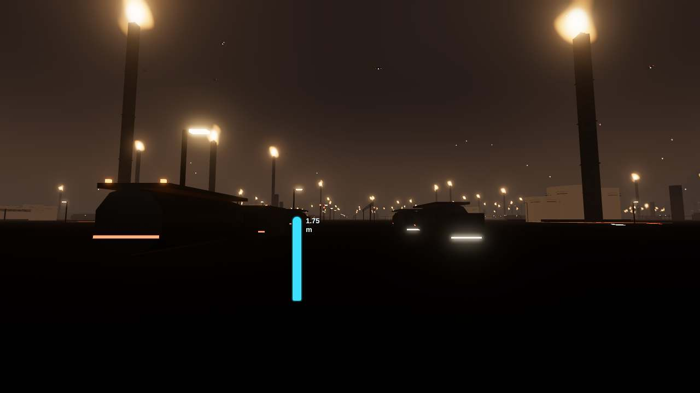

| Item | Measured | Expected | Verdict | Severity | Source |
| --- | --- | --- | --- | --- | --- |
| Façade storey | Industrial 7 m (14 masses) | 3–4 m if it reads as a floor; 6–8 m is a bay Industrial cell is a bay height, not a residential storey. | watch | medium | `src/world/windows/facade.ts CELL_H` |
| Sampled mass height | 16 m median of 14 detail-0 boxes | 10–140 m fabric band Sample range 6.9 m to 139.1 m. Heroes are landmarks and are not in this fabric sample. | pass | — | `generateFabric visual height (slope sink of 8 m removed)` |
| Street signs | none in the fabric sample | panels about 0.6–4 m The sample window had no sign records. Landmark signs are listed with the landmark. | watch | low | `fabric Sign.h` |
| Street width | 26 m | bible 26 m | pass | — | `src/data/city-layout.json grid.street` |
| Driving-line offset | 6.6 m from the centreline | bible ±6.6 m; not a 3.5–3.7 m painted lane The constant is metres from the street centreline to the car. Freeway spacing is the painted-lane module. | pass | — | `streetLattices().lane` |
| Implied sidewalk | 4.6 m | 1.5–4.5 m street/2 − driving line − 1.8 m (half of a 3.6 m lane centred on the driving line). The driving line is not a painted lane width. | watch | low | `derived: street/2 − lane − 1.8` |
| Freeway lane spacing | I-110 3.5 m × 3; US-101 3.45 m × 3; I-10 3.55 m × 3; I-405 3.6 m × 2; I-5 3.6 m × 2; I-105 3.6 m × 2; I-710 3.6 m × 2 | 3.5–3.7 m I-110 is 3.5, I-10 is 3.55, I-405 / I-5 / I-105 / I-710 are 3.6. US-101 is 3.45, a tenth under the band. | watch | low | `src/vehicles/trafficBuiltins.ts spacing` |
| Signal pole | 5.45 m pole, head centred at 5.52 m | bible about 5.5 m; real signal about 4.5–6.5 m | pass | — | `src/vehicles/groundTraffic.ts BoxGeometry 0.16 × 5.45` |
| Quality rescale | none | metres stay put at every tier detailScale, farRadius, crowd count and groundTraffic change. The city is not shrunk for a phone. | pass | — | `src/core/quality.ts settingsFor` |
| Box truck, visual | 2.58 m roof, 7.38 m long | real box truck roof 2.8–3.8 m, length 6–10 m MESH_LEN.box is 7.9 m (bible traffic length). | watch | low | `src/vehicles/vehicleModels.ts box boxes` |
| Tanker, visual | 2.78 m roof, 8.53 m long | real tanker overall height about 3.2–4.0 m MESH_LEN.tanker is 10.8 m. The shell is a 1.05 m radius cylinder. | watch | medium | `src/vehicles/vehicleModels.ts tanker` |
| Traffic spinner | 5 m long, 2.66 m wide, 1.51 m high | length 4.5–5.6 m; cabin about 1.2–1.8 m Authored SPINNER_DIMS are 5.0 × 2.3 × 1.45 m. Pods reach about 2.66 m. The player craft is the glTF spinner; traffic uses this procedural mesh. Width vs the 2.3 m field is 2.66 m. | pass | — | `src/vehicles/spinnerModel.ts spinnerGeometries / SPINNER_DIMS` |
| Pedestrian head | 1.8 m | 1.60–1.90 m One shared mesh. WalkController HUMAN is eye 1.7 m, height 1.8 m, walk 1.5 m/s, run 4.2 m/s. | pass | — | `src/districts/little-tokyo-market/crowd.ts personGeometry` |
| Pedestrian hat | 1.92 m | 1.60–1.90 m to the top of the head; a hat may add a little The crown box is centred at 1.86 m with height 0.12 m. | watch | low | `src/districts/little-tokyo-market/crowd.ts hat box` |
| Crowd share | 0.04 | registered crowd using the 1.80 m mesh Share scales how many of the tier budget this district keeps. It does not scale the mesh. | pass | — | `registerCrowdSource share 0.04` |
| Shared street lamp | 7.5 m pole | arterial pole 6–12 m Spacing 32 m. Curb inset is min(2.2, street × 0.18). The mesh is translated so the pole stands on the ground. | pass | — | `src/districts/_shared/streetLamps.ts POLE_H` |
| Wallace Tower B mast | inside published 1250 m (36 m mast subtracted before the body) | bible 1250 m with a 36 m mast inside that height Sited in southeast-industrial, just outside the Wallace polygon if that is not the home district. | pass | — | `src/districts/wallace-vernon/satellite.ts bodyH = height − crown − mast` |
| Old Corporate Pyramid (north) visual top | 1070 m | published 1000 m + 70 m spire = 1070 m Bible height is the penthouse. The spire is parts.top = height + 70. Flame stacks sit near height + 46. Sited in southeast-industrial. | pass | — | `src/districts/_shared/megatower/pyramid.ts parts.top` |
| Old Corporate Pyramid (north) height field | JSON 1000 m, mesh top 1070 m | published height versus the silhouette | watch | low | `city-layout.json height; pyramid.ts` |
| Old Corporate Pyramid (south) visual top | 930 m | published 860 m + 70 m spire = 930 m Bible height is the penthouse. The spire is parts.top = height + 70. Flame stacks sit near height + 46. Sited in southeast-industrial. | pass | — | `src/districts/_shared/megatower/pyramid.ts parts.top` |
| Old Corporate Pyramid (south) height field | JSON 860 m, mesh top 930 m | published height versus the silhouette | watch | low | `city-layout.json height; pyramid.ts` |

### 16. Hollywood Entertainment Strip

`hollywood` · archetype `hollywood-strip` · 13 pass, 9 watch, 1 fail.
Sample around (-8955, -5291), ground 2.7 m, 6 blocks, 177 boxes, 107 signs.

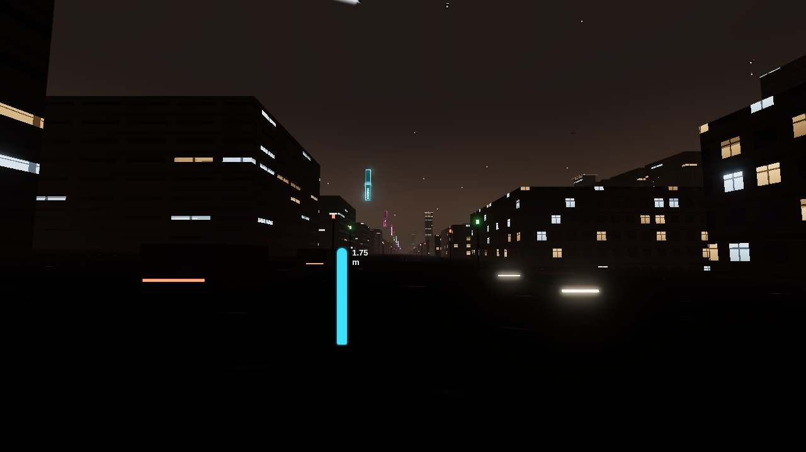

| Item | Measured | Expected | Verdict | Severity | Source |
| --- | --- | --- | --- | --- | --- |
| Façade storey | Panel 3.9 m (12 masses) | 3–4 m storey Panel cell sits in the real storey band. | pass | — | `src/world/windows/facade.ts CELL_H` |
| Façade storey (Deco) | Deco 5.6 m (11 masses) | 3–4 m floor; bible office/civic band stops at 5.5 m Deco sits just past the office band. | watch | medium | `src/world/windows/facade.ts CELL_H` |
| Sampled mass height | 17.6 m median of 34 detail-0 boxes | 22–119 m fabric band Sample range 4.4 m to 49.3 m. Heroes are landmarks and are not in this fabric sample. | watch | low | `generateFabric visual height (slope sink of 8 m removed)` |
| Flat sign panel | 1.15 m median (13 in sample) | 0.6–4 m street panel | pass | — | `fabric Sign.h kind 0` |
| Blade sign | 9.9 m median (92 in sample) | 2–8 m blade | watch | medium | `fabric Sign.h kind 1` |
| Billboard panel | 10 m median (2 in sample) | a billboard, not a door or a person Kind 2 is a figure panel. Height is the board, not a storey. | pass | — | `fabric Sign.h kind 2` |
| Street width | 22 m | bible 22 m | pass | — | `src/data/city-layout.json grid.street` |
| Driving-line offset | 6.4 m from the centreline | bible ±6.4 m; not a 3.5–3.7 m painted lane The constant is metres from the street centreline to the car. Freeway spacing is the painted-lane module. | pass | — | `streetLattices().lane` |
| Implied sidewalk | 2.8 m | 1.5–4.5 m street/2 − driving line − 1.8 m (half of a 3.6 m lane centred on the driving line). The driving line is not a painted lane width. | pass | — | `derived: street/2 − lane − 1.8` |
| Freeway lane spacing | I-110 3.5 m × 3; US-101 3.45 m × 3; I-10 3.55 m × 3; I-405 3.6 m × 2; I-5 3.6 m × 2; I-105 3.6 m × 2; I-710 3.6 m × 2 | 3.5–3.7 m I-110 is 3.5, I-10 is 3.55, I-405 / I-5 / I-105 / I-710 are 3.6. US-101 is 3.45, a tenth under the band. | watch | low | `src/vehicles/trafficBuiltins.ts spacing` |
| Signal pole | 5.45 m pole, head centred at 5.52 m | bible about 5.5 m; real signal about 4.5–6.5 m | pass | — | `src/vehicles/groundTraffic.ts BoxGeometry 0.16 × 5.45` |
| Quality rescale | none | metres stay put at every tier detailScale, farRadius, crowd count and groundTraffic change. The city is not shrunk for a phone. | pass | — | `src/core/quality.ts settingsFor` |
| Compact car, visual roof | 1.03 m roof, 4.2 m long, 1.82 m wide | real sedan roof 1.40–1.55 m, length 4.5–5.6 m Traffic length MESH_LEN.car is 4.35 m. The bible compact car is 4.2 × 1.82 × 0.9 m. The mesh matches that length and width; the roof is 1.03 m against the bible 0.9 m and a real roof near 1.45 m. | fail | high | `src/vehicles/vehicleModels.ts car boxes` |
| Compact car vs bible height | 1.03 m | bible 0.9 m The authored height is the short one. Real-world scale is the row above. | watch | low | `docs/BIBLE.md ground vehicles; vehicleModels.ts` |
| Traffic spinner | 5 m long, 2.66 m wide, 1.51 m high | length 4.5–5.6 m; cabin about 1.2–1.8 m Authored SPINNER_DIMS are 5.0 × 2.3 × 1.45 m. Pods reach about 2.66 m. The player craft is the glTF spinner; traffic uses this procedural mesh. Width vs the 2.3 m field is 2.66 m. | pass | — | `src/vehicles/spinnerModel.ts spinnerGeometries / SPINNER_DIMS` |
| Pedestrian head | 1.8 m | 1.60–1.90 m One shared mesh. WalkController HUMAN is eye 1.7 m, height 1.8 m, walk 1.5 m/s, run 4.2 m/s. | pass | — | `src/districts/little-tokyo-market/crowd.ts personGeometry` |
| Pedestrian hat | 1.92 m | 1.60–1.90 m to the top of the head; a hat may add a little The crown box is centred at 1.86 m with height 0.12 m. | watch | low | `src/districts/little-tokyo-market/crowd.ts hat box` |
| Crowd share | 0.22 | registered crowd using the 1.80 m mesh Share scales how many of the tier budget this district keeps. It does not scale the mesh. | pass | — | `registerCrowdSource share 0.22` |
| Shared street lamp | suppressed (NO_LAMPS) | a 6–12 m pole where the district has no replacement The shared pole is 7.5 m (head near the top). This district is in NO_LAMPS, so that pole is not drawn. | watch | low | `src/districts/_shared/streetLamps.ts NO_LAMPS / POLE_H 7.5` |
| Lobby door | 2.4 m high, 2.1 m wide | 2.0–2.4 m | pass | — | `src/districts/hollywood/interior.ts placeVolume height 2.4, hw 1.05` |
| Street lobby mouth | 5.4 m wide | a door leaf is about 0.9–2.1 m; a lobby mouth can be wider The interior door is 2.1 m wide. The street gap is DOOR_HALF_T × 2. | watch | medium | `src/districts/hollywood/plan.ts DOOR_HALF_T 2.7` |
| Strip floor module | 4.4 m | 3–4 m floor; bible office band 4.0–5.5 m | watch | medium | `src/districts/hollywood/spec.ts FLOOR` |
| Veil Mark pylons | 50 m pylons on a 1.6 m plinth; pylon top 51.2 m above ground | bible 50 m pylons; JSON height 52 m Panels are 10.5 × 42 m. Beacons sit at ground + 52.4 m. The 52 m JSON field is the beacon band, not the panel. | pass | — | `src/districts/hollywood/sign.ts PYLON_H` |

### 17. LAX Off-World Spaceport

`lax-spaceport` · archetype `lax-apron` · 11 pass, 9 watch, 1 fail.
Sample around (-15210, 12637), ground 0.0 m, 4 blocks, 22 boxes, 7 signs.

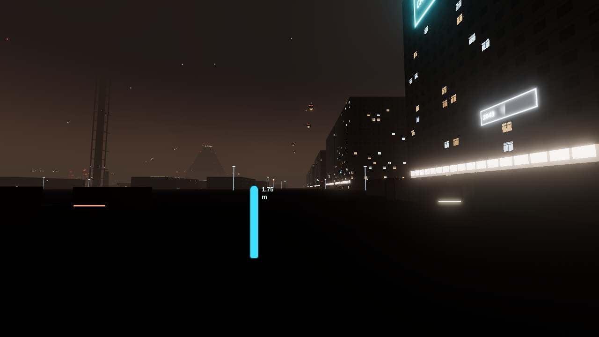

| Item | Measured | Expected | Verdict | Severity | Source |
| --- | --- | --- | --- | --- | --- |
| Façade storey | Megablock 3.6 m (9 masses) | 3–4 m storey Megablock cell sits in the real storey band. | pass | — | `src/world/windows/facade.ts CELL_H` |
| Façade storey (Industrial) | Industrial 7 m (5 masses) | 3–4 m if it reads as a floor; 6–8 m is a bay Industrial cell is a bay height, not a residential storey. | watch | medium | `src/world/windows/facade.ts CELL_H` |
| Sampled mass height | 70 m median of 14 detail-0 boxes | 15–80 m fabric band Sample range 22 m to 70 m. Heroes are landmarks and are not in this fabric sample. | pass | — | `generateFabric visual height (slope sink of 8 m removed)` |
| Flat sign panel | 2.2 m median (7 in sample) | 0.6–4 m street panel | pass | — | `fabric Sign.h kind 0` |
| Street width | 60 m | bible 60 m | pass | — | `src/data/city-layout.json grid.street` |
| Driving-line offset | 11.5 m from the centreline | bible ±11.5 m; not a 3.5–3.7 m painted lane The constant is metres from the street centreline to the car. Freeway spacing is the painted-lane module. | pass | — | `streetLattices().lane` |
| Implied sidewalk | 16.7 m | 1.5–4.5 m street/2 − driving line − 1.8 m (half of a 3.6 m lane centred on the driving line). The driving line is not a painted lane width. One tracked lane in a film-wide street; the remainder is carriageway, not a sidewalk slab. | watch | medium | `derived: street/2 − lane − 1.8` |
| Freeway lane spacing | I-110 3.5 m × 3; US-101 3.45 m × 3; I-10 3.55 m × 3; I-405 3.6 m × 2; I-5 3.6 m × 2; I-105 3.6 m × 2; I-710 3.6 m × 2 | 3.5–3.7 m I-110 is 3.5, I-10 is 3.55, I-405 / I-5 / I-105 / I-710 are 3.6. US-101 is 3.45, a tenth under the band. | watch | low | `src/vehicles/trafficBuiltins.ts spacing` |
| Signal pole | 5.45 m pole, head centred at 5.52 m | bible about 5.5 m; real signal about 4.5–6.5 m | pass | — | `src/vehicles/groundTraffic.ts BoxGeometry 0.16 × 5.45` |
| Quality rescale | none | metres stay put at every tier detailScale, farRadius, crowd count and groundTraffic change. The city is not shrunk for a phone. | pass | — | `src/core/quality.ts settingsFor` |
| Compact car, visual roof | 1.03 m roof, 4.2 m long, 1.82 m wide | real sedan roof 1.40–1.55 m, length 4.5–5.6 m Traffic length MESH_LEN.car is 4.35 m. The bible compact car is 4.2 × 1.82 × 0.9 m. The mesh matches that length and width; the roof is 1.03 m against the bible 0.9 m and a real roof near 1.45 m. | fail | high | `src/vehicles/vehicleModels.ts car boxes` |
| Compact car vs bible height | 1.03 m | bible 0.9 m The authored height is the short one. Real-world scale is the row above. | watch | low | `docs/BIBLE.md ground vehicles; vehicleModels.ts` |
| Van, visual | 1.73 m roof, 5.05 m long, 2.02 m wide | real van roof 1.8–2.6 m, length 5.0–6.2 m MESH_LEN.van is 5.55 m (bible). Visual length is the merged boxes. | watch | low | `src/vehicles/vehicleModels.ts van boxes` |
| Traffic spinner | 5 m long, 2.66 m wide, 1.51 m high | length 4.5–5.6 m; cabin about 1.2–1.8 m Authored SPINNER_DIMS are 5.0 × 2.3 × 1.45 m. Pods reach about 2.66 m. The player craft is the glTF spinner; traffic uses this procedural mesh. Width vs the 2.3 m field is 2.66 m. | pass | — | `src/vehicles/spinnerModel.ts spinnerGeometries / SPINNER_DIMS` |
| Pedestrian head | 1.8 m | 1.60–1.90 m One shared mesh. WalkController HUMAN is eye 1.7 m, height 1.8 m, walk 1.5 m/s, run 4.2 m/s. | pass | — | `src/districts/little-tokyo-market/crowd.ts personGeometry` |
| Pedestrian hat | 1.92 m | 1.60–1.90 m to the top of the head; a hat may add a little The crown box is centred at 1.86 m with height 0.12 m. | watch | low | `src/districts/little-tokyo-market/crowd.ts hat box` |
| Crowd share | not registered (0) | a street crowd where people should read No source calls registerCrowdSource for this district, so the player sees none of the 1.80 m mesh here. | watch | medium | `src/districts/little-tokyo-market/crowd.ts registerCrowdSource` |
| Shared street lamp | suppressed (NO_LAMPS) | a 6–12 m pole where the district has no replacement The shared pole is 7.5 m (head near the top). This district is in NO_LAMPS, so that pole is not drawn. | watch | low | `src/districts/_shared/streetLamps.ts NO_LAMPS / POLE_H 7.5` |
| Office module | 5.0 m | 3–4 m floor; bible office band 4.0–5.5 m | watch | medium | `src/districts/lax-spaceport/spec.ts FLOOR` |
| Flood mast | 16.5 m | apron floodlight 12–25 m Shared sodium is off. This is the apron mast, placed with its centre at half height so it stands on the ground. | pass | — | `src/districts/lax-spaceport/spec.ts PYLON_H = 3 × BAY` |
| LAX gantry | 420 m including the 30 m mast | bible 420 m including a 30 m mast | pass | — | `src/districts/lax-spaceport/gantry.ts shaftTop = height − MAST; top = height` |

### 18. South Bay Refineries

`south-bay-refineries` · archetype `south-bay-refinery` · 11 pass, 6 watch, 0 fail.
Sample around (-6035, 16568), ground 0.0 m, 6 blocks, 61 boxes, 1 signs.

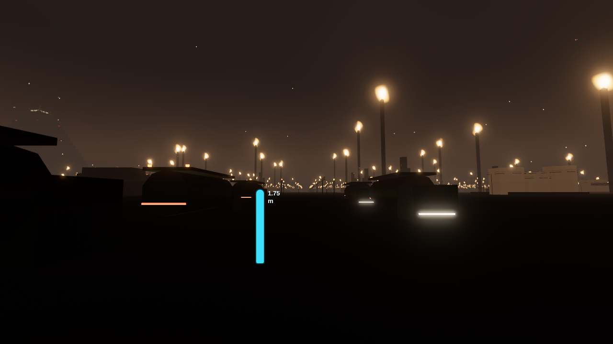

| Item | Measured | Expected | Verdict | Severity | Source |
| --- | --- | --- | --- | --- | --- |
| Façade storey | Industrial 7 m (15 masses) | 3–4 m if it reads as a floor; 6–8 m is a bay Industrial cell is a bay height, not a residential storey. | watch | medium | `src/world/windows/facade.ts CELL_H` |
| Sampled mass height | 13.1 m median of 15 detail-0 boxes | 12–140 m fabric band Sample range 8.4 m to 125 m. Heroes are landmarks and are not in this fabric sample. | pass | — | `generateFabric visual height (slope sink of 8 m removed)` |
| Flat sign panel | 1.1 m median (1 in sample) | 0.6–4 m street panel | pass | — | `fabric Sign.h kind 0` |
| Street width | 24 m | bible 24 m | pass | — | `src/data/city-layout.json grid.street` |
| Driving-line offset | 6.2 m from the centreline | bible ±6.2 m; not a 3.5–3.7 m painted lane The constant is metres from the street centreline to the car. Freeway spacing is the painted-lane module. | pass | — | `streetLattices().lane` |
| Implied sidewalk | 4 m | 1.5–4.5 m street/2 − driving line − 1.8 m (half of a 3.6 m lane centred on the driving line). The driving line is not a painted lane width. | pass | — | `derived: street/2 − lane − 1.8` |
| Freeway lane spacing | I-110 3.5 m × 3; US-101 3.45 m × 3; I-10 3.55 m × 3; I-405 3.6 m × 2; I-5 3.6 m × 2; I-105 3.6 m × 2; I-710 3.6 m × 2 | 3.5–3.7 m I-110 is 3.5, I-10 is 3.55, I-405 / I-5 / I-105 / I-710 are 3.6. US-101 is 3.45, a tenth under the band. | watch | low | `src/vehicles/trafficBuiltins.ts spacing` |
| Signal pole | 5.45 m pole, head centred at 5.52 m | bible about 5.5 m; real signal about 4.5–6.5 m | pass | — | `src/vehicles/groundTraffic.ts BoxGeometry 0.16 × 5.45` |
| Quality rescale | none | metres stay put at every tier detailScale, farRadius, crowd count and groundTraffic change. The city is not shrunk for a phone. | pass | — | `src/core/quality.ts settingsFor` |
| Tanker, visual | 2.78 m roof, 8.53 m long | real tanker overall height about 3.2–4.0 m MESH_LEN.tanker is 10.8 m. The shell is a 1.05 m radius cylinder. | watch | medium | `src/vehicles/vehicleModels.ts tanker` |
| Traffic spinner | 5 m long, 2.66 m wide, 1.51 m high | length 4.5–5.6 m; cabin about 1.2–1.8 m Authored SPINNER_DIMS are 5.0 × 2.3 × 1.45 m. Pods reach about 2.66 m. The player craft is the glTF spinner; traffic uses this procedural mesh. Width vs the 2.3 m field is 2.66 m. | pass | — | `src/vehicles/spinnerModel.ts spinnerGeometries / SPINNER_DIMS` |
| Pedestrian head | 1.8 m | 1.60–1.90 m One shared mesh. WalkController HUMAN is eye 1.7 m, height 1.8 m, walk 1.5 m/s, run 4.2 m/s. | pass | — | `src/districts/little-tokyo-market/crowd.ts personGeometry` |
| Pedestrian hat | 1.92 m | 1.60–1.90 m to the top of the head; a hat may add a little The crown box is centred at 1.86 m with height 0.12 m. | watch | low | `src/districts/little-tokyo-market/crowd.ts hat box` |
| Crowd share | 0.03 | registered crowd using the 1.80 m mesh Share scales how many of the tier budget this district keeps. It does not scale the mesh. | pass | — | `registerCrowdSource share 0.03` |
| Shared street lamp | suppressed (NO_LAMPS) | a 6–12 m pole where the district has no replacement The shared pole is 7.5 m (head near the top). This district is in NO_LAMPS, so that pole is not drawn. | watch | low | `src/districts/_shared/streetLamps.ts NO_LAMPS / POLE_H 7.5` |
| Control-room door | 2.4 m high, 1.5 m wide | 2.0–2.4 m | pass | — | `src/districts/south-bay-refineries/interior.ts placeVolume y 0 to 2.4, hw 0.75` |
| El Segundo stacks | 147 m tallest of 14 (published 140 m) | bible stacks to 140 m The loop can draw 1.1 × the published height, then a flare sprite 4 m above that. | watch | medium | `src/world/landmarks/Landmarks.ts flare-field h = height × range(0.6, 1.1)` |

### 19. Harbor & Container Port

`harbor` · archetype `harbor-port` · 10 pass, 6 watch, 1 fail.
Sample around (4363, 32750), ground 0.0 m, 3 blocks, 9 boxes, 0 signs.

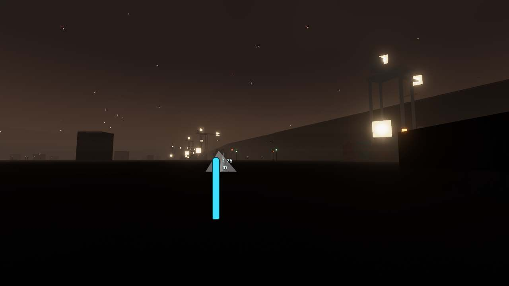

| Item | Measured | Expected | Verdict | Severity | Source |
| --- | --- | --- | --- | --- | --- |
| Façade storey | Industrial 7 m (8 masses) | 3–4 m if it reads as a floor; 6–8 m is a bay Industrial cell is a bay height, not a residential storey. | watch | medium | `src/world/windows/facade.ts CELL_H` |
| Sampled mass height | 15 m median of 8 detail-0 boxes | 15–80 m fabric band Sample range 12.3 m to 30 m. Heroes are landmarks and are not in this fabric sample. | pass | — | `generateFabric visual height (slope sink of 8 m removed)` |
| Street signs | none in the fabric sample | panels about 0.6–4 m The sample window had no sign records. Landmark signs are listed with the landmark. | watch | low | `fabric Sign.h` |
| Street width | 30 m | bible 30 m | pass | — | `src/data/city-layout.json grid.street` |
| Driving-line offset | 7.5 m from the centreline | bible ±7.5 m; not a 3.5–3.7 m painted lane The constant is metres from the street centreline to the car. Freeway spacing is the painted-lane module. | pass | — | `streetLattices().lane` |
| Implied sidewalk | 5.7 m | 1.5–4.5 m street/2 − driving line − 1.8 m (half of a 3.6 m lane centred on the driving line). The driving line is not a painted lane width. One tracked lane in a film-wide street; the remainder is carriageway, not a sidewalk slab. | watch | medium | `derived: street/2 − lane − 1.8` |
| Freeway lane spacing | I-110 3.5 m × 3; US-101 3.45 m × 3; I-10 3.55 m × 3; I-405 3.6 m × 2; I-5 3.6 m × 2; I-105 3.6 m × 2; I-710 3.6 m × 2 | 3.5–3.7 m I-110 is 3.5, I-10 is 3.55, I-405 / I-5 / I-105 / I-710 are 3.6. US-101 is 3.45, a tenth under the band. | watch | low | `src/vehicles/trafficBuiltins.ts spacing` |
| Signal pole | 5.45 m pole, head centred at 5.52 m | bible about 5.5 m; real signal about 4.5–6.5 m | pass | — | `src/vehicles/groundTraffic.ts BoxGeometry 0.16 × 5.45` |
| Quality rescale | none | metres stay put at every tier detailScale, farRadius, crowd count and groundTraffic change. The city is not shrunk for a phone. | pass | — | `src/core/quality.ts settingsFor` |
| Hauler, visual | 2.85 m roof, 10.75 m long | real articulated truck height 3.5–4.2 m, length 14–18 m MESH_LEN.hauler is 11.7 m, which matches the bible and is short of a real tractor-trailer. | fail | high | `src/vehicles/vehicleModels.ts hauler boxes` |
| Traffic spinner | 5 m long, 2.66 m wide, 1.51 m high | length 4.5–5.6 m; cabin about 1.2–1.8 m Authored SPINNER_DIMS are 5.0 × 2.3 × 1.45 m. Pods reach about 2.66 m. The player craft is the glTF spinner; traffic uses this procedural mesh. Width vs the 2.3 m field is 2.66 m. | pass | — | `src/vehicles/spinnerModel.ts spinnerGeometries / SPINNER_DIMS` |
| Pedestrian head | 1.8 m | 1.60–1.90 m One shared mesh. WalkController HUMAN is eye 1.7 m, height 1.8 m, walk 1.5 m/s, run 4.2 m/s. | pass | — | `src/districts/little-tokyo-market/crowd.ts personGeometry` |
| Pedestrian hat | 1.92 m | 1.60–1.90 m to the top of the head; a hat may add a little The crown box is centred at 1.86 m with height 0.12 m. | watch | low | `src/districts/little-tokyo-market/crowd.ts hat box` |
| Crowd share | 0.02 | registered crowd using the 1.80 m mesh Share scales how many of the tier budget this district keeps. It does not scale the mesh. | pass | — | `registerCrowdSource share 0.02` |
| Shared street lamp | suppressed (NO_LAMPS) | a 6–12 m pole where the district has no replacement The shared pole is 7.5 m (head near the top). This district is in NO_LAMPS, so that pole is not drawn. | watch | low | `src/districts/_shared/streetLamps.ts NO_LAMPS / POLE_H 7.5` |
| Harbor wall crest | 75 m | bible 75 m | pass | — | `city-layout.json seaWalls.crestHeight` |
| Sea-wall parapet | 1.15 m × 0.46 m | crest parapet about 0.9–1.3 m Sits on the crest. It is a wall, not a handrail. Bible: 1.15 m, above the 0.45 m step-up. | pass | — | `src/districts/coastal-strip/profile.ts PARAPET_H` |

### 20. Long Beach Secondary Core

`long-beach` · archetype `long-beach-core` · 11 pass, 8 watch, 1 fail.
Sample around (11460, 30953), ground 0.0 m, 6 blocks, 205 boxes, 77 signs.

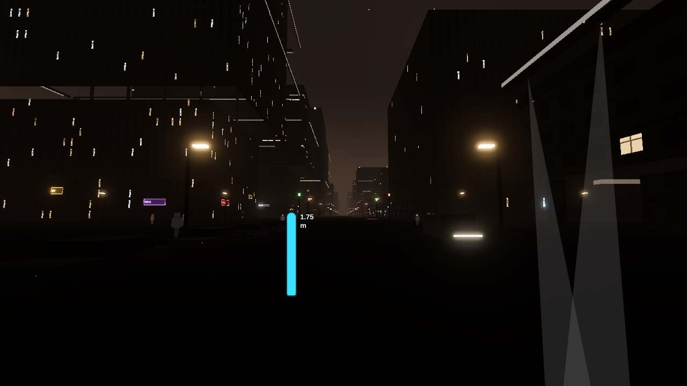

| Item | Measured | Expected | Verdict | Severity | Source |
| --- | --- | --- | --- | --- | --- |
| Façade storey | Panel 3.9 m (15 masses) | 3–4 m storey Panel cell sits in the real storey band. | pass | — | `src/world/windows/facade.ts CELL_H` |
| Sampled mass height | 50 m median of 24 detail-0 boxes | 60–180 m fabric band Sample range 6.4 m to 161.5 m. Heroes are landmarks and are not in this fabric sample. | watch | low | `generateFabric visual height (slope sink of 8 m removed)` |
| Flat sign panel | 1.78 m median (69 in sample) | 0.6–4 m street panel | pass | — | `fabric Sign.h kind 0` |
| Blade sign | 10.5 m median (7 in sample) | 2–8 m blade | watch | medium | `fabric Sign.h kind 1` |
| Billboard panel | 16 m median (1 in sample) | a billboard, not a door or a person Kind 2 is a figure panel. Height is the board, not a storey. | pass | — | `fabric Sign.h kind 2` |
| Street width | 30 m | bible 30 m | pass | — | `src/data/city-layout.json grid.street` |
| Driving-line offset | 6.8 m from the centreline | bible ±6.8 m; not a 3.5–3.7 m painted lane The constant is metres from the street centreline to the car. Freeway spacing is the painted-lane module. | pass | — | `streetLattices().lane` |
| Implied sidewalk | 6.4 m | 1.5–4.5 m street/2 − driving line − 1.8 m (half of a 3.6 m lane centred on the driving line). The driving line is not a painted lane width. One tracked lane in a film-wide street; the remainder is carriageway, not a sidewalk slab. | watch | medium | `derived: street/2 − lane − 1.8` |
| Freeway lane spacing | I-110 3.5 m × 3; US-101 3.45 m × 3; I-10 3.55 m × 3; I-405 3.6 m × 2; I-5 3.6 m × 2; I-105 3.6 m × 2; I-710 3.6 m × 2 | 3.5–3.7 m I-110 is 3.5, I-10 is 3.55, I-405 / I-5 / I-105 / I-710 are 3.6. US-101 is 3.45, a tenth under the band. | watch | low | `src/vehicles/trafficBuiltins.ts spacing` |
| Signal pole | 5.45 m pole, head centred at 5.52 m | bible about 5.5 m; real signal about 4.5–6.5 m | pass | — | `src/vehicles/groundTraffic.ts BoxGeometry 0.16 × 5.45` |
| Quality rescale | none | metres stay put at every tier detailScale, farRadius, crowd count and groundTraffic change. The city is not shrunk for a phone. | pass | — | `src/core/quality.ts settingsFor` |
| Compact car, visual roof | 1.03 m roof, 4.2 m long, 1.82 m wide | real sedan roof 1.40–1.55 m, length 4.5–5.6 m Traffic length MESH_LEN.car is 4.35 m. The bible compact car is 4.2 × 1.82 × 0.9 m. The mesh matches that length and width; the roof is 1.03 m against the bible 0.9 m and a real roof near 1.45 m. | fail | high | `src/vehicles/vehicleModels.ts car boxes` |
| Compact car vs bible height | 1.03 m | bible 0.9 m The authored height is the short one. Real-world scale is the row above. | watch | low | `docs/BIBLE.md ground vehicles; vehicleModels.ts` |
| Traffic spinner | 5 m long, 2.66 m wide, 1.51 m high | length 4.5–5.6 m; cabin about 1.2–1.8 m Authored SPINNER_DIMS are 5.0 × 2.3 × 1.45 m. Pods reach about 2.66 m. The player craft is the glTF spinner; traffic uses this procedural mesh. Width vs the 2.3 m field is 2.66 m. | pass | — | `src/vehicles/spinnerModel.ts spinnerGeometries / SPINNER_DIMS` |
| Pedestrian head | 1.8 m | 1.60–1.90 m One shared mesh. WalkController HUMAN is eye 1.7 m, height 1.8 m, walk 1.5 m/s, run 4.2 m/s. | pass | — | `src/districts/little-tokyo-market/crowd.ts personGeometry` |
| Pedestrian hat | 1.92 m | 1.60–1.90 m to the top of the head; a hat may add a little The crown box is centred at 1.86 m with height 0.12 m. | watch | low | `src/districts/little-tokyo-market/crowd.ts hat box` |
| Crowd share | 0.16 | registered crowd using the 1.80 m mesh Share scales how many of the tier budget this district keeps. It does not scale the mesh. | pass | — | `registerCrowdSource share 0.16` |
| Shared street lamp | 7.5 m pole | arterial pole 6–12 m Spacing 32 m. Curb inset is min(2.2, street × 0.18). The mesh is translated so the pole stands on the ground. | pass | — | `src/districts/_shared/streetLamps.ts POLE_H` |
| Concourse door | 2.6 m high, 2.1 m wide | 2.0–2.4 m | watch | medium | `src/districts/long-beach/interior.ts door y 0 to 2.6, hw 1.05` |
| Floor module | 5.0 m | 3–4 m floor; bible office band 4.0–5.5 m | watch | medium | `src/districts/long-beach/spec.ts MODULE` |

### 21. East LA Sprawl

`east-la` · archetype `east-la-sprawl` · 12 pass, 5 watch, 1 fail.
Sample around (4703, 714), ground 0.0 m, 6 blocks, 427 boxes, 26 signs.

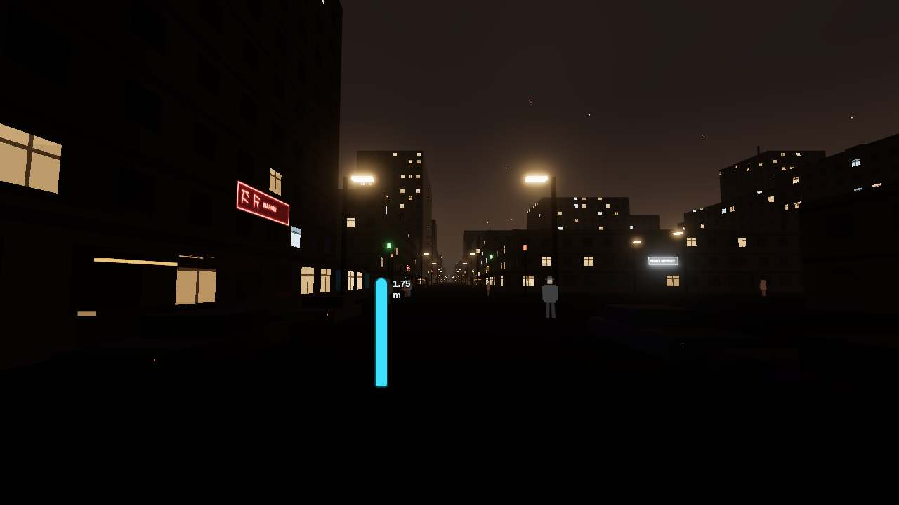

| Item | Measured | Expected | Verdict | Severity | Source |
| --- | --- | --- | --- | --- | --- |
| Façade storey | Sprawl 3.2 m (51 masses) | 3–4 m storey Sprawl cell sits in the real storey band. | pass | — | `src/world/windows/facade.ts CELL_H` |
| Sampled mass height | 22.1 m median of 54 detail-0 boxes | 10.2–57.8 m fabric band Sample range 6.8 m to 54.4 m. Heroes are landmarks and are not in this fabric sample. | pass | — | `generateFabric visual height (slope sink of 8 m removed)` |
| Flat sign panel | 1.16 m median (26 in sample) | 0.6–4 m street panel | pass | — | `fabric Sign.h kind 0` |
| Street width | 16 m | bible 16 m | pass | — | `src/data/city-layout.json grid.street` |
| Driving-line offset | 5.1 m from the centreline | bible ±5.1 m; not a 3.5–3.7 m painted lane The constant is metres from the street centreline to the car. Freeway spacing is the painted-lane module. | pass | — | `streetLattices().lane` |
| Implied sidewalk | 1.1 m | 1.5–4.5 m street/2 − driving line − 1.8 m (half of a 3.6 m lane centred on the driving line). The driving line is not a painted lane width. | watch | low | `derived: street/2 − lane − 1.8` |
| Freeway lane spacing | I-110 3.5 m × 3; US-101 3.45 m × 3; I-10 3.55 m × 3; I-405 3.6 m × 2; I-5 3.6 m × 2; I-105 3.6 m × 2; I-710 3.6 m × 2 | 3.5–3.7 m I-110 is 3.5, I-10 is 3.55, I-405 / I-5 / I-105 / I-710 are 3.6. US-101 is 3.45, a tenth under the band. | watch | low | `src/vehicles/trafficBuiltins.ts spacing` |
| Signal pole | 5.45 m pole, head centred at 5.52 m | bible about 5.5 m; real signal about 4.5–6.5 m | pass | — | `src/vehicles/groundTraffic.ts BoxGeometry 0.16 × 5.45` |
| Quality rescale | none | metres stay put at every tier detailScale, farRadius, crowd count and groundTraffic change. The city is not shrunk for a phone. | pass | — | `src/core/quality.ts settingsFor` |
| Compact car, visual roof | 1.03 m roof, 4.2 m long, 1.82 m wide | real sedan roof 1.40–1.55 m, length 4.5–5.6 m Traffic length MESH_LEN.car is 4.35 m. The bible compact car is 4.2 × 1.82 × 0.9 m. The mesh matches that length and width; the roof is 1.03 m against the bible 0.9 m and a real roof near 1.45 m. | fail | high | `src/vehicles/vehicleModels.ts car boxes` |
| Compact car vs bible height | 1.03 m | bible 0.9 m The authored height is the short one. Real-world scale is the row above. | watch | low | `docs/BIBLE.md ground vehicles; vehicleModels.ts` |
| Van, visual | 1.73 m roof, 5.05 m long, 2.02 m wide | real van roof 1.8–2.6 m, length 5.0–6.2 m MESH_LEN.van is 5.55 m (bible). Visual length is the merged boxes. | watch | low | `src/vehicles/vehicleModels.ts van boxes` |
| Traffic spinner | 5 m long, 2.66 m wide, 1.51 m high | length 4.5–5.6 m; cabin about 1.2–1.8 m Authored SPINNER_DIMS are 5.0 × 2.3 × 1.45 m. Pods reach about 2.66 m. The player craft is the glTF spinner; traffic uses this procedural mesh. Width vs the 2.3 m field is 2.66 m. | pass | — | `src/vehicles/spinnerModel.ts spinnerGeometries / SPINNER_DIMS` |
| Pedestrian head | 1.8 m | 1.60–1.90 m One shared mesh. WalkController HUMAN is eye 1.7 m, height 1.8 m, walk 1.5 m/s, run 4.2 m/s. | pass | — | `src/districts/little-tokyo-market/crowd.ts personGeometry` |
| Pedestrian hat | 1.92 m | 1.60–1.90 m to the top of the head; a hat may add a little The crown box is centred at 1.86 m with height 0.12 m. | watch | low | `src/districts/little-tokyo-market/crowd.ts hat box` |
| Crowd share | 0.18 | registered crowd using the 1.80 m mesh Share scales how many of the tier budget this district keeps. It does not scale the mesh. | pass | — | `registerCrowdSource share 0.18` |
| Shared street lamp | 7.5 m pole | arterial pole 6–12 m Spacing 32 m. Curb inset is min(2.2, street × 0.18). The mesh is translated so the pole stands on the ground. | pass | — | `src/districts/_shared/streetLamps.ts POLE_H` |
| Wallace Tower A mast | inside published 1400 m (36 m mast subtracted before the body) | bible 1400 m with a 36 m mast inside that height Sited in east-la, just outside the Wallace polygon if that is not the home district. | pass | — | `src/districts/wallace-vernon/satellite.ts bodyH = height − crown − mast` |

### 22. Hills (sparse overlay)

`hills-sparse` · archetype `hills-sparse` · 10 pass, 4 watch, 0 fail.
Sample around (-26406, -5285), ground 352.2 m, 6 blocks, 17 boxes, 0 signs.

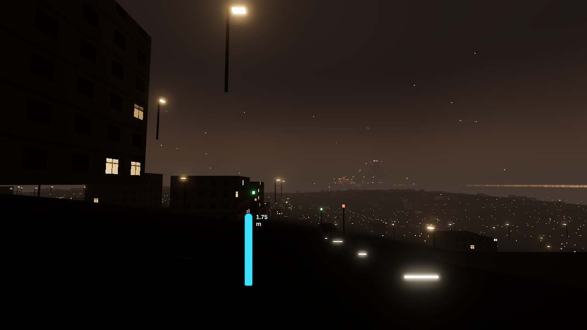

| Item | Measured | Expected | Verdict | Severity | Source |
| --- | --- | --- | --- | --- | --- |
| Façade storey | Sprawl 3.2 m (17 masses) | 3–4 m storey Sprawl cell sits in the real storey band. | pass | — | `src/world/windows/facade.ts CELL_H` |
| Sampled mass height | 9 m median of 17 detail-0 boxes | 5–11 m fabric band Sample range 5 m to 10.9 m. Heroes are landmarks and are not in this fabric sample. | pass | — | `generateFabric visual height (slope sink of 8 m removed)` |
| Street signs | none in the fabric sample | panels about 0.6–4 m The sample window had no sign records. Landmark signs are listed with the landmark. | watch | low | `fabric Sign.h` |
| Driving line | no lattice | a centreline offset where cars are spawned Hills keep the host district grid and do not add a lattice. | pass | — | `src/vehicles/trafficRegistry.ts` |
| Freeway lane spacing | I-110 3.5 m × 3; US-101 3.45 m × 3; I-10 3.55 m × 3; I-405 3.6 m × 2; I-5 3.6 m × 2; I-105 3.6 m × 2; I-710 3.6 m × 2 | 3.5–3.7 m I-110 is 3.5, I-10 is 3.55, I-405 / I-5 / I-105 / I-710 are 3.6. US-101 is 3.45, a tenth under the band. | watch | low | `src/vehicles/trafficBuiltins.ts spacing` |
| Signal pole | 5.45 m pole, head centred at 5.52 m | bible about 5.5 m; real signal about 4.5–6.5 m | pass | — | `src/vehicles/groundTraffic.ts BoxGeometry 0.16 × 5.45` |
| Quality rescale | none | metres stay put at every tier detailScale, farRadius, crowd count and groundTraffic change. The city is not shrunk for a phone. | pass | — | `src/core/quality.ts settingsFor` |
| Host street | hills replace the archetype above 45 m and keep the host grid | overlay, not a 21st polygon | pass | — | `src/world/fabric/generator.ts HILL_ARCHETYPE_THRESHOLD` |
| Ground vehicles | no street graph | cars only where a lattice exists This district never receives ground-traffic edges. | pass | — | `src/vehicles/trafficRegistry.ts NO_STREET_GRAPH` |
| Traffic spinner | 5 m long, 2.66 m wide, 1.51 m high | length 4.5–5.6 m; cabin about 1.2–1.8 m Authored SPINNER_DIMS are 5.0 × 2.3 × 1.45 m. Pods reach about 2.66 m. The player craft is the glTF spinner; traffic uses this procedural mesh. Width vs the 2.3 m field is 2.66 m. | pass | — | `src/vehicles/spinnerModel.ts spinnerGeometries / SPINNER_DIMS` |
| Pedestrian head | 1.8 m | 1.60–1.90 m One shared mesh. WalkController HUMAN is eye 1.7 m, height 1.8 m, walk 1.5 m/s, run 4.2 m/s. | pass | — | `src/districts/little-tokyo-market/crowd.ts personGeometry` |
| Pedestrian hat | 1.92 m | 1.60–1.90 m to the top of the head; a hat may add a little The crown box is centred at 1.86 m with height 0.12 m. | watch | low | `src/districts/little-tokyo-market/crowd.ts hat box` |
| Crowd share | not registered (0) | a street crowd where people should read No source calls registerCrowdSource for this district, so the player sees none of the 1.80 m mesh here. | watch | medium | `src/districts/little-tokyo-market/crowd.ts registerCrowdSource` |
| Shared street lamp | 7.5 m pole | arterial pole 6–12 m Spacing 32 m. Curb inset is min(2.2, street × 0.18). The mesh is translated so the pole stands on the ground. | pass | — | `src/districts/_shared/streetLamps.ts POLE_H` |
