# Neon LA 2049 — visual and structural critique

Date of the brief: 2026-10-10. Pictures were taken in the early hours of 2026-10-11 UTC from a local `vite preview` of `cbe3064` (Detail Pass D2). D3 Photo Mode landed on main as `f14f9c8` after that build. It was not in the surveyed tree, and this document does not change it. Photo grades (`sodium`, `neon`, `ash`, `harbor` in `src/photo/grades.ts`) are a postcard pass. They do not recolor the walk-mode street shader, so the wet-street findings below still belong to the city material.

The city has **19 district polygons plus the default basin**, which is 20 district ids. `hills-sparse` is a height override in `src/world/fabric/generator.ts` when the ground is above 45 m. It is not a 21st polygon. Stages in the roadmap run past that count because Stage 1 is the foundation.

The look this critique is grading against is the 2049 city: a sodium-orange haze, cyan and magenta only where the street is selling something, grey brutalist daylight, wet asphalt that stays dark, signage in more than one language, and a few silhouettes (the sea wall, the pyramid, a freeway cut) that still read after the detail has fogged out.

## How the pictures were taken

Headless Chrome, SwiftShader, WebGL2 (`?webgl=1`), `freeze=1`, HUD off except on the low pass. Desktop frames are 1280×720 at device pixel ratio 1. The phone pass is 390×844, also at pixel ratio 1, so it checks the crop and the touch layout. It does not check the medium pixel-ratio cap of 1.5, and it does not check fill rate on an iPhone.

Frame rate on SwiftShader is often 0–6. That number is not a phone measurement. Draw calls and triangles come from `renderer.info` after the shot settles. A fly camera can log the position from the frame before the last reapply, so a JPEG can be a high shot while the log still says `y=2`. Where those disagree, the picture is the composition and the log is only a neighbour of that frame.

The planar wet reflector never runs here. It is gated to a real GPU, high or ultra, Little Tokyo, and altitude under 28 m (`src/app/App.ts`). Bloom is off on medium and on low. Ultra frames below are SwiftShader with bloom enabled in the pipeline; they are a stand-in for the grade, not for a desktop GPU.

Medium budget, from `docs/ARCHITECTURE.md`: **≤ 250 draws, ≤ 1.5 M triangles, no post.**

## What already works

Leave these alone. Later passes should not sand them down to fix a neighbour.

- **Broadway at night** is the street that already looks like the film. Vertical blades, readable Latin (`RICE BOWL`, `BLACK OIL`, `RED LANTERN`, `NIGHT MARKET`), people, blocky cars, and a canyon that closes in fog. `broadwayView:street`. About 178 draws and 0.53 M triangles on medium.

  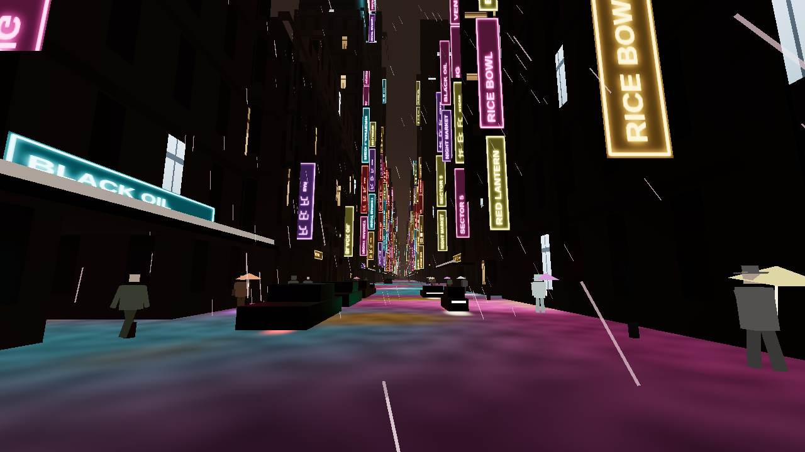

- **The downtown avenue at dusk** is the best grade in the set. Sodium sky, window grids, a skybridge, a flame on a legacy crown, red aviation lights. Camera `dtlaView:lanes`, logged near 197 m. Night is the same plate with a darker sky and sits on the draw cap (250). Dusk went to 280.

  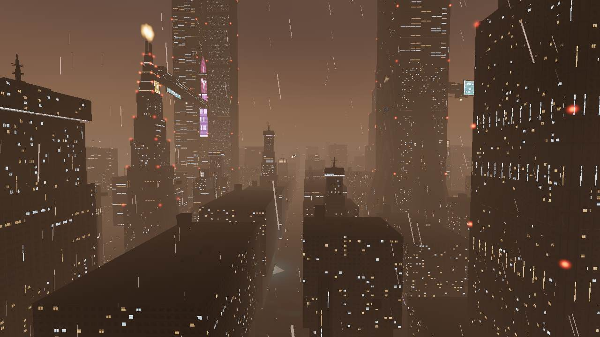

- **The financial crown** is a clean brutalist shaft in brown fog, red edge lights, one cyan plate. `megaView:crown`, about y=961, **73 draws**, LOD0 empty. Scale is cheap when the mesh is one shaft.

  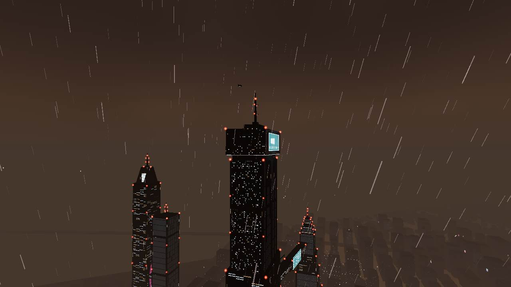

- **K from above** sells the megablock. One 185 m slab, a window field, shorter blocks in the fog. `kView:aerial`, 126 draws.

  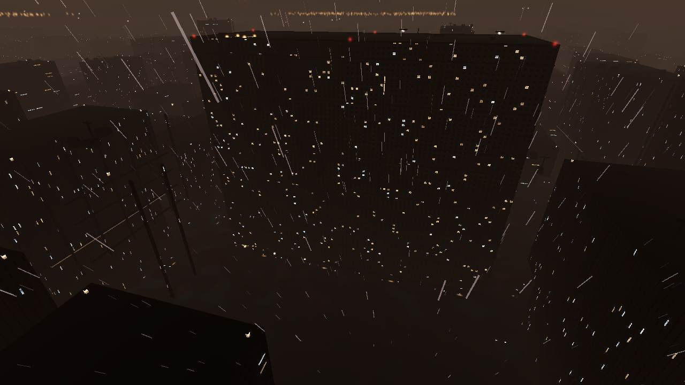

- **Daytime smog over the avenues** is the grey brutalist plate. Same camera as the dusk skyline (`dtlaView:lanes`), clear of the night neon, 140 draws and 0.36 M triangles. The window stamp is still one grid. The grade is the part that works.

  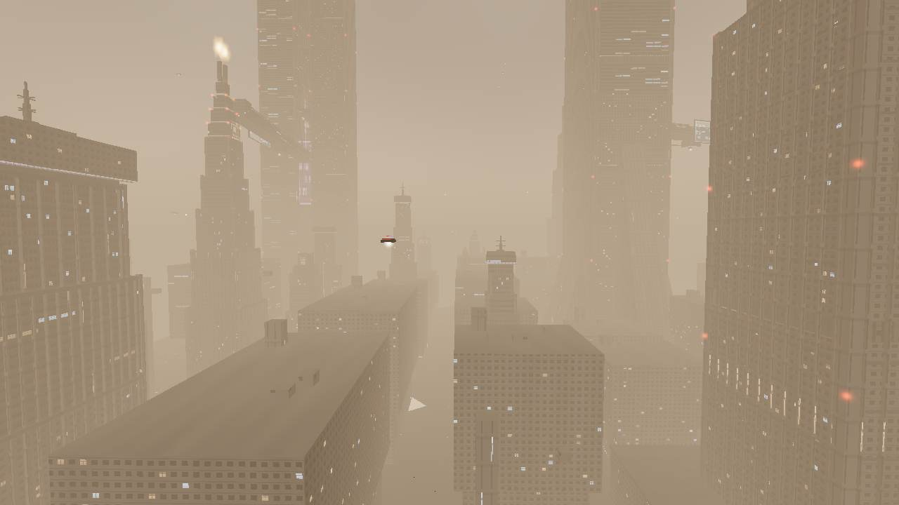

- **The dormant pyramids east of Wallace** read as stepped masses with flame stacks in sodium fog. `wallaceView:oldpyramids`, 92 draws. This is the pyramid composition the close Wallace cameras miss.

  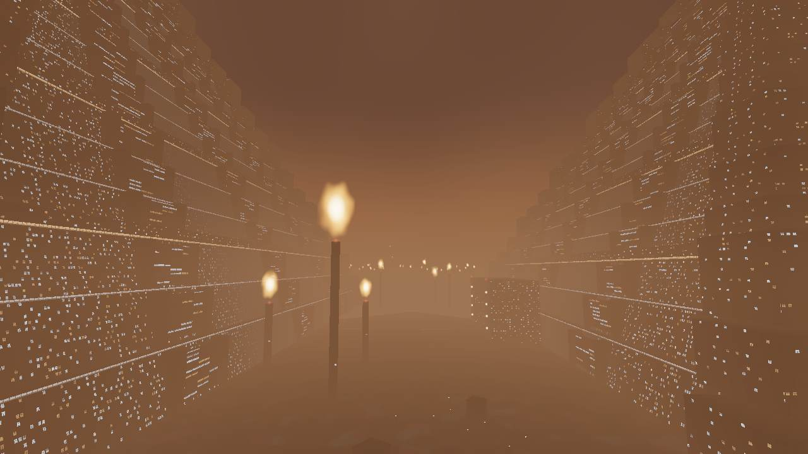

- **The sea wall in daylight** shows the batter, the triangular toes, the city grid, and the water. `coastView:aerial` at 14:00, 54 draws. Night reduces that to a dark curve. The crest and the harbor face still fail (finding F7).

  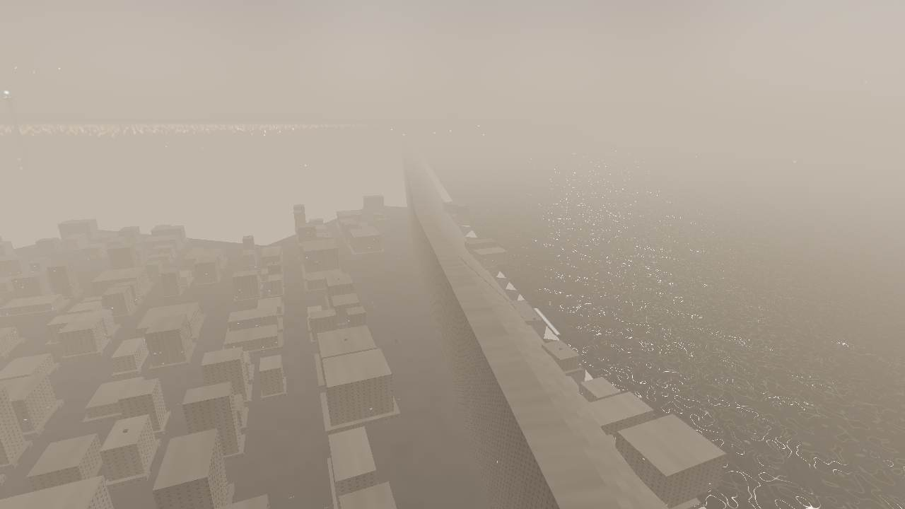

- **Bradbury court** is the interior that proves the occlusion path. Stair, galleries, warm light, one window back to the street. **20 draws, about 37 k triangles.** `interiorView:court`.

  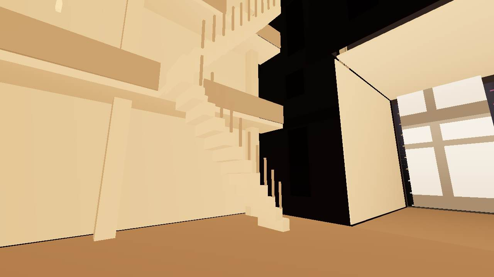

- **The Wallace pyramid from far away** already has the monolith silhouette. The close cameras throw it away (finding F6). The far view showed up by accident when South LA had not streamed.

  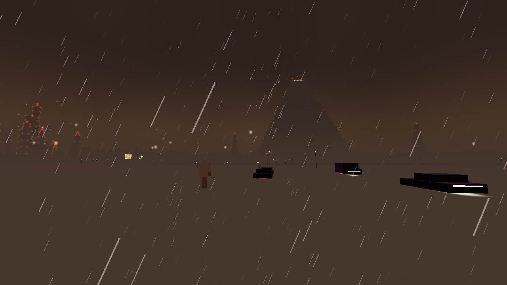

- **LAPD steps** read as a black shaft, a `SECTOR 5` plate, and a red practical next to a blue one. `civicView:steps`, 199 draws. The stair treads are the problem, not the shaft (finding F8).

- **Audio registration is the pattern the rest of the city should copy.** `registerDistrictAudio` in `src/audio/registry.ts`. The frame loop does not grow a branch per district. Voice cap is 2 / 4 / 6 / 8. No samples and no score, which is fine for this pass.

## Ranked findings

Rank is impact on how the city looks and feels, times how small the change is. A high look-change that stays inside the existing shader or the existing crowd mesh outranks a new freeway.

### F1. Wet streets are one nightclub colour

**Rank 1.** Every uncovered street in the rain picks up the same magenta, cyan, and amber, including districts whose own notes say the floor should stay dark.

**Where.** `src/world/materials/cityMaterial.ts` builds one `neonCol` from magenta `(1.00, 0.18, 0.55)`, cyan `(0.15, 0.85, 1.00)`, and amber `(1.00, 0.55, 0.15)`. Ground albedo is about `0.05`. The fresnel is `pow(1 - viewDir.y, 2.5)`, and the puddle term adds `0.25` even where the puddle mask is low, so a grazing camera paints the whole foreground. `STREET_NEON` in `src/world/fabric/mesher.ts` only scales that colour. `industrial-dense` is `0.1` and the Arts District street is still a cyan and magenta ocean. `k-megablock` and `civic-center` are missing from the table, so they fall through to `0.2`. `U.neonWet` in `src/app/App.ts` is a nested ternary on district id. K under 48 m is `0.5`. East LA under 40 m is `0.4`. Hollywood, Westside, the basin, and the financial district are missing from that chain and land on the default `0.22`. The same uniform tints rain streaks and the ground haze.

**Shots.** `artsView:street` (below), `kView:market`, `eastLaView:market`, `harborView:street`, `dtlaView:street`, `westsideView:freeway`, `hollywoodView:hills`. Broadway is the district where this colour is earned. At dusk the open Arts District sky goes sodium and the floor stays cyan and magenta. The DTLA canyon at dusk is still a purple slot (167 draws): the buildings fill the frame, so the sodium horizon never reaches the eye. The night factor on the fresnel is `U.night * 0.8 + 0.2`, which dims the neon and does not change its hue. A clear afternoon street does go dark: `dtlaView:street` at 13:30 in clear weather is grey asphalt, 143 draws, LOD0 17. The bug is the wet night and dusk fresnel, including places with a tiny weight. `hills-sparse` is `0.05` in `STREET_NEON`, and `hollywoodView:hills` still puts a magenta, cyan, and amber blotch field under the sign.

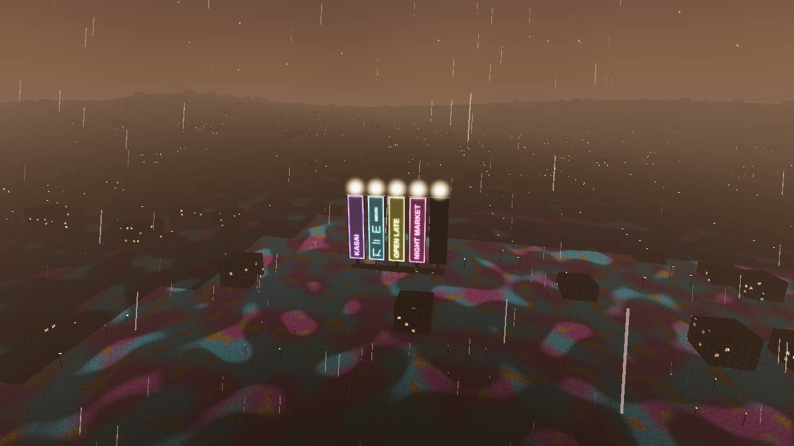

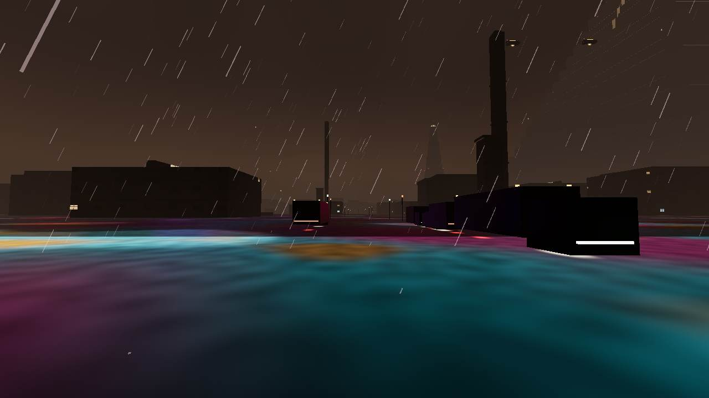

**Fix.** Give the fresnel a district colour. Broadway, Little Tokyo, and Hollywood keep cyan and magenta. Everywhere else the sheen is black asphalt or a thin sodium. Drop the `0.25` puddle floor on low-neon districts so a `0.1` weight cannot own the frame. Put `civic-center` and `k-megablock` in `STREET_NEON` and `SPRAWL_LIGHTS` (both currently miss the live ids and inherit `0.2` and `0.6`). Move the `U.neonWet` and `U.streetFog` ternaries onto a table keyed by district id, the way `registerDistrictAudio` already works.

**Size.** S for the colour and the two missing keys. M if the App.ts ternary moves in the same change.

**Perf risk.** None if it stays in the existing emissive node. Do not turn on the planar reflector to get a wetter street. That re-renders the scene and is banned on medium.

### F2. One food atlas is the whole city's language

**Rank 2.** The signs are dense in the right places and they say the same meal everywhere else. Narrow blades crop the cell so the invented glyphs read as broken Latin.

**Where.** `src/world/materials/signPhrases.ts` is 64 phrases, almost all food (`NOODLES`, `RICE BOWL`, `UDON`, `BLACK OIL`, `COUNTER`, `HOT BROTH`). Latin is real `fillText`. Kana, hangul, hanzi, and devanagari are a handful of random strokes plus a Latin subtitle (`src/world/materials/signAtlas.ts`). There is no Spanish. The same cells are instanced on Broadway, Hollywood, the financial podium, and the East LA stalls.

**Shots.** Broadway (above) repeats `RICE BOWL` and `BLACK OIL`. `hollywoodView:street` hangs `HOT BROTH` and `BLACK OIL` beside blades that read as broken strokes. `megaView:street` puts a cyan `UDON` bar on the podium under the megatower. `marketView:street` has a readable `COUNTER` and the same cropped blades. `hollywoodView:hills` is five food blades on the ridge (`KASAI`, a cropped `K I E`, `OPEN LATE`, `NIGHT MARKET`) with a lamp ball on each. That camera is the hillside sign, and the copy is still the market menu.

**Fix.** Keep the 8×8 atlas and the one sign draw. Split the cells into pools the archetype already knows: food for the market and Broadway, ads and wayfinding for downtown and Hollywood, stencils for industry and the harbor, civic plates for LAPD. Add short Spanish lines. Draw glyph blocks so a narrow blade still contains a whole mark and its Latin subtitle, instead of a slice of a stroke.

**Size.** S for phrase pools and crop insets. M if each district gets its own seed bias.

**Perf risk.** None. Same instanced sign batch.

### F3. From a kilometre up, most districts are the same dark grid

**Rank 3.** Street identity dies at altitude. The fly fantasy is a lamp carpet or a box field in brown fog.

**Where.** Far LOD draws a light carpet from `SPRAWL_LIGHTS` (`src/world/fabric/mesher.ts`). Southeast is `0.9`, South Bay `0.72`, East LA `0.78`. Shared street lamps register on `*` (`src/districts/_shared/streetLamps.ts`). `NO_LAMPS` skips South Bay, the harbor, LAX, Hollywood, the coast, and several cores, and the aerials of the belt still read as poles because the far carpet and the neighbour's lamps do the same job. Lakewood, the basin, and East LA aerials are one repeating block.

**Shots.** `lakewoodView:aerial`, `basinView:aerial`, `eastLaView:aerial` (dark rectangles, no spine). `southeastView:aerial` (below): a sodium lamp forest, candle flares, one black plane, and the old stepped pyramid as the only silhouette. `laxView:aerial`: three thin gantries in that same carpet. `southBayView:aerial` matches the lamp forest. Hollywood's neon does not survive `hollywoodView:aerial` (logged near y=1006, LOD0 empty, 107 draws).

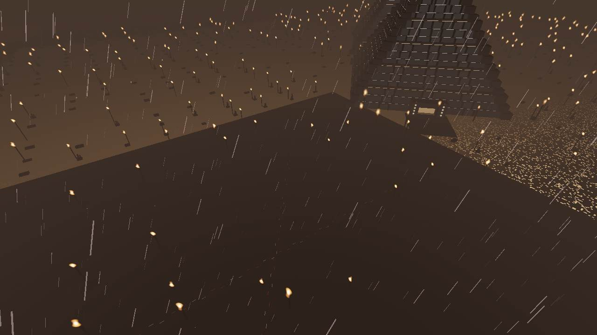

**Fix.** At the far ground-light cell, keep one readable signal per district and let the rest go dark: a flare that is a flame, a freeway cut, the sea-wall batter, a gantry silhouette, one lit avenue. Distance-cull lamp heads past the LOD0 radius so a 1 km camera does not draw a forest of 7.5 m poles. Optional in the same pass: add the **60, the 605, and the 91** as on-grade polylines in `city-layout.json`, the same treatment the 405 already has. Do not sink them and do not build ramps here.

**Size.** M for the carpet and the lamp cull. L if the three missing freeways are real trenches.

**Perf risk.** A cull removes draws. New trench meshes would add them. Streaks only.

### F4. People are blocks, and the umbrella is a diamond

**Rank 4.** Crowds are what make a street feel occupied. Right now they clip the stall, the counter, and the lens, and the rain shade reads as a pyramid stuck through the body.

**Where.** One `InstancedMesh` in `src/districts/little-tokyo-market/crowd.ts`. The canopy is a shallow wedge so it has area at eye height. Counts stay 56 / 160 / 340 / 680. Medium swings inside 28 m. The bible already says the hem sits above the knee and the canopy is a solid pyramid. The pictures show the pyramid edge-on, and bodies inside stall boxes.

**Shots.** `marketView:interior` (noodle soffit): a pink plane in the lens, umbrellas through the counter, a cook clipped by the sign. `eastLaView:market`: figures standing inside black stall boxes. `hollywoodView:street`: a pedestrian and a pale shard in the lower left. `kView:market`: diamond shades on a magenta floor. Broadway is the best of them, and the coats are still boxes.

**Fix.** Keep the one mesh and the triangle count (the body is a handful of boxes; the survey's crowd stays inside that draw). Reshape the canopy so a side view is a shallow disc, not a diamond, and keep the shaft off the counter. Nudge stall loops so a walker stops at the counter face instead of inside the box. Do not add a second crowd mesh, cloth, or hair cards.

**Size.** M.

**Perf risk.** Low if the index count holds and the crowd stays one draw. Raising the medium count past 160 is out of scope.

### F5. After Bradbury, the rooms are one beige corridor

**Rank 5.** Walking through a door is the best draw-call win in the project, and most rooms do not pay it back with a place.

**Where.** `buildCorridorRoom` in `src/world/interiors/template.ts` is the shell for K, the Arts foundry, the Lakewood shop, the South LA laundry, the Westside diner, the southeast pump room, the Hollywood lobby, the LAX concourse, South Bay control, harbor control, the Long Beach concourse, the East LA counter, and the Bradbury service hall. Bradbury court is a custom room. Wallace atrium is custom and still reads as two teal slabs in a black box (`wallaceView:atrium`, 14 draws). Noodle bar and the LAPD lobby are soffits, so the city and the rain stay (`docs/ARCHITECTURE.md`).

**Shots.** Bradbury court, above, 20 draws. `kView:apartment`: beige walls, a bench, two shelves, a fluorescent slot, 18 draws and about 35 k triangles. `eastLaView:interior` and `southeastView:interior` are the same box. `civicView:lobby`: a black soffit, rain streaks in the room, one `SECTOR 5` plate, **161 draws** because the city is still in the frame.

**Fix.** Keep the template for the service rooms. Spend the art on three doors a player will actually use: K's apartment, the East LA counter, and the LAPD lobby. Darken the LAPD soffit and stop the rain mesh while the label says the player is inside it. Give the Wallace atrium the water read the bible already describes, with the existing emissive attribute, not a scene light. A dressed room should stay near Bradbury's 20 draws.

**Size.** M.

**Perf risk.** None if the rooms stay unlit meshes and the occlusion path keeps hiding the city. The LAPD soffit at 161 draws is the case to fix, not a budget to copy.

### F6. The pyramid is a black wall from the cameras that are supposed to show it

**Rank 6.** The 3.5 km form is in the haze from South LA. The authored plaza, face, and approach cameras sit on a portal or on rain.

**Where.** `wallaceView:plaza` at night frames a pale window grid in a black surround, two lit bollards, district query often `basin-sprawl` because the causeway is outside the polygon. `wallaceView:face` at night is a rain-filled black wall (logged y≈5). `wallaceView:approach` in afternoon smog is a long causeway, two dark walls, a couple of cars, and the portal grid fading out (95 draws, y≈8, 87 s to settle). The tiers above the gate are gone in the fog, and the camera never backs up far enough for the South LA silhouette. The mesh and the face sectors already exist (`docs/BIBLE.md` Stage 7 close range). The atrium is a separate small room and does not explain the exterior.

**Shot.** `img/south-la-popin-wallace.jpg` is the silhouette. The day causeway is below. Do not add a second pyramid material.

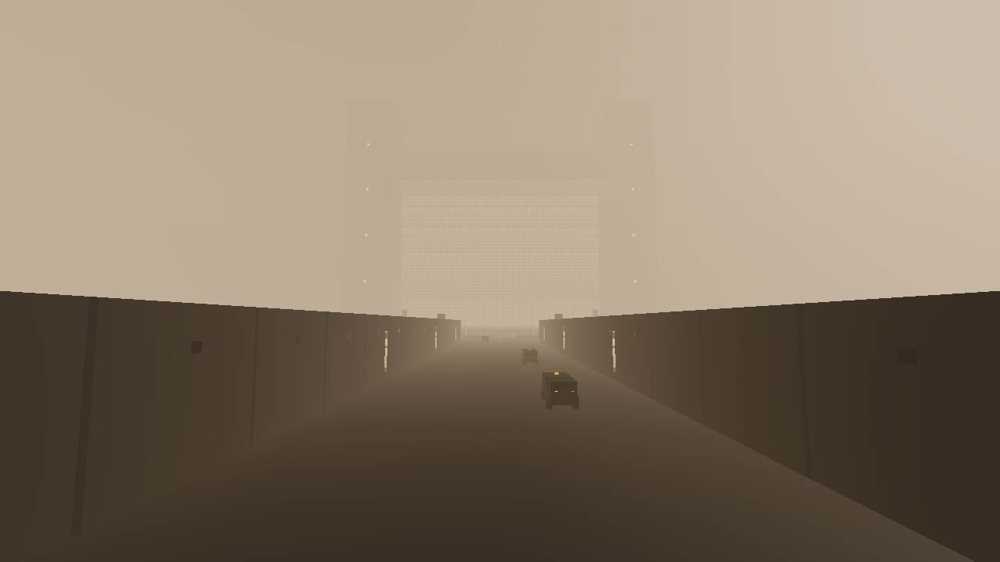

**Fix.** Move `face` and `approach` back along the causeway until the battered tiers and the bare portal mouth fill the frame, with the apex in the haze. Leave the central slot and the portal bare, which the bible already asks for. The South LA accident is the target composition. The old pyramids (`img/old-pyramids-dusk.jpg`) already have it: stepped faces, a flame that reads as fire, fog between the masses.

**Size.** M, mostly camera and a check that near sectors stream before the shot is considered dressed.

**Perf risk.** Low. Wallace street shots in this survey were about 90 draws and 0.23 M triangles. Do not add lights.

### F7. The sea wall, the gantries, and the cranes die at the distance the film would hold them

**Rank 7.** The aerial sea wall works. The crest, the LAX gantries, and a late harbor chunk do not.

**Where.** `coastView:aerial` in daylight is the plate above. The same camera at night is only the dark curve. `coastView:crest` (y≈92) is a black slab, one mast, and a sodium line on the horizon. Terraces and surf do not read from the crest. `coastView:apron` is a pale rail in front of a row of grey translucent cards and a dark wall. Those cards may be the surf or spray quads mis-drawn by SwiftShader; confirm on a real GPU before changing the material, and treat the missing terrace as the real defect either way. `harborView:wall` is a featureless dark cliff with one pale lip and the F1 colour along the bottom. `laxView:aerial` reduces 420 m gantries to wires in the lamp carpet. `harborView:street` settled at **lod0 = 0** (52 draws): a crane and the wall are visible, the near fabric is a black mass, and the ground is still the F1 colour.

**Fix.** One extra read on silhouettes that already exist: the sea-wall toe and a single terrace lip, a gantry chord thick enough to survive fog, a crane jib that stays in the far landmark LOD. Dress the harbor street the way the crane is already dressed, so the first second is not an empty quay. No new landmark.

**Size.** M.

**Perf risk.** Low if the extra triangles live on the existing landmark meshes and respect `landmarkLod`.

### F8. Flat stamps: windows, roofs, stair rules, hologram cards

**Rank 8.** Close up, surfaces that should have thickness are one repeating decal.

**Where.** Window grids are one mullion stamp in `cityMaterial.ts` (the interior-mapping work was left open for high and ultra). Foreground roofs in the belt aerials are empty black planes. LAPD stair treads at `civicView:steps` are glowing white horizontal rules. Hologram ads are flat cards: a stack of ovals over the market and over the DTLA avenue, a green disc on the financial shaft, a leaf panel in the canyon. Medium allows 18 panels (`src/core/quality.ts`). They read as signs, which F2 already has.

**Fix.** On medium, break the stair rules into a dark tread with a thin nose, and keep roofs from going fully black by reusing the ground stain noise. Leave interior parallax on high and ultra. On medium, use the existing hologram slices so one panel has a second ghost, and do not raise `holoCount`.

**Size.** S for stairs and roof stain. M for hologram depth. L, and out of this set of passes, for medium interior mapping.

**Perf risk.** Interior mapping on medium is the risk. Do not do it. Stairs and stain are the same materials.

### F9. Arriving in a district can be an empty brown plane

**Rank 9.** Two street cameras settled with no LOD0 and the player would have been standing on that frame.

**Where.** Streaming is 2000 m superchunks and 500 m chunks, hole-free swaps (`src/world/streaming/ChunkStreamer.ts`). The swap is correct and the wait is still visible. `southLaView:street` settled in about 6 s with **lod0 = 0**, 78 draws: brown plane, three cars, a pedestrian, and the Wallace silhouette. `harborView:street` matched it (lod0 0, 52 draws) with a crane floating over missing fabric. South LA's roof, shot a few seconds later, had lod0 8. The pop-in is the arrival, not a missing district.

**Fix.** Keep a low-rise impostor (the far carpet, darkened per F3) until LOD0 swaps, and prefetch along the walk velocity that `App.ts` already passes to `query.warm`. Do not raise `uploadsPerFrame` past the medium cap of 2.

**Size.** M.

**Perf risk.** An impostor that is the existing far mesh is free. A second near mesh would blow the draw cap. Do not add one.

### F10. The draw cap is already broken in two cameras, and the famous East LA number did not show up

**Rank 10.** The budget is the constraint every pass below has to obey. Two medium cameras are over it. The 485-draw story is not what this machine measured.

**Where.** Arts District stacks, `artsView:stacks`, night rain, medium, SwiftShader, DPR 1: **304 draws, about 0.80 M triangles, 14 LOD0 chunks, y=45.** That is the worst settled medium frame in the night survey. DTLA avenue lanes, `dtlaView:lanes`: **250 draws at night, 280 at dusk** (dusk camera logged over the financial district at y=197). The financial skyline camera at dusk logged **287 draws** while sitting over Westside at y=501; the night twin of that camera was 185. Treat the dusk pair as over budget and remeasure on a real GPU before tuning them further. East LA market, `eastLaView:market`, medium, settled with LOD0 8: **89 draws, about 0.28 M triangles.** Triangles stayed under 1.5 M in every settled night and dusk frame. The heaviest settled medium frame was the Arts roof.

**Low tier, same machine.** The HUD was on (`hud` is the first query value; the capture URL also appends `hud=0`, and `URLSearchParams.get` keeps the first). The East LA market HUD printed **464 calls and 0.50 M triangles** with the stream still queued (far 0, queue 24, a handful of LOD0 chunks). The log for that shot said 455. Broadway low printed **396 calls** with the queue still in the 50s. Those frames sit near the often-quoted 485, and they are not a finished budget: SwiftShader did not go idle inside the settle. The low frames that did dress are inside the cap. DTLA street low, LOD0 8: **168 draws, 0.28 M triangles.** East LA street low, LOD0 6: **161 draws.** East LA interior low: **16 draws.** Do not write "485" into a pass as a settled measurement of this tree. The R6 probe has to wait for `inFlight === 0` and `readyQueue === 0`.

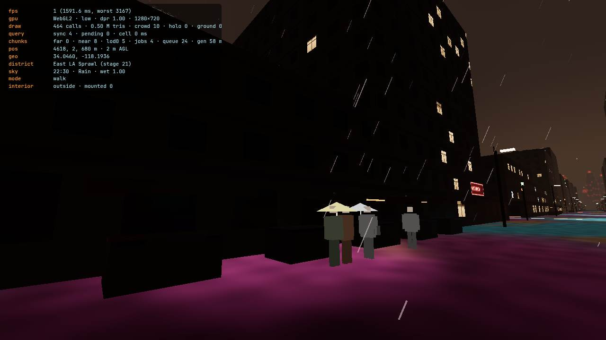

**Ultra, for context only.** Ultra is allowed to be heavier than medium. Broadway ultra is the same canyon with more pedestrians and the same magenta floor and the same food signs (285 draws). Bloom on SwiftShader does not fix F1, F2, or F4. South LA ultra street logged **678 draws and 1.29 M triangles** at LOD0 3. That combination (huge draw count, almost no LOD0) matches the unsettled low frames more than it matches a dressed block. Remeasure it on a real GPU before treating South LA as an ultra hotspot. Do not bring any of that density down into medium.

**Fix.** On the Arts stacks shot, merge the steam cards and the rank-2 props into the kit passes that `src/districts/_shared/kit/batch.ts` already builds (opaque, fade, add). Fourteen LOD0 chunks times a handful of extra draws is the 304. On DTLA lanes, the dusk overage is about 30 draws; find which pass appears when the sky brightens and cull it past the existing LOD radii. Add a CI check that fails when the Arts stacks camera and the DTLA lanes camera, on medium, exceed 250 draws or 1.5 M triangles after the stream is idle. Run the same check on low East LA market and low Broadway, and fail only on an idle frame. `.github/workflows/ci.yml` is `npm ci` and `npm run build` only. `scripts/bench-x6.ts` is not in that workflow. There are no unit tests in the tree.

**Size.** M.

**Perf risk.** The change is a reduction. Do not buy the Arts frame back by dropping East LA's stall caps so far that F4 gets worse. Medium stays without bloom, shadows, and the reflector.

### F11. Flying cars still have a roof-height band, and the freeways still have no ramps

**Rank 11.** This is structural, and it shows up as a spinner in a mast or as a freeway that is only a streak.

**Where.** `src/vehicles/SpinnerTraffic.ts`. `overRoofs` lifts Lakewood, South LA, the Arts District, the southeast belt, Hollywood, LAX, South Bay, and the harbor. Long Beach uses `overCore` (floor at ground + 220 m). LAX gantries use a 460 m floor. Downtown free fliers stay at 340–520 m. The historic canyon is free at 148–260 m. Everyone else — East LA, K, Little Tokyo, Westside, the basin, the coast, Wallace — can spawn at **ground + 55 to 90 m** (`layer < 0.12` in the final else). East LA's own README says roofs stay under 60 m and masts under 66 m, so the 74 m and 112 m graph parks clear them, and that the 55–90 m band is not lifted. K's slab is 185 m, so 55–90 m and the 175–260 m band both enter it. `insideLandmark` pushes a car up. Fabric boxes are not tested. This survey did not catch a spinner inside a roof in a single frame. The heights are in the spawn function.

Freeways in `src/data/city-layout.json`: I-10, I-110, US-101, I-405, I-5, I-105, I-710. `src/vehicles/trafficBuiltins.ts` sinks and drives the **110, the 101, and the 10**. The **405, 5, 105, and 710** are on-grade streaks with no vehicles. The **60, the 605, and the 91** are absent. East LA builds static decks where the 5 and the 710 cross the sunk 10 (`src/districts/east-la/interchange.ts`) and does not add a graph edge. Street lattices do not share nodes with each other or with a freeway chain (`docs/ARCHITECTURE.md`).

**Shots.** `trafficView:freeway` (the 110, 78 draws, y≈28) is a black cut filled with white and red light bars. The concrete walls do not read; the traffic does, as streaks. `eastLaView:interchange` (73 draws) is an on-grade deck of white dashes and white pin lamps over a black trench, with the F1 carpet on the streets behind it. `westsideView:freeway` (72 draws) is a black stripe beside the magenta street. No ramp, no vehicles, no trench. The aerial seam `basinView:seam-dtla` (75 draws, lod0 0, y≈1001) shows downtown towers on one side of a diagonal cut and the basin grid on the other. Part of that emptiness is F9. The cut is still the district edge. `lakewoodView:k-edge` at street level is two block languages meeting in a canyon, which is a fair seam; the cyan lip on the ground is F1 again.

**Fix.** Add East LA, K, Little Tokyo, Westside, the basin, and the coast to the same lift the Arts District already uses, with a floor above that district's mast height. K needs the Long Beach treatment, not the 155 m floor. Leave ramps for a later job. F3's optional streaks are the only freeway geometry this set of passes should add. On the East LA deck, replace the white pin lamps with the sodium head the street-lamp material already has, and keep the neighbourhood fresnel off that deck (R1). A soft skirt along the basin/DTLA polygon, using the existing far mesh, is enough seam work for R4. Do not retile both districts.

**Size.** S for the lift list. L for real ramps, which are not in R1–R6.

**Perf risk.** None for a higher spawn. Ramps would be new edges and new trench meshes. Out of these passes.

### F12. Dead archetypes still ship, and App.ts is where new districts go to grow a branch

**Rank 12.** The worker still contains bodies nothing in the layout calls, and the frame loop has the per-district branching the audio pass was told not to add.

**Where.** `src/districts/fabric-index.ts` imports `src/districts/_shared/archetypes.ts` first. Later modules overwrite the same id. Live layout archetypes are the 20 ids in `city-layout.json` (`basin-sprawl` through `east-la-sprawl`, including `civic-center` and `k-megablock`). Still registered, and not used by the JSON: `megatower-core`, `civic`, `street-market`, `entertainment`, `industrial`, `megablock-residential`, `megablock-market`, `sprawl-dense`, `spaceport`, `port`. The first bodies of `industrial-dense` and `coastal-grey` are overwritten by the Arts District and the coastal strip. `SPRAWL_LIGHTS` still carries `neon-canyon`, `entertainment`, `civic`, `port`, and `spaceport`. `hills-sparse` stays; the generator uses it.

`debugApi()` in `src/app/App.ts` repeats the same camera-apply block for `marketView`, `megaView`, `dtlaView`, `civicView`, `broadwayView`, `artsView`, `wallaceView`, `southeastView`, `southLaView`, `lakewoodView`, `kView`, `westsideView`, `hollywoodView`, `coastView`, `laxView`, `southBayView`, `harborView`, `longBeachView`, `eastLaView`, `basinView`, and `interiorView`. The neon and fog ternaries above are the runtime version of that copy.

**Deep links.** `?at=` on a landmark uses a distance-based fly pose (`initialPose`). `?at=` on a POI sets **y = 60**, which is inside a megatower and inside K. A low-tier fly to the East LA market at that height logged 446 draws at y=64. `streetView` snaps to the nearest fabric block, then `WalkController.enter` runs `findStreetSpot`, which can spiral out to 400 m, so a door POI can miss the door. The probe returned true for all 59 landmark and POI ids. Interior ids are not `at=` targets unless they are also POIs. `k-apartment` and `bradbury` are POIs. `east-la-counter` is not.

**Trash.** The only trash-mesa entry is the POI `trash-mesa-gate`, "out of bounds", stage 99. There is no junk district to critique from inside the playable map.

**Memory.** Chunk swaps dispose geometry that is not marked shared (`ChunkStreamer.disposeGroup`). Shared lamp and crowd geometry is kept. This survey did not measure a leak. Do not rewrite disposal in a visual pass.

**Fix.** Stop importing the dead archetype bodies into the worker, or delete them once nothing references the ids. Collapse the debug cameras behind one helper. F1 moves the fog and neon tables out of the frame loop. A draw-budget script in CI is the lock (F10).

**Size.** M.

**Perf risk.** Deleting dead archetypes shrinks the worker. It does not change a dressed frame.

## Refinement passes

Each pass is one agent's job. Every one of them stays inside the iPhone medium budget: ≤ 250 draws, ≤ 1.5 M triangles, pixel-ratio cap 1.5, no bloom, no shadows, no planar reflector, rain at 6 k, crowd at 160, holograms at 18.

### R1 — Wet colour and the dusk street

Retune the wet-street fresnel in `src/world/materials/cityMaterial.ts` and the `STREET_NEON` / `SPRAWL_LIGHTS` tables in `src/world/fabric/mesher.ts` so magenta and cyan survive only on Broadway, Little Tokyo, and Hollywood. East LA, K, the basin, Westside, Lakewood, South LA, the Arts District, the coast, both industrial belts, the harbor, LAX, civic, Wallace, and Long Beach stay black asphalt or a thin sodium sheen. Add the missing `civic-center` and `k-megablock` keys. Move `U.neonWet` and `U.streetFog` out of the district ternary in `src/app/App.ts` and onto a table keyed by district id, following `registerDistrictAudio`. Dusk should reach the eye-level street: the aerial sky already lerps toward the sodium horizon in `src/atmosphere/Atmosphere.ts`, and the street shader still multiplies the night neon. No new draw, no reflector, no bloom on medium. Done when the Arts District street, the K market, and the Hollywood hills ground no longer read as a nightclub floor, Broadway still does, and the clear-day DTLA street stays dark asphalt.

### R2 — Signs that belong to the district

Keep the one 8×8 atlas and the one instanced sign draw. Split phrases in `src/world/materials/signPhrases.ts` into food, ads, stencils, and civic plates, and bias the seed by archetype so a financial podium does not say `UDON` and a refinery does not say `RICE BOWL`. Add short Spanish lines. Replace the random stroke glyphs with a small stable set, and inset them so a narrow blade still shows a whole mark plus the Latin subtitle. Hollywood and Broadway keep density. Done when a blade on `hollywoodView:street` is readable and a belt street is not a noodle menu.

### R3 — Crowd and stall silhouettes

Stay on the single crowd mesh and its current triangle count. Reshape the umbrella so a side view reads as a canopy, and stop walkers intersecting the noodle counter, the East LA stall boxes, and the camera near-plane. Coats can stay boxes. Do not add a second mesh, and do not raise the medium count above 160. Done when `marketView:interior` and `eastLaView:market` show the person in front of the counter, and the draw count does not move. On a 390×844 screen the touch sticks cover the lower third, so the read has to sit above them.

### R4 — A readable city from a kilometre up

Make Lakewood, the basin, East LA, and Long Beach distinguishable at `*View:aerial`, and stop the southeast belt, South Bay, and LAX reading as a sodium lamp forest. Distance-cull street-lamp heads, and darken `SPRAWL_LIGHTS` so one signal survives: a flare, a freeway cut, the sea-wall batter, a gantry, one lit spine. If the pass has room, add the 60, the 605, and the 91 as on-grade streaks only. No trenches, no ramps, no per-chunk draw. Done when those three aerials are not interchangeable and the Arts stacks camera is still the only frame anyone is allowed to leave near the cap (R6 brings that one under).

### R5 — The pyramid, the wall, and three rooms

Fix the Wallace close cameras so `face` and `approach` show the battered tiers and a bare portal, matching the silhouette that already appears in the South LA haze. Give the sea-wall crest a toe and one terrace, and keep the LAX gantries and the harbor cranes as silhouettes after fog. Dress three interiors that are not the beige corridor: K's apartment, the East LA counter, and the LAPD lobby. Suppress rain while the player is in the LAPD soffit. The Wallace atrium keeps its dark room and gains the water read without a scene light. Bradbury court stays the occlusion proof at about 20 draws. No second city render, no new scene lights, no bloom on medium.

### R6 — Budget, spinner height, and the dead code

Bring `artsView:stacks` under 250 draws (measured 304 and about 0.80 M triangles) by folding extra Arts passes into the existing kit batches. Recheck `dtlaView:lanes` at dusk (measured 280) and the financial skyline camera (287 at dusk, over Westside). East LA market on medium, settled, was 89 draws and 0.28 M triangles. The low HUD hit 464 calls on that camera while the chunk queue was still full, and Broadway low hit 396 the same way. DTLA low and East LA street low, once dressed, were 168 and 161. The CI check has to sample an idle stream. Do not treat 485 as a settled number for this tree. Lift the 55–90 m spinner band over East LA, K, Little Tokyo, Westside, the basin, and the coast, using each district's mast height. K is a high floor, in the Long Beach sense. Delete or stop shipping the unused archetype bodies (`port`, `sprawl-dense`, `entertainment`, `spaceport`, `civic`, `street-market`, `industrial`, `megablock-residential`, `megablock-market`, `megatower-core`). Add a small medium-tier draw check to CI for the Arts stacks camera, the DTLA lanes camera, and East LA market. Do not add shadows, bloom, occlusion queries, or the planar reflector on medium. Ramps stay out.

## Measured frames

Medium, night, rain, SwiftShader, 1280×720, DPR 1, after the settle used for this survey. Draws over 250 are marked. Triangles are rounded. FPS is omitted on purpose.

| Camera | Draws | Triangles | LOD0 | Notes |
|---|---:|---:|---:|---|
| Little Tokyo street | 132 | 0.49 M | 8 | Pale kit floor, figure in the lens |
| Financial street | 143 | 0.31 M | 14 | Scale works, `UDON` on the podium |
| Financial crown | 73 | 0.30 M | 0 | y≈961 |
| Financial skyline | 185 | 0.53 M | 6 | Logged over Westside, y≈501 |
| DTLA street | 131 | 0.31 M | 7 | Magenta floor, oval hologram |
| DTLA lanes | 250 | 0.49 M | 14 | On the cap. Dusk: 280 |
| Civic steps | 199 | 0.47 M | 10 | White stair rules |
| Broadway street | 178 | 0.53 M | 10 | Best street |
| Arts street | 181 | 0.57 M | 8 | Cyan and magenta floor |
| Arts stacks | **304** | 0.80 M | 14 | Over budget |
| Wallace plaza | 91 | 0.23 M | 6 | Portal grid |
| Southeast street | 122 | 0.32 M | 8 | |
| Southeast aerial | 75 | 0.29 M | 0 | Lamp forest, y≈1001 |
| South LA street | 78 | 0.31 M | 0 | Undressed. Pyramid in the haze |
| K street | 136 | 0.39 M | 7 | Magenta floor, cantilever |
| K aerial | 126 | 0.35 M | 8 | |
| Hollywood street | 70 | 0.22 M | 9 | Food signs, clipped figure |
| Coast aerial | 69 | 0.21 M | 9 | Sea-wall curve, y≈260 |
| LAX aerial | 102 | 0.24 M | 0 | Thin gantries |
| Harbor street | 52 | 0.19 M | 0 | Undressed, crane visible |
| East LA market | 89 | 0.28 M | 8 | Not 485 on medium |
| East LA interchange | 73 | 0.27 M | 9 | White pin lamps, black trench |
| I-110 trench | 78 | 0.27 M | 9 | Light bars, walls unread |
| Westside freeway | 72 | 0.26 M | 7 | Black stripe, no trench |
| Hollywood hills sign | 59 | 0.21 M | 8 | Food blades, blotched ground |
| DTLA day smog lanes | 140 | 0.36 M | 8 | Grey grade works |
| DTLA day street | 143 | 0.27 M | 17 | Asphalt is dark in clear day |
| Market day street | 184 | 0.55 M | 13 | Dark ground, figures in the lens |
| Wallace day approach | 95 | 0.20 M | 2 | Causeway and gate, no tiers |
| Coast day aerial | 54 | 0.19 M | 9 | Batter and water read |
| Basin day aerial | 45 | 0.20 M | 0 | Flat beige grid, undressed |
| Old pyramids | 92 | 0.27 M | 6 | Flames read |
| Basin aerial | 103 | 0.34 M | 6 | Same dark grid as East LA |
| Bradbury court | 20 | 37 k | 9 | Occlusion proof |
| K apartment | 18 | 35 k | 7 | Beige template |
| LAPD lobby soffit | 161 | 0.48 M | 6 | City and rain still drawn |
| Noodle soffit | 117 | 0.47 M | 4 | Rain and city still drawn |

Interiors that go through the door and hide the city land between 13 and 23 draws and about 34–40 k triangles (K lobby, Wallace atrium, Arts foundry, Lakewood shop, South LA laundry, Westside diner, southeast pump, Hollywood lobby, LAX concourse, South Bay control, harbor control, Long Beach concourse, East LA counter, Bradbury service and stair).

## Phone crop

390×844, medium, night rain, DPR 1 (not the medium cap of 1.5). The heaviest phone street in this set was the Arts District at **139 draws**. Broadway, East LA, and the K apartment were all under the cap (the apartment was 17 draws). Portrait hides the side streets, which is part of why the counts sit under the desktop numbers. The two touch sticks cover the lower third of the frame, including people's legs and the near street. F1 and F2 are unchanged in the crop: the canyon is magenta, and the blades still say `RICE BOWL`.

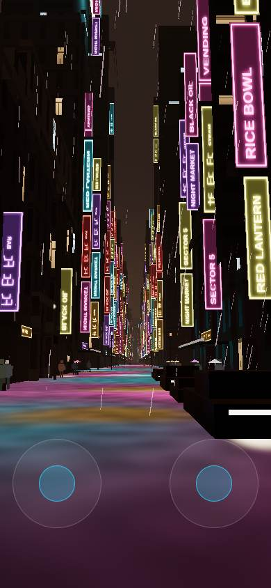

## Deep links

`streetView` returned true for all 59 ids (28 landmarks and 31 POIs). It did not return false for any of them. The district column in that probe is not a landing check. `WalkController.enter` writes the feet and moves the camera on the next update, and the probe read `camera.position` in the same turn, so a fast row often names the previous place.

The code path is the finding. `?at=` on a landmark is a fly pose at a distance. `?at=` on a POI sets y = 60. A low-tier fly to the East LA market coordinates at that height logged **446 draws at y=64** (`at-east-la-market-fly`). `streetView` then stands on the nearest block's street, and `findStreetSpot` can spiral out to 400 m if that point is inside a solid, which is how a door POI misses the door. `trash-mesa-gate` is in the list and is out of bounds. Interior ids that are not also POIs are absent. `noodle-bar`, `k-apartment`, and `bradbury` are POIs. `east-la-counter` is not.
