# D7 roads polish — film check

12 October 2026. Night rain on `main` at `8cc5530`. The roads polish is `#64` at `5868937`. Nothing under `src/roads`, `src/atmosphere/WetReflector.ts`, or `src/lighting/shade.ts` has changed since that commit. Docs only. No game code, no film frames, no logos.

The readable copy is [roads-polish-2026-10-12.html](roads-polish-2026-10-12.html). The earlier roads note is [roads-spinner-2026-10-12.md](roads-spinner-2026-10-12.md). The lighting note that scored this polish from the source, without a new shoot, is [lighting-l1-2026-10-12.md](lighting-l1-2026-10-12.md).

**Fail.** Crosswalks and the three named hero grounds clear 7. Wet asphalt does not, and the street under the signs still does not read as dark water. L2 still owns the neon bleed. R5 does not have to wait.

## Scores

The four gates are the ones the October roads note asked for. A row under 7 fails the polish. Sodium is the lamp half of that same note, scored so the pool can be checked, and it is outside the gate.

| Check | Was | Now | What the frames show |
| --- | ---: | ---: | --- |
| Crosswalk and lane paint | 5 | 7 | One ladder per mouth. Broadway, South LA, and the Lakewood chart read as paint. At your feet the white is frayed. Low drops it. |
| Wet asphalt, no rainbow streaks | 4 | 5 | Broadway's forced mirror is a dark comb. The lane stays near (21, 22, 30). Hollywood's lane, mirror off, is a magenta sheet, (92, 51, 72) in the foreground. |
| Hero ground | 4 | 7 | K, the sea-wall blocks, and the Wallace causeway are carriageways. The market frame is still the stall floor. |
| Reads as a wet neon LA street | 5 | 6 | Broadway is a rainy canyon. The ground under the signs is black, or pink. |
| Sodium pool (not a gate) | 3 | 7 | K, the coast, Wallace, and Lakewood show a short orange disc. It dies before the next pole. |

## How this was looked at

Headless Chrome, WebGL2 on SwiftShader. This machine has no real GPU, so the planar mirror stays off unless `?refl=1`. Night rain, time 22.5, frozen weather, UI hidden. Desktop 1280×720. Phone 390×844 at device scale 1, with the touch sticks. Tiers are the query `quality`.

Stills are from [capture-roads-polish.mjs](capture-roads-polish.mjs), written for this note. `OUT` was `/tmp/roads-polish`, outside `tests/visual`. S3's baselines were not touched. Contact sheets and the frames they come from are in [captures/](captures/).

A patch average is one downscaled block of the jpeg, so a thin line can miss the sample. The numbers below are the blocks that landed on road.

Reference stills were read in the browser and left out of git.

## What a stranger sees

Night rain. On the neon canyon the near corner is a set of pale bars, side by side, on black asphalt. A white dash sits in the right of the frame. The signs stay on the walls. Rain is a stroke in the air. Force the mirror and the same corner grows thin vertical lines of pink, blue, and yellow. The asphalt between them stays black.

On the residential road a double yellow runs down the middle. White marks the edges. An orange disc sits under a lamp and stops. From high above, the crossing is four separate ladders around an empty centre.

At the foot of the dark slab, between the sea-wall blocks, and on the causeway to the gate, the ground has that same yellow and a curb. In the night market the lens is a stall row and a tan floor. On the entertainment street the ground is pink, and a pale ladder sits in that pink.

## Paint

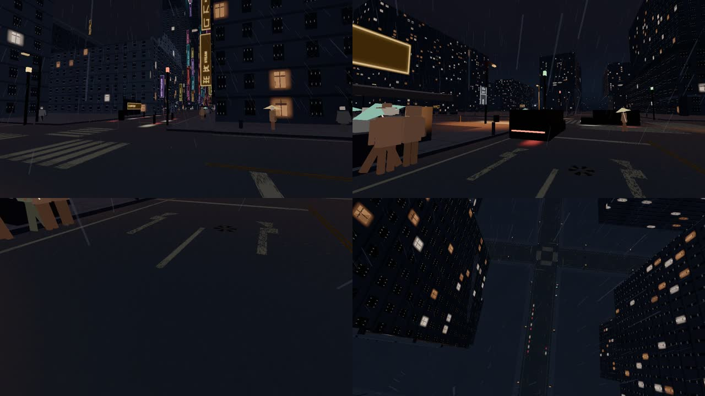

Broadway, high, `broadwayView('street')`, camera `[-373, 1.7, 121]`. 220 draws, 675 k triangles, 37 cars, crowd 245, mirror off. The near left is a zebra. The bars run one way. The box where the other direction would have crossed is empty asphalt. Ultra is the same street with a heavier crowd (234 draws, 801 k triangles, 59 cars, crowd 490).

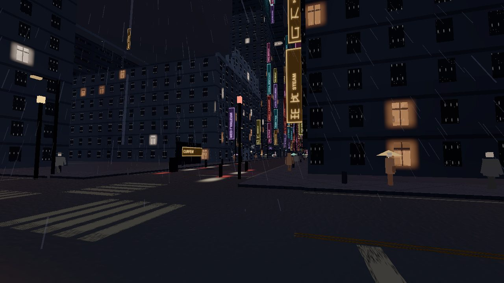

South LA spine, high, camera `[-4083, 1.7, 4422]`. 179 draws, 421 k triangles, 7 cars. An arrow, a dash, a double yellow, and a ladder on the right all read. The arrow's edges are chewed. From 2 m the same paint is a worn dash and a worn arrow on asphalt that samples (15, 19, 28). The middle of a dash is a stripe. The rim breaks up.

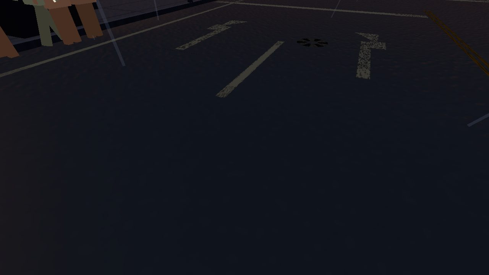

Lakewood from about 120 m, high, camera y 121. 142 draws. The intersection is four mouths. Each mouth has its own bars. The centre of the box is empty. The double yellow and the white dashes survive at that height. Headlight pairs sit in the lanes.

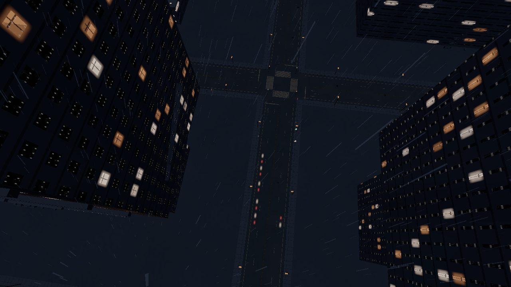

Low, same Broadway camera, 459 draws, 470 k triangles, 0 cars, crowd 40. The foreground is a brown sheet, about (49, 35, 39). The canyon signs remain. The paint is gone. That is the low material, and it is the same drop the earlier note recorded.

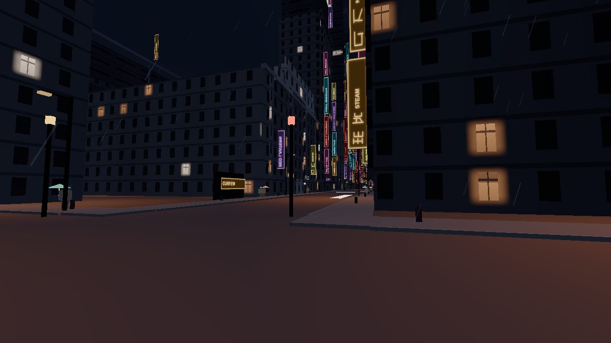

Phone, 390×844, medium, 129 draws. The sticks cover the lower third, which is where the Broadway ladder sits, so the crossing leaves the frame. K's yellow, on the same phone size, still reads above the sticks. 65 draws.

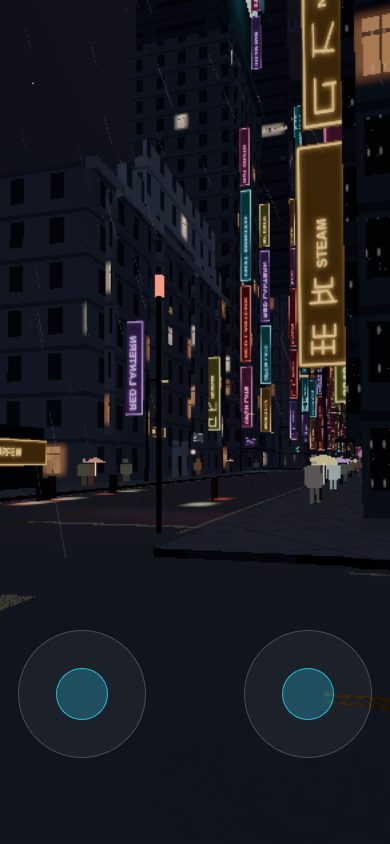

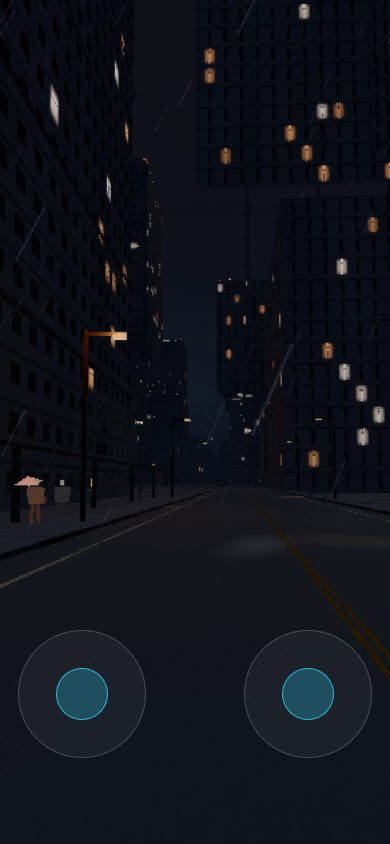

## Wet

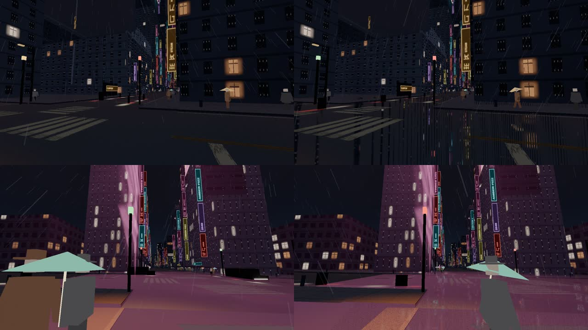

Unforced high and ultra leave `refl` false. Broadway's lane samples (22, 24, 31). Sign colour stays on the signs. Vehicle lights sit on the asphalt as short smears. K, the coast, and Wallace are the same black, with the yellow on top.

`?refl=1` on Broadway: 408 draws, 1.25 M triangles, mirror on. The near road becomes a comb of thin vertical lines, pink and blue and yellow, with black between them. A foreground block still averages (21, 22, 30), against (18, 22, 31) with the mirror off. The copy of the signs is broken, and it is dim. It is also a regular barcode. A wet street in the references carries a few long reflections of the brightest lamps. This carries a line for every sign.

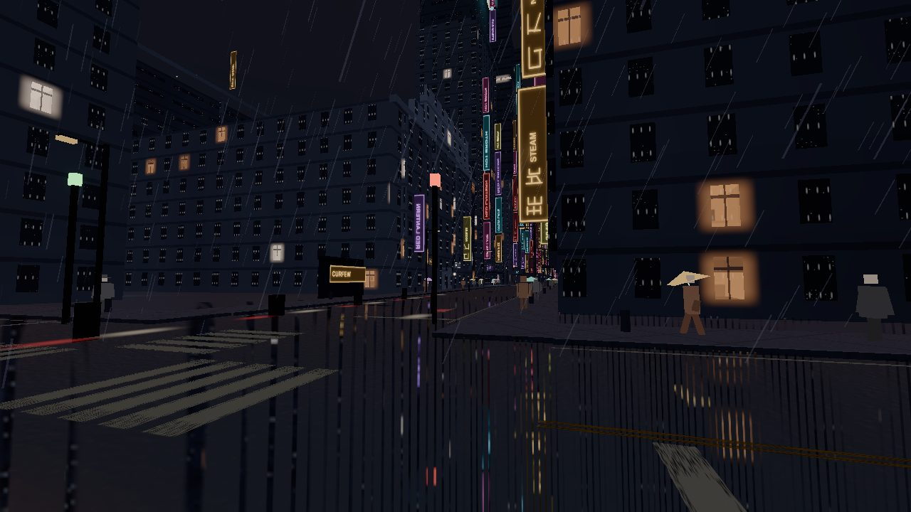

K with the mirror forced is the frame to keep. 246 draws. The yellow stays a yellow pair. The asphalt samples (16, 19, 26). A few small coloured dashes sit in the near left, inside the orange pool. The gaps are road.

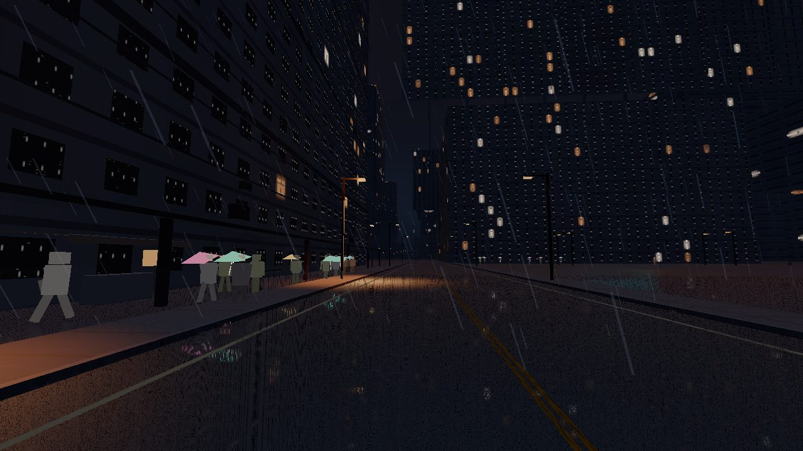

Hollywood, high, mirror off, `hollywoodView('street')`, camera `[-10816, 6.8, -5286]`. 223 draws, 574 k triangles, 17 cars. The foreground lane samples (92, 51, 72). A pale ladder sits in that pink further down the street. The eye height matches the old street camera. The ground under it is the new failure. Forcing the mirror (533 draws, 1.48 M triangles) keeps the sheet and adds the comb. A near block goes to (102, 61, 68).

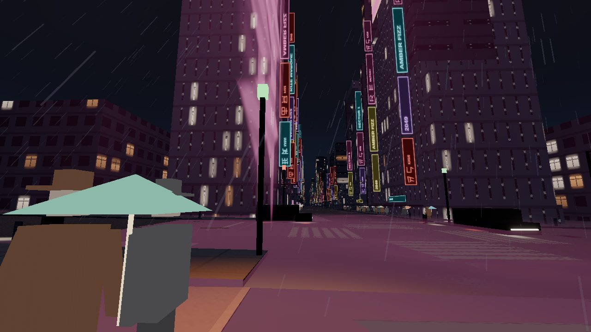

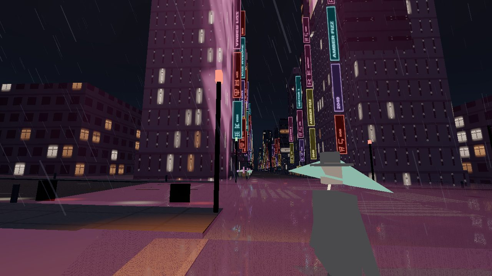

DTLA, same pose both ways, camera `[-913, 1.7, -843]`. Unforced: 218 draws, the street runs through to the pink panel, a purple disc sits under that panel, the near road samples (71, 52, 42). Forced: 462 draws. The near lane grows the comb and samples (24, 21, 25), and a black bar closes across the canyon where the unforced frame shows the people and the sign. The bar arrives with the mirror.

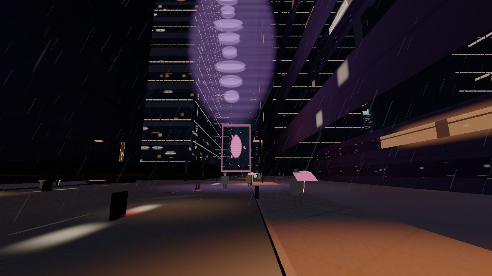

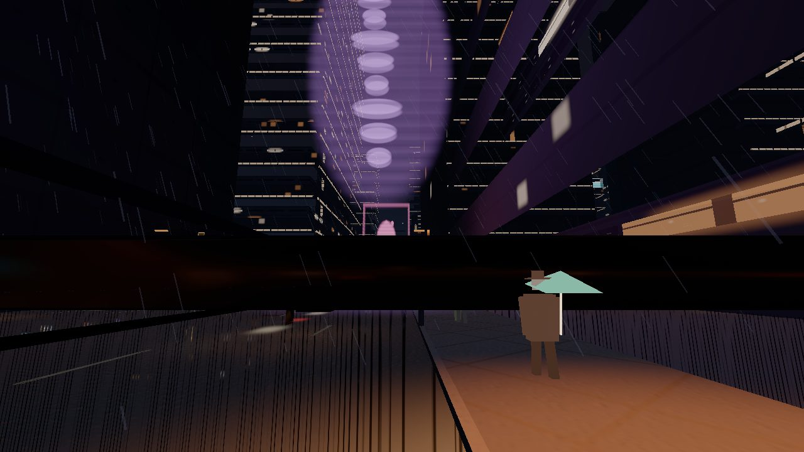

The little-tokyo mirror, 456 draws, lays the same comb on the tan stall floor. It does not find a black carriageway to lie on.

## Hero ground

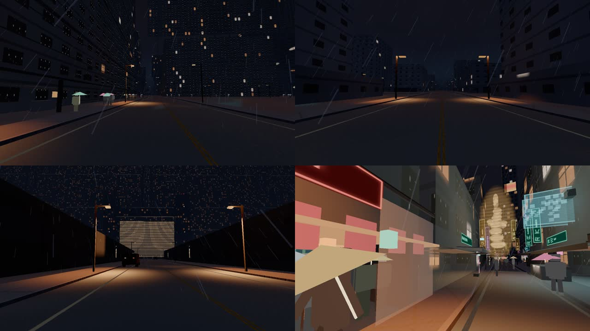

| Place | Ground | High, night rain |
| --- | --- | --- |
| K's street | Double yellow, a curb, one orange pool, the dark gap past it | 139 draws, 328 k, camera `[11080, 1.7, 21474]` |
| K's market side | The same yellow, the stall row beside it | 193 draws, 375 k |
| Sea-wall blocks | Centre line, white edges, a lamp disc at each pole | 155 draws, 319 k, camera `[-18891, 1.7, 10661]` |
| Wallace causeway | Two yellows, white edges, pools along the curb, a car in the lane | 121 draws, 262 k, 8 cars, camera `[4033, 1.8, 2999]` |
| Little Tokyo street camera | Tan floor, about (65, 49, 44), stalls across the lens | 231 draws, 801 k, crowd 340 |
| Hollywood street camera | The pink sheet above | 223 draws, eye at y 6.8 |

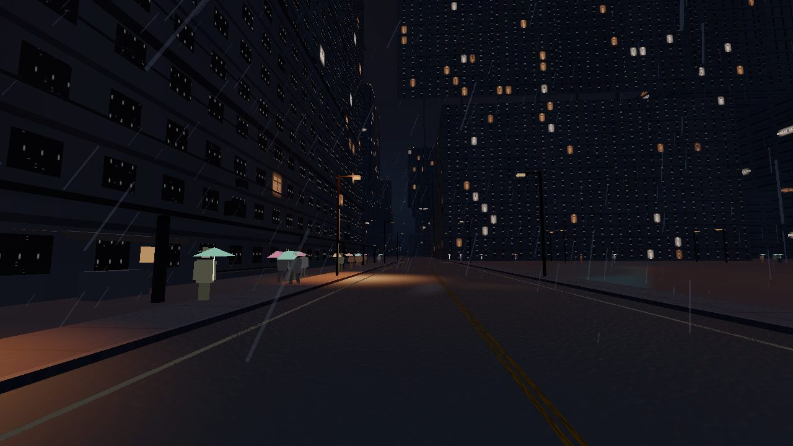

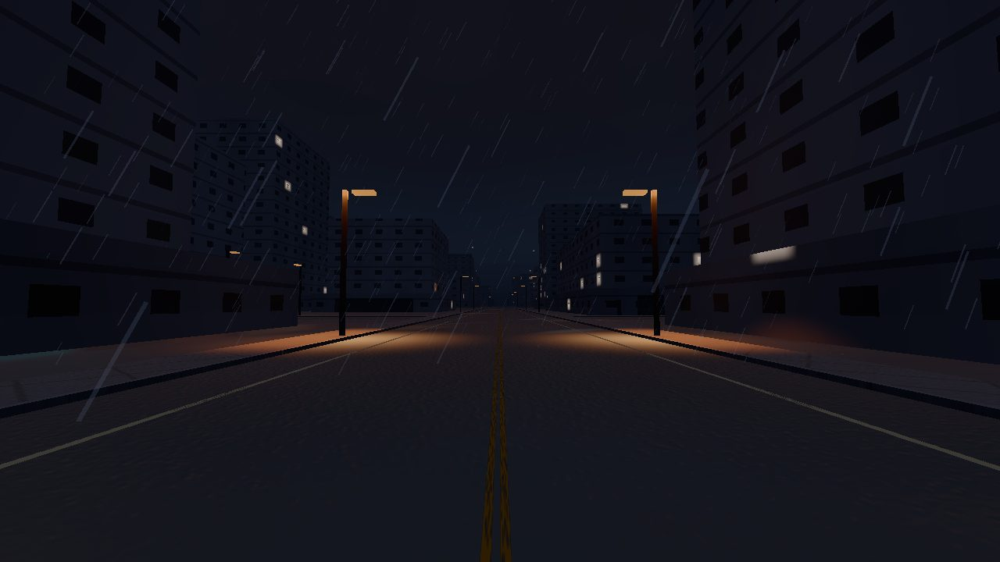

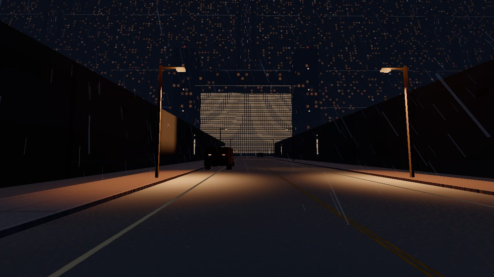

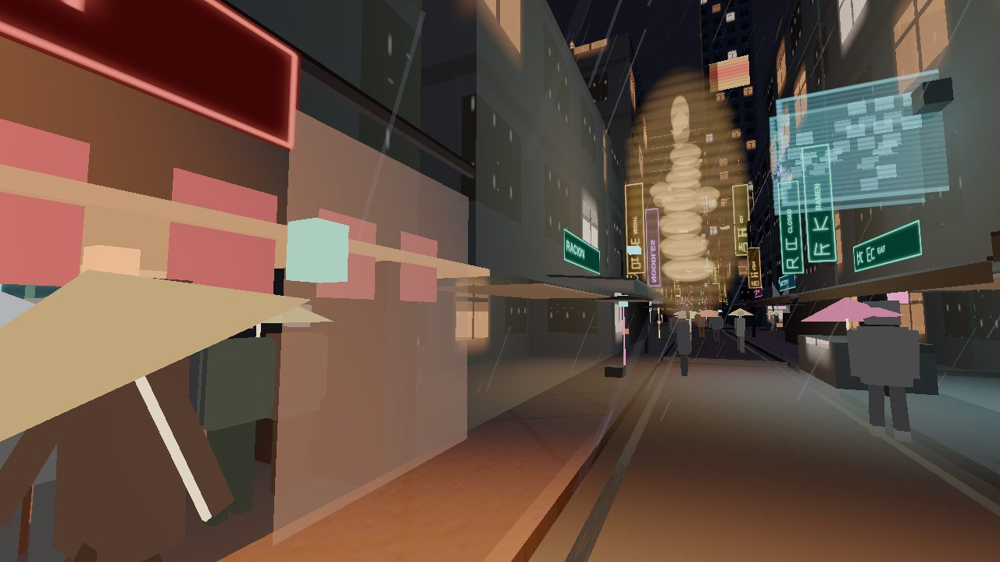

K, the sea wall, and Wallace were the three a viewer would name. They are streets. The market camera stands on a carriage and looks into the stalls, so the frame is still the aisle. Hollywood's paint exists as a faint ladder, and the colour of that ground is scored with the wet row.

## What the references ask the street to do

No frames from these pages are in the repo.

- [Roger Deakins, British Cinematographer](https://britishcinematographer.co.uk/roger-deakins-cbe-bsc-asc-blade-runner-2049/) — the city night was built as mist on the stage, with rain put on top of that mist. The picture is grey, thick, and shot in camera.
- [Sébastien Lagarde, observing rain](https://seblagarde.wordpress.com/2012/12/10/observe-rainy-world/) and [wet surfaces](https://seblagarde.wordpress.com/2013/04/14/water-drop-3b-physically-based-wet-surfaces/) — a porous wet surface goes darker and a little smoother. Open water reflects about 2% straight on, so a dark body disappears, and a bright lamp survives as a stretched glint. Standing water is a broken mirror of those lamps, with the dry-dark pavement still showing between the glints.
- [Paul Lambert, DNEG, on the Los Angeles shots](https://vfxblog.com/2018/01/04/blade-runner-2049-vfx-breakdown-joi-los-angeles/) — the vista was meant to die in the murk, black included. Rain had to be lit by the ads and the spinners that were actually near the camera.

The residential frames are close to that: black lane, one warm pool, rain in the air. The neon frames split. Broadway keeps the black and, with the mirror forced, replaces the few glints with a comb. Hollywood replaces the black with a pink floor.

## Follow-up

One short pass. It is not started here. It stays off the open drafts: K1 (`App.ts`, vehicle traffic), B3 (tower families), G1 (LAPD, City Hall, Wallace meshes), H1 (people), S3 (`tests/visual`, and the weather files those drafts already hold).

### The pink sheet, and the comb

The pink is in the road shader with the mirror off. `src/roads/material.ts`, the puddle `glow` inside `emissiveNode`. Where `sheen` is 0 the colour is still an authored magenta, times `neonWet`, times a grazing fresnel, times 18. Hollywood's `neonWet` is 0.40 and its `sheen` is 0 (`src/atmosphere/looks.ts`). The puddle mask is a broad noise, so one cell of it fills the foreground. Broadway's camera is standing off that cell, which is why the same shader stays near (22, 24, 31) there.

Leave `neonWet` where it is. An empty shade slot stays black. A slot that is actually a sign may tint the puddle it touches. The gaps stay asphalt. Bloom, haze, and the night exposure stay with L2. This pass does not raise them.

`src/atmosphere/WetReflector.ts` is the comb. The mask is a sine across the view, thresholded high, on a 64 m quad. Broadway shows the sine. On `dtlaView('street')` the far end of that quad closes into the black bar. Widen the gaps. Keep `resolutionScale` at 0.18. K's forced frame is the one to match: dark asphalt, the yellow left alone, a few small dashes.

Judge again on `hollywoodView('street')` with the mirror off, and on Broadway and DTLA with `?refl=1`. Hollywood's foreground wants to fall back toward the Broadway asphalt numbers. The DTLA bar wants to be gone, with the people and the pink panel visible as they are in the unforced frame.

### The market aim

`src/districts/little-tokyo-market/view.ts`, the street camera. The feet are already on a carriage. The heading turns toward the noodle stall, so the picture is the aisle. Aim down the lane that already has paint. Leave the crowd mesh alone.

The ladders in `src/roads/crosswalk.ts` are doing the job the chart shows. Leave them. Low dropping the paint is the low material. Leave that too.

## L2, and R5

L2 should still own the wet-road neon bleed. The sheet is on screen with the mirror off, so it is the puddle term and the missing sign-to-ground path, which is the lighting refine L1 already named. The comb's regularity is the roads remainder inside that same pass. Brightening the Broadway mirror would move the canyon away from the dark lane the residential frames just earned.

More roads work is still needed before the street is finished. It does not have to land before R5. R5 is the pyramid face, the sea-wall crest, and three interiors. The Wallace causeway and the sea-wall street, which those cameras stand on, now read as roads.
