# Roads and K's spinner — 12 October 2026

Judged on `main` at `54170d8` (D7 real roads #56, M3 stray parts #59, M4 front wheels #60). Docs only. No game code, no film frames, no logos in git.

**Spinner: yes, approve it.** Every spinner column is at least 7. Stray parts: no. Front wheels sit in the prongs. That is the gate for the LAPD, City Hall, and Wallace model-harness redo.

**Roads: no.** Several corridors now read as streets. K's ground, the sea-wall blocks, the market aisle, the Wallace apron, and the Hollywood street camera do not. Crosswalks break up close. Wet asphalt is either a black sheet or, when the mirror is forced on, a sharp picture of the signs.

The readable copy is [roads-spinner-2026-10-12.html](roads-spinner-2026-10-12.html).

## How this was looked at

Headless Chrome 148, WebGL2 on SwiftShader. There is no real GPU on this machine, so the planar wet mirror stays off unless `?refl=1`. Night rain, time 22.5, frozen weather, UI hidden. Desktop 1280×720. Phone 390×844 at device scale 1, with the touch sticks. Tiers are the query `quality`, not an iPhone draw cap.

The spinner sheet is the shipping glTF on the harness turntable (`spinner-high.glb`, `spinner-medium.glb`, `spinner-low.glb`). Comparison stills were fetched into gitignored `tools/model-harness/.refs/` and sat beside the model for the top, front, side, and rear. Those pixels are not in this commit. The pictures below are the game and the model only.

Harness box, all three tiers: **5.45 × 2.32 × 1.36 m**. Triangles: high 6,894, medium 3,786, low 2,242. Against the scale rig: height is 0.78 of a 1.75 m figure, width is 0.63 of a 3.70 m lane.

## What a stranger sees

Night rain. One residential road is black. A yellow pair runs down the middle. White lines mark the edges and break into dashes. Pairs of white and red lights sit between the lines. Lamp heads glow at the sides. The pavement under them stays dark. A low black shape with a red strip at the tail and a small red-and-blue lamp on the roof sits over the left side of that road. A person with an umbrella stands on the right edge, smaller than the gap between the white lines.

On the neon canyon the near corner is a white hash of bars that cross each other. Stand on it and the white is speckled. Farther along, a double yellow and white dashes show on black pavement. Force the mirror and the same corner reflects the signs as a sharp picture, paint included.

At the foot of the dark slab, between the sea-wall blocks, and in the night-market aisle, the ground is a flat sheet. No yellow line. No raised curb.

The black vehicle, from the front on a turntable, is a long low wedge. The nose is two arms with an open slot between them, where a hood would be. Round drums sit in those arms and again at the tail. The roof is one smooth line with a low lamp. Nothing stands up as a fin, a spike, or a slab off the tail. The flank reads POLICE. A 1.75 m figure is taller than the roof. The body is narrower than a 3.70 m lane.

A stranger would call the residential road a street. They would not call the slab's ground or the sea-wall gap a street. They would call the vehicle K's spinner from the front and from above. From behind, in the street, they would call it a low black police craft. The open nose is the part that takes the front view.

## Roads

| Check | Score | What the frames show |
| --- | ---: | --- |
| Lane width vs cars and people | 6 | On Lakewood a dark car sits in one lane, and from above the headlight pairs sit between the white lines. People on the South LA sidewalk are a fraction of that lane. On DTLA and the downtown avenue, people stand on the paint. Many cars are only a white blob and a red blob. |
| Markings | 5 | Double yellow and white dashes read at a distance on Lakewood, the avenue, Arts District, South LA, and the freeway. Broadway and South LA crosswalks are lattices of speckled bars. Low drops the paint. |
| Wet reflection | 4 | High and ultra on this software GPU stay black, with vehicle lights as soft blobs. Forcing the mirror (`refl=1`) reflects the canyon signs as a sharp picture. Draws go from 211 to 412. |
| Curb, sidewalk, buildings | 5 | Broadway and South LA have a walk beside the wall. DTLA's edge is a flat color change. K, the market aisle, and the coast blocks have no curb. |
| Sodium pool on the asphalt | 3 | Lamp heads are visible on Broadway, Lakewood, the harbor, and the freeway. A Broadway sample under the lamps is about (22, 15, 10) a few metres from the head. The pool does not cross the lane. |
| Missing roads on major corridors | 4 | K, the sea-wall blocks, the Wallace apron, the market aisle, and the Hollywood street camera have no lane paint. Downtown, Broadway, Lakewood, South LA, Arts, East LA, the harbor, and the freeway do. |

Overall roads: **5**. Recognisable where the street graph is paved and the camera is in the lane. Not finished.

### Where a street reads

Lakewood, high, night rain. Camera about `[9403, 1.7, 22255]`. 163 draws, 454 k triangles, 6 ground cars. A box-shaped car sits between white lines, double yellow to its right, lamps down the road. From 43 m up the same street is a black ribbon: yellow centre, white edges, dashes, and rows of headlight and taillight pairs in the lanes.

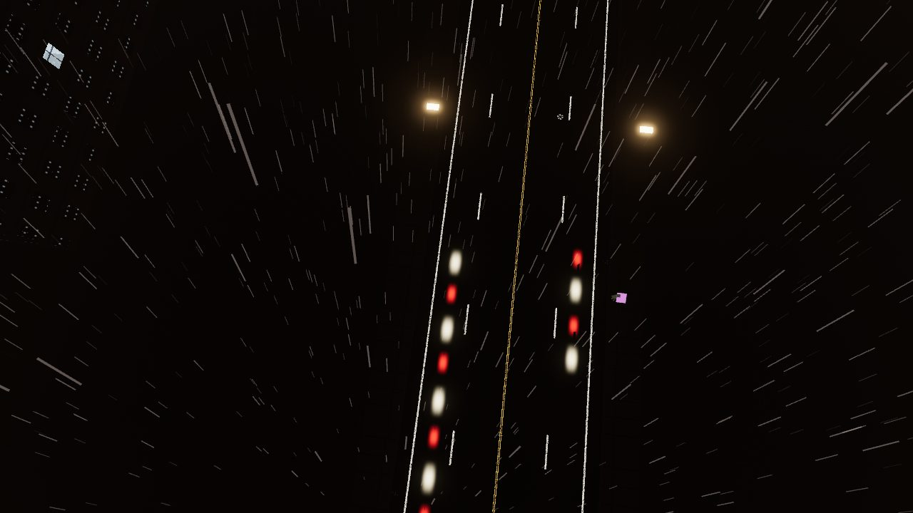

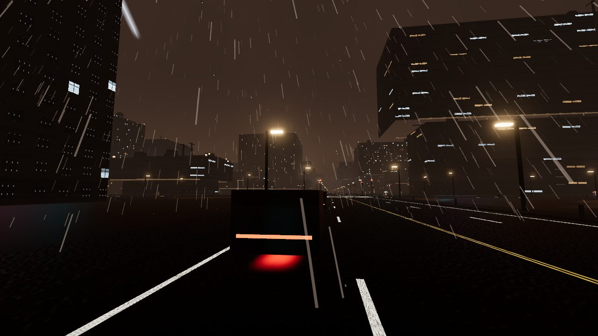

The downtown avenue (ultra, `trafficView('intersection')`, camera `[-665, 1.7, 1189]`) is the same paint at eye height: double yellow, a white edge, a crosswalk, a red light and a white light sitting in the lane. 369 draws, 1.24 M triangles, 59 ground cars. People fill the crossing. The car body is the lights. Phone 390×844, medium, 201 draws: the same crossing, sticks over the near paint.

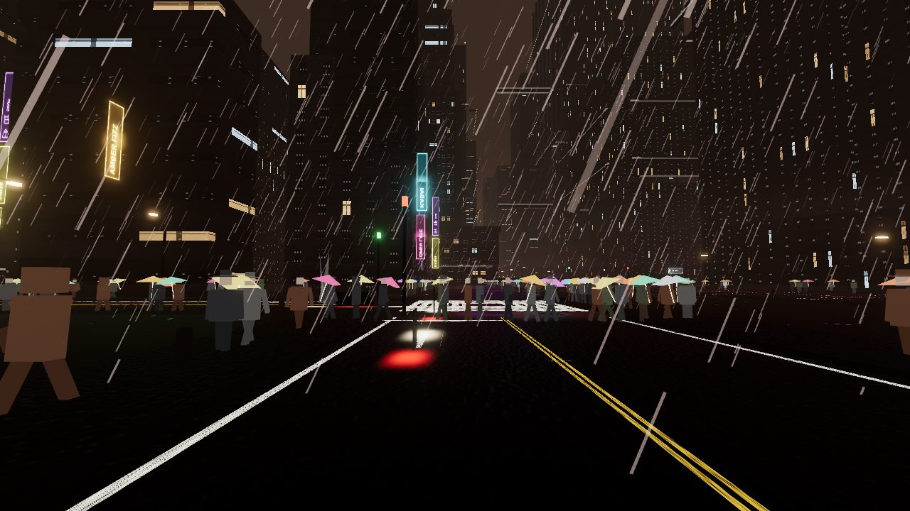

South LA spine, high: arrows, a crosswalk, double yellow, people on the left sidewalk, a dark vehicle in the intersection. 136 draws, 434 k triangles. Arts District, high: double yellow and dashes on black asphalt, 169 draws. East LA: a large dark vehicle beside people, a yellow line farther down, 135 draws. Harbor: white lane lines and lamp heads, 88 draws. Freeway: a yellow dash and a white marking from above, lamps along the deck, rain streaks over most of the frame, 121 draws. Camera y about 28 m.

### Where the paint fails up close

Broadway, high, `broadwayView('street')`, camera `[-373, 1.7, 121]`, historic core. 211 draws, 639 k triangles, 37 cars, crowd 245. The near corner is two directions of white bars crossing into a hash. Zoomed, each bar is speckled, not a solid stripe. The double yellow farther down is two clean lines with a dark gap. A sidewalk and lamp heads sit on the left. People stand on the right. The asphalt band in the mid-road is mostly under (30, 25, 20).

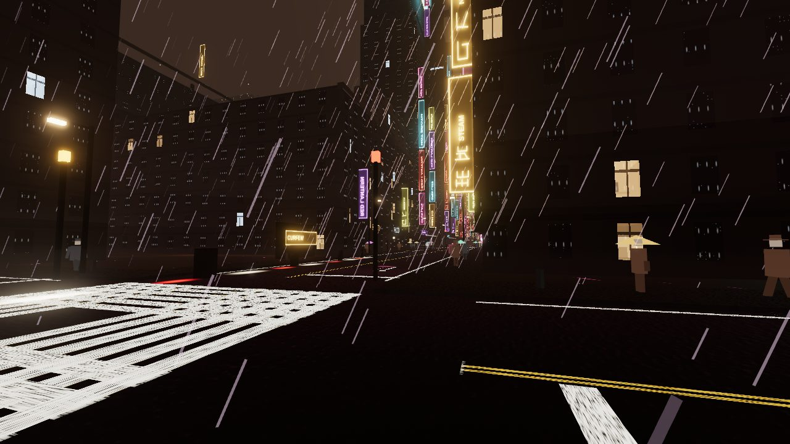

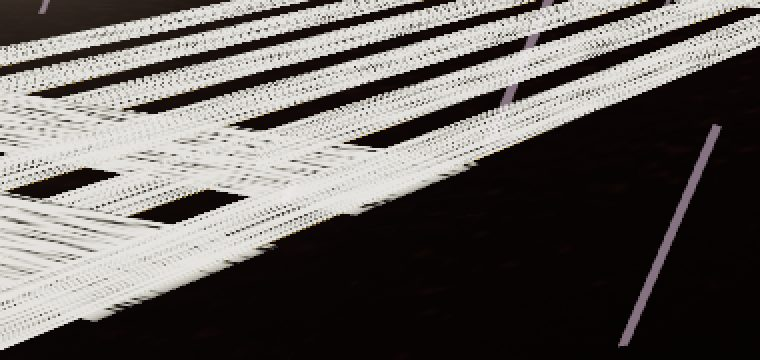

The same corner at medium (146 draws, 539 k triangles, 20 cars, crowd 115) is the same hash. Ultra is the same street with a heavier crowd (207 draws, 774 k triangles, 59 cars, crowd 490). Low (426 draws, 500 k triangles, 0 cars, crowd 40) drops the paint. The foreground samples as (0, 0, 0). The canyon signs remain. Phone medium, 390×844, 127 draws: the hash is a corner patch and the sticks cover the yellow.

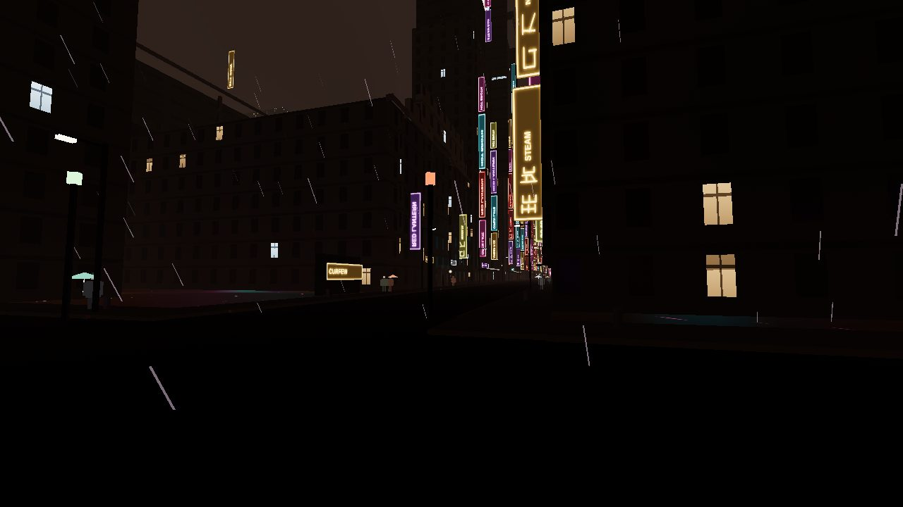

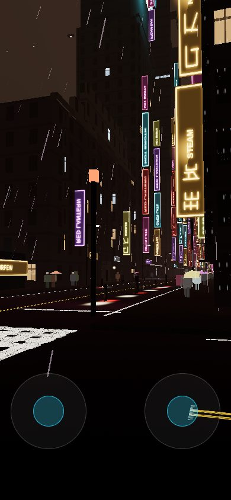

South LA's crosswalk is the same noisy white field, with arrows that do read as arrows.

### Wet night

Unforced high and ultra on SwiftShader leave `refl` false. The road is black. Vehicle lights sit on it as blobs. Sign colour stays on the signs.

`?refl=1` on the same Broadway camera turns the mirror on. Draws 412, triangles 1.27 M. The near asphalt becomes a sharp reflection of the signs, including the white hash. That is wetter than the black sheet, and it is a mirror of the wall rather than a broken, dark, streaky street.

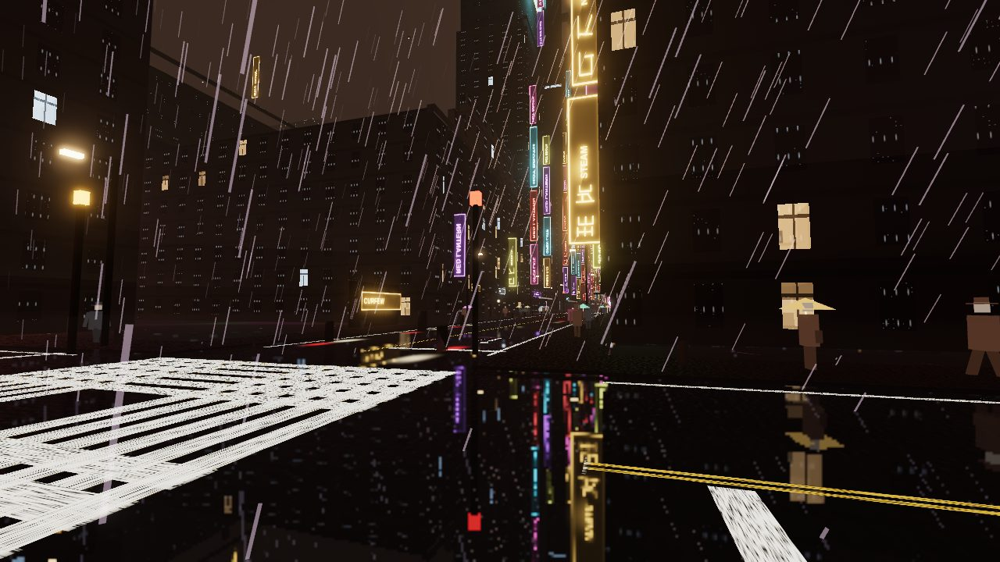

DTLA street, high, camera `[-913, 1.7, -843]`, 180 draws, 546 k triangles, 80 cars. Dashes and a yellow line read. A headlight and a taillight sit on the asphalt. A purple wash lies under the big sign and on the right-hand plane. The road band itself averages about (37, 23, 27), so the purple is a local spill, not a repaint of the whole street. People stand on the lane lines. The right edge meets the building as a flat purple plane. Phone medium, 127 draws, is the same street with the sticks over the near ground.

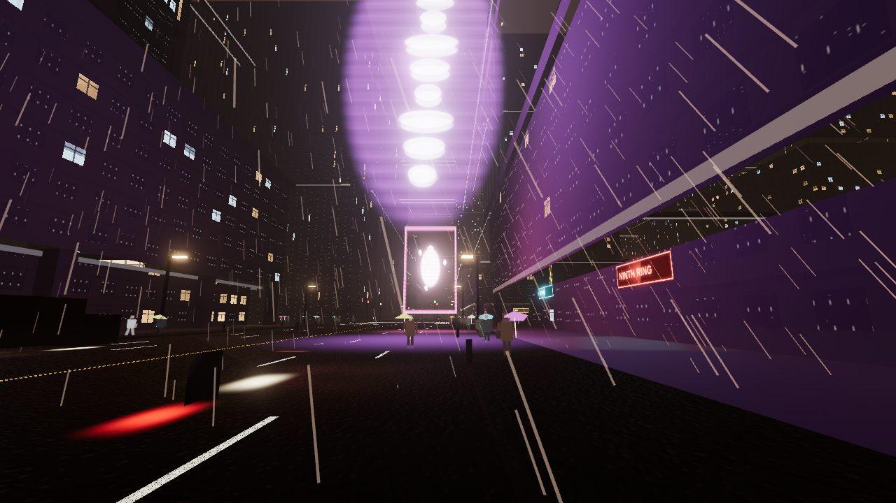

### Corridors with no carriageway

These cameras show no lane paint.

| Place | What is on the ground | High, night rain |
| --- | --- | --- |
| K's street and market | Dark sheet, a coloured smear at the edge, people, no lines, 0 cars | 192 draws / 387 k at the street; 114 draws / 323 k at the market |
| Sea-wall blocks | Dark sheet, purple and cyan at the far edge, 0 cars | 113 draws, 241 k |
| Wallace apron | Black plane, two pale guide lines, the lit gate | 75 draws, 242 k, 8 cars not in this frame |
| Little Tokyo market aisle | Pale floor, stalls, no lines | 236 draws, 765 k, 10 cars elsewhere in the district |
| Hollywood street camera | Brown plane, one vehicle, no lines. Eye at y 6.8 | 140 draws, 460 k, 17 cars |

K's megablock, the coastal strip, and Wallace Vernon are listed in `NO_STREET_GRAPH` in `src/vehicles/trafficRegistry.ts`, so the road builder skips them. The pictures match that list. The market aisle and the Hollywood street camera are on districts that do have a graph, and these particular views still show an unpainted sheet.

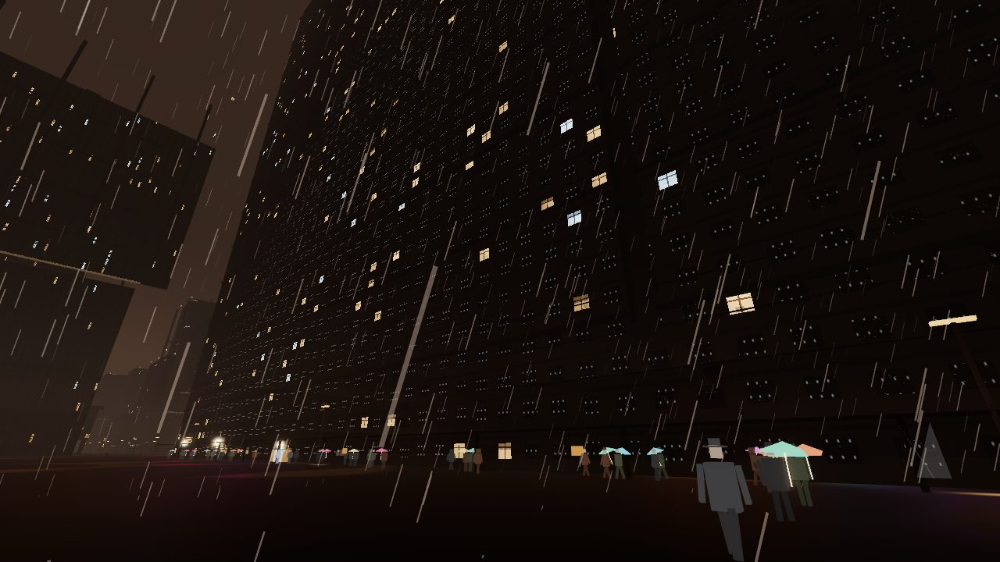

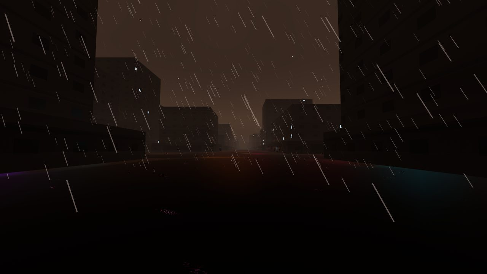

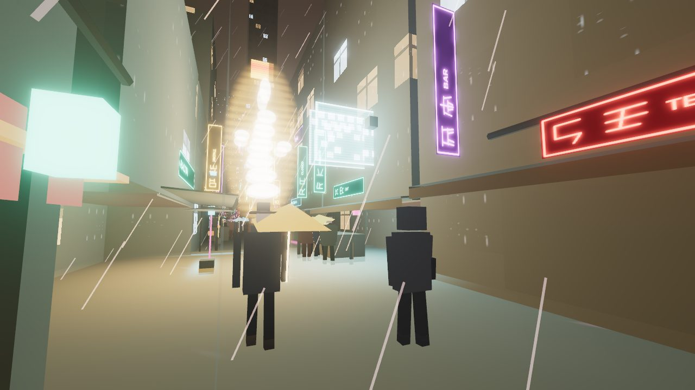

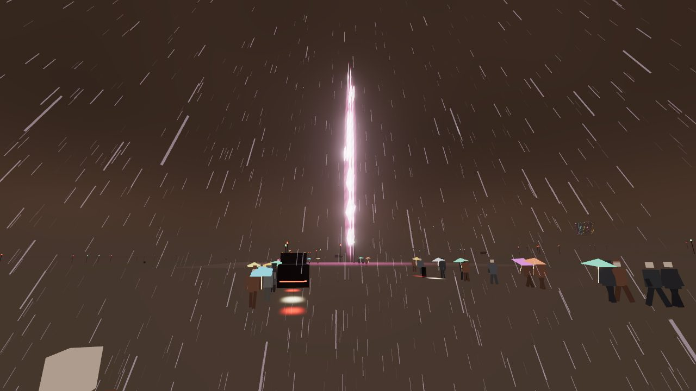

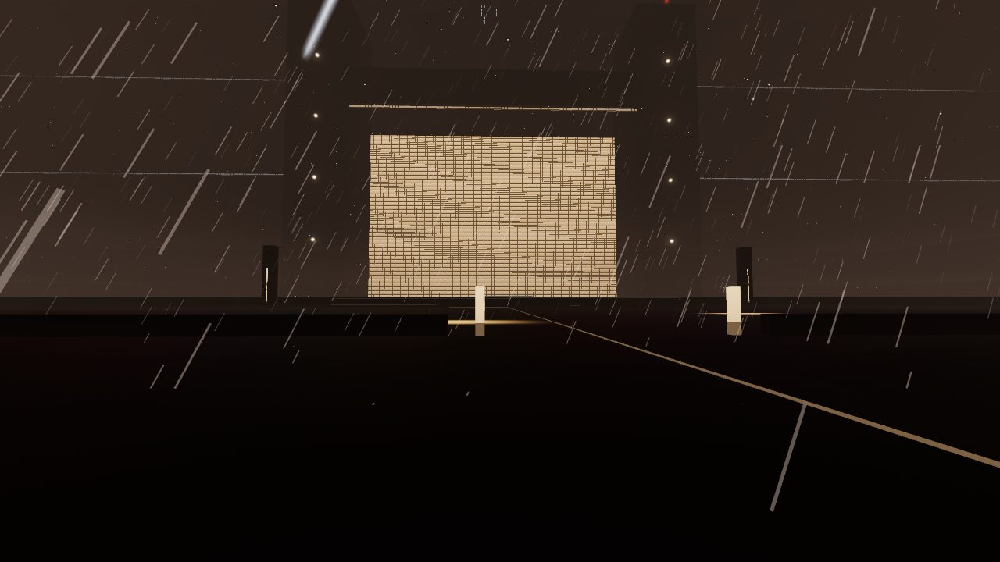

### Tier numbers

No phone draw cap is applied here. These are the frames above.

| View | Tier | Viewport | Draws | Triangles | Ground cars | Mirror |
| --- | --- | --- | ---: | ---: | ---: | --- |
| Broadway street | high | 1280×720 | 211 | 639 k | 37 | off |
| Broadway street | ultra | 1280×720 | 207 | 774 k | 59 | off |
| Broadway street | medium | 1280×720 | 146 | 539 k | 20 | off |
| Broadway street | low | 1280×720 | 426 | 500 k | 0 | off |
| Broadway street | medium | 390×844 | 127 | 472 k | 20 | off |
| Broadway, mirror forced | high | 1280×720 | 412 | 1.27 M | 37 | on |
| Downtown avenue | ultra | 1280×720 | 369 | 1.24 M | 59 | off |
| Lakewood street | high | 1280×720 | 163 | 454 k | 6 | off |
| K's street | high | 1280×720 | 192 | 387 k | 0 | off |

High and ultra turn on the fancy road shader (second trim sample, normal, rain ripples) and the puddles. Medium keeps markings and drops puddles. Low drops markings and replaces cars with streaks, which is why low can cost more draws than high. Ultra and high share the spinner mesh.

## Spinner

Scored from the shipping turntable, the scale rig, and the craft in the city. The gitignored top orthographic sat beside the top view. The gitignored opening overhead sat beside the nose-channel view. That overhead is a small car over a field and does not resolve a plan. The museum front and the side and rear stills sat on the same sheet and are not committed.

| Check | Score | What the frames show |
| --- | ---: | --- |
| Silhouette | 8 | Long low wedge, flat roof, squared tail, drums at both ends. Rim light shows the same outline with nothing standing off the roof. |
| Open front gap | 8 | Front, top, and the nose close-up are two arms and an open slot. The roof behind the slot is filled. |
| Front wheels in the prongs | 8 | Each front drum sits in its arm. The arm continues ahead of the drum. The channel between the arms stays open. |
| Stray fin, spike, or rear slab | no | Roof lamp is a low red-and-blue bar. Tail is a flat louvered face with a red strip. |
| Drums, not balls | 8 | High and medium faces are flat discs with a dark tire lip. Low is a faceted short cylinder, still a drum. |
| Reads as K's spinner | 8 | Split nose, housed drums, POLICE, louvers, and the low bar. In the street, from behind, it reads as that craft's tail. The nose slot wants the front. |

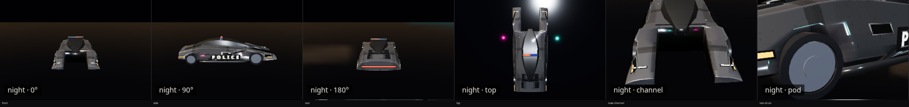

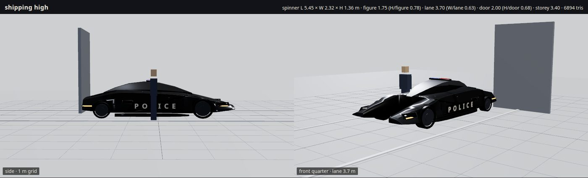

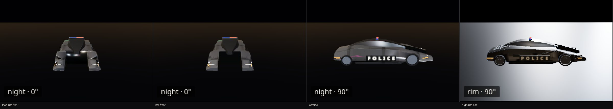

In Lakewood at night the chase camera puts the craft over the left side of the paved road. Red tail strip, low red-and-blue bar, no fin. White lane lines and a double yellow run ahead of it. A person with an umbrella is on the right edge. High, 184 draws, 461 k triangles.

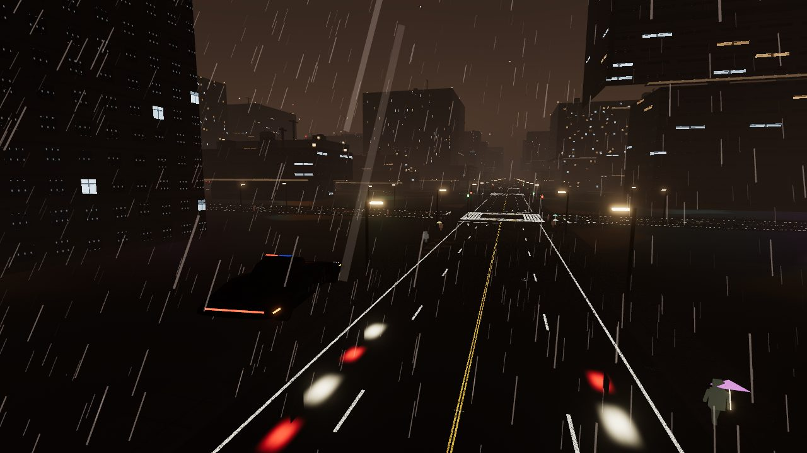

In the Broadway canyon the same craft is close and dark: POLICE on the flank, the low bar, an amber line along the skirt. High, 236 draws. On a 390×844 medium chase the silhouette and the bar still read above the touch controls, 143 draws.

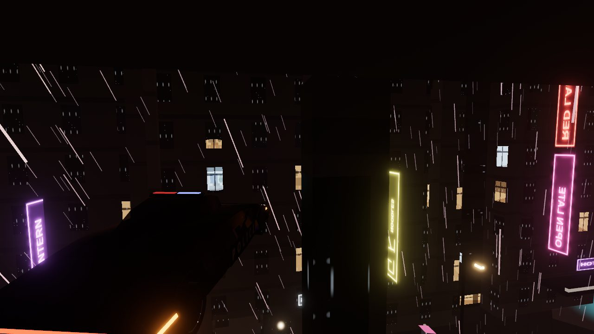

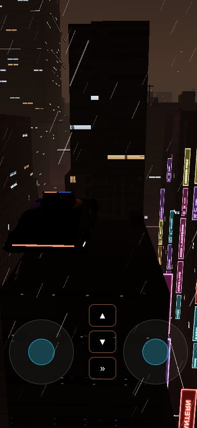

Approve the spinner. Do not start a spinner redo before LAPD, City Hall, and Wallace.

## Refinement passes

Roads are under 7, so three passes. None of these are implemented.

### R1 — Crosswalks and the white paint

The two crosswalk directions are stamped across each other, and the white cell is grime-speckled, so a corner reads as a hash.

- `src/roads/buildChunk.ts` — `maybeIntersection`, the bar loops. Keep one ladder on each mouth of the crossing, short of the box where the other direction's bars live.
- `src/roads/paint.ts` — `markBytes`, cells `dash`, `stop`, and `bar`. A solid stripe can stay worn at the edges and still be a stripe in the middle.

Look again at `broadwayView('street')` and `southLaView('spine')`, high, night rain, from 2 m and from 20 m.

### R2 — Wet asphalt and the lamp pool

The unforced road is black. The forced mirror is a sharp copy of the signs. Lamp heads do not light the lane.

- `src/atmosphere/WetReflector.ts` — break the mirror into dark streaks. Keep the asphalt black between them.
- `src/roads/material.ts` — the wet sheen on the asphalt is a small fresnel. A lamp needs a pool on the carriageway, warm, falling off in a few metres.
- `src/roads/profile.ts` and `src/roads/buildChunk.ts` — `ROAD_LAMPS` is commented as the districts that opted out, and `lampOk` treats it as the allow-list. Broadway is in the set and has the new heads. Lakewood is not in the set and still has older heads. Neither head pools on the asphalt. Make the comment and the test the same thing, then light the lanes that have poles.

Judge on the Broadway mirror frame and on Lakewood from above. High on a real GPU is the mirror case. This machine only reached that with `?refl=1`.

### R3 — Hero ground that is still a sheet

K, the coastal strip, and Wallace Vernon are in `NO_STREET_GRAPH` (`src/vehicles/trafficRegistry.ts`). Their hero cameras show an unpainted sheet. The Little Tokyo market aisle and `hollywoodView('street')` do the same even though those districts have a graph.

Pave the ground those cameras stand on, or move the cameras onto a carriageway that already has paint. K's street and the sea-wall blocks are the two that a viewer would name. Files: `src/vehicles/trafficRegistry.ts`, the K ground in `src/districts/k-megablock/`, the coast blocks camera, `src/districts/little-tokyo-market/`, `src/districts/hollywood/view.ts`.

## Sources

Lane width and paint, used as the real-street half of the score. The game's street lane is 3.6 m (about 11.8 ft), inside the city's 11 ft standard and 12 ft maximum. A normal line in the California manual is 4 to 6 inches wide. A broken line is on the order of a 10 ft mark and a 30 ft gap. The game's dash is 0.15 m wide, 3 m long, with a 12 m step.

- [Los Angeles Bureau of Engineering, E 612 lane widths](https://completestreetdesignmanual.engineering.lacity.gov/e-600-cross-section-elements/e-610-streets/e-612-width-standards-and-component-arrangements) — standard travel lane 11 ft, maximum 12 ft.
- [LADOT striping manual (2023)](https://ladot.lacity.gov/sites/default/files/2023-01/mpp_531_01_2023.pdf) — lane width is centre of stripe to centre of stripe, or stripe to curb.
- [California MUTCD, Chapter 3A (2026)](https://dot.ca.gov/-/media/dot-media/programs/safety-programs/documents/ca-mutcd/2026/2026-camutcd-2026-3a-a11y.pdf) — normal line 4–6 inches; broken line about 10 ft marks and 30 ft gaps.

Wet night streets and the spinner's shape, used as the film half. No frames from these pages are in the repo.

- [Roger Deakins, American Cinematographer](https://theasc.com/article/deakins-blade-runner-2049/) and [British Cinematographer](https://britishcinematographer.co.uk/roger-deakins-cbe-bsc-asc-blade-runner-2049/) — rain, mist, and practical light shot in camera. The city night is grey, wet, and thick.
- [Dennis Gassner, ASC](https://theasc.com/article/blade-runner-2049-designing-the-future/) and [Deadline](https://deadline.com/2018/02/blade-runner-2049-dennis-gassner-oscars-production-design-interview-1202280798/) — the spinner's angular body was the pattern for the rest of the picture. He describes the film's light as LED rather than neon tubing.
- [Vanity Fair, Gassner on the spinner](https://www.vanityfair.com/hollywood/2017/10/blade-runner-2049-production-design) — the new craft is more robust, angular, and brutal than the 2019 spinner.
- [Syd Mead, AutoDesignO](https://autodesigno.com/blade-runner/) — the front projections of the new craft read as the same idea as the original's forward arms.
- [Fireball Tim, the cars of 2049](https://fireballtim.com/2017/10/20/cars-blade-runner-2049/) — the police craft is an older, worn machine: scratches, dirt, no clean panel.
- [Make: painting the police spinners](https://makezine.com/article/maker-news/behind-the-scenes-on-blade-runner-2049-painting-police-spinners-in-budapest/) — the body paint started as dull graphite and needed variation. Swing-up doors, thin lamps.
- [Spinner, Wikipedia](https://en.wikipedia.org/wiki/Spinner_(Blade_Runner)) — the 2049 police craft is driven on the ground and flown. The manufacturer mark on the prop is not copied here.
